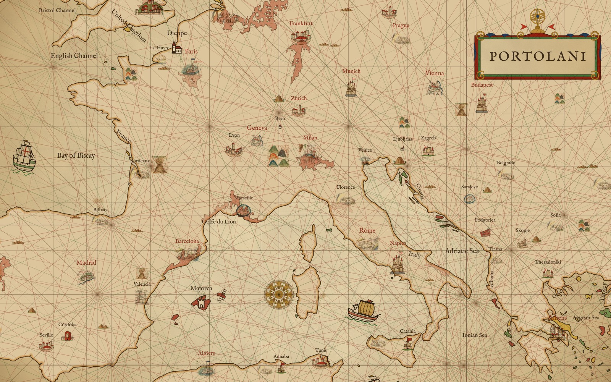

# portolani

[](https://mark-brannan.github.io/portolani/)

A base map with modern geometry, but drawn the way a 15th-century portolan chart would have drawn it: ink on parchment, rhumb lines radiating from wind roses, names lettered along the coast, ships and sea monsters where the ocean is empty.

**[Open the demo →](https://mark-brannan.github.io/portolani/)**

Drag to pan, wheel or pinch to zoom, anywhere in the world. The ornaments follow public-domain charts (the *Carta Marina*, the Catalan Atlas, Aguiar, de Wit), drawn as vectors or cropped from the scans. Click a figure for its story. It is a work in progress and changes often.

## Why

Simply, because it is beautiful, interesting, and fun. To experience the joy of looking at maps. It carries the voyages, people and places of several traditions, not one, with their sources shown, and it keeps the hand-drawn quality of the originals rather than flattening them into a tileset.

## Reading a portolan chart

- Rhumb lines run from each wind rose: black for the eight winds, green for the half-winds, red for the quarter-winds.
- To read a course, follow the line parallel to the track back to a rose.
- Ports are lettered inland, at right angles to the coast; important ones in red, lesser ones in black.
- More: [Trinity College Library](https://trinitycollegelibrarycambridge.wordpress.com/2015/08/14/portolan-chart-of-the-mediterranean/) and [Cartography Unchained](https://www.cartographyunchained.com/chug1/).

## Run it yourself

```shell
npm ci
npm run build:preview  # assembles _site/
npm run render     # draws the same scene in Node to out/
```

Node 20 or newer. Sources, licences and checksums are in [ASSETS.md](ASSETS.md).

## Licence

MIT for the code, `MIT AND LGPL-3.0-or-later` for the package as a whole ([LICENSE](LICENSE)). Natural Earth is public domain. GSHHG shorelines are by Wessel and Smith, LGPL-3.0-or-later; they ship unchanged, with their copyright and permission notice at `geo/gshhg-licence.txt`. The scans are public domain, credited to their holding institutions in [ASSETS.md](ASSETS.md). IM Fell English is under the SIL OFL 1.1, shipped with its licence text.
