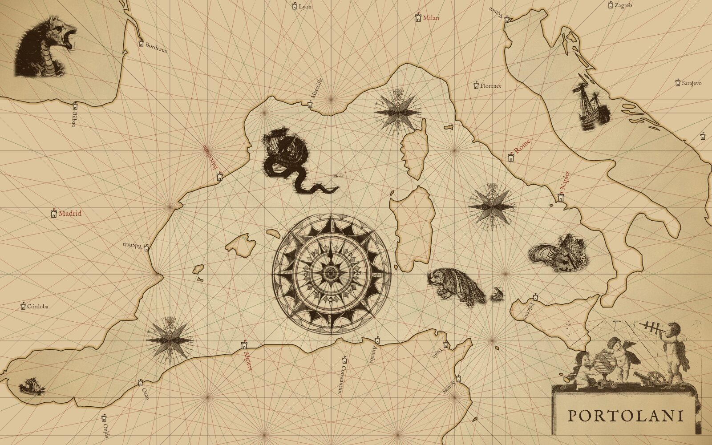

# portolani

[](https://mark-brannan.github.io/portolani/)

A base map drawn the way a 15th-century portolan chart would have drawn it: ink on parchment, rhumb lines radiating from wind roses, names lettered along the coast, ships and sea monsters where the ocean is empty. The geometry under the ornament is today's. A fun alternative for a chart plotter.

**[See the current proof of concept →](https://mark-brannan.github.io/portolani/)**

It opens on the western Mediterranean, drawn in your browser from Natural Earth data and sprites cropped from public-domain scans (Olaus Magnus's *Carta Marina*, the Catalan Atlas, Aguiar, de Wit). Drag to pan and wheel or pinch to zoom, anywhere in the world; the view is kept in the URL, so a place can be linked. Ink colour, parchment tone and ornament density are adjustable. Ornaments are placed again each time the map stops, and the known defects are still visible: a few sprites over land, some flipped names, halos around sprites. The live page is the work in progress and will change as the project moves toward a working map.

## Where this is going

The plan, and the reasons for it, are in [#26](https://github.com/mark-brannan/portolani/issues/26). In short: one renderer, run in the browser or in Node, drawing the same map either way, with ornament packs the user can choose and tune. The earlier coastline-compression tool this repository used to hold was withdrawn; the story is in [#25](https://github.com/mark-brannan/portolani/issues/25).

## Run it yourself

```shell
npm ci
npm run build:preview   # assembles _site/ (downloads pinned sources, checks their sha256)
npm run render          # draws the same scene in Node to out/
npm run packs           # rebuilds the ornament packs from the scans (maintainers)
```

Node 20 or newer. Sources, licences and checksums are in [ASSETS.md](ASSETS.md).

## Licence

MIT for the code. Natural Earth is public domain. The scans are public domain, credited to their holding institutions in [ASSETS.md](ASSETS.md). IM Fell English is under the SIL OFL 1.1, shipped with its licence text.
