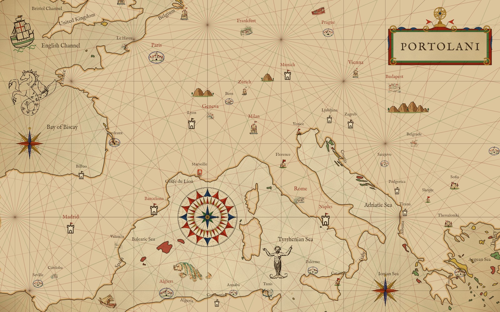

# portolani

[](https://mark-brannan.github.io/portolani/)

A base map drawn the way a 15th-century portolan chart would have drawn it: ink on parchment, rhumb lines radiating from wind roses, names lettered along the coast, ships and sea monsters where the ocean is empty. The geometry under the ornament is today's. A fun alternative for a chart plotter.

**[See the current proof of concept →](https://mark-brannan.github.io/portolani/)**

It opens on the western Mediterranean, drawn in your browser from Natural Earth data. The ornaments follow public-domain charts (Olaus Magnus's *Carta Marina*, the Catalan Atlas, Aguiar, de Wit), drawn as vectors or cropped from the scans. Drag to pan and wheel or pinch to zoom, anywhere in the world; the view is kept in the URL, so a place can be linked. Ink colour, parchment tone and ornament density are adjustable, and so is which roses, monsters, ships and towns are drawn, one by one or by family, scans and vectors mixed. Ornaments are placed again each time the map stops. Known defects: a few sprites over land, some flipped names, halos around sprites. It is a work in progress and changes often.

## Reading a portolan chart

- Rhumb lines run from each wind rose: black for the eight winds, green for the half-winds, red for the quarter-winds.
- To read a course, find the rhumb line parallel to the track and follow it back to a rose for the wind's name.
- Ports are lettered inland, at right angles to the coast; important ones in red, lesser ones in black.
- More: [Trinity College Library](https://trinitycollegelibrarycambridge.wordpress.com/2015/08/14/portolan-chart-of-the-mediterranean/) and [Cartography Unchained](https://www.cartographyunchained.com/chug1/).

## Run it yourself

```shell
npm ci
npm run build:preview   # assembles _site/ (downloads pinned sources, checks their sha256)
npm run render          # draws the same scene in Node to out/
npm run packs           # rebuilds the ornament packs from the scans (maintainers)
```

Node 20 or newer. Sources, licences and checksums are in [ASSETS.md](ASSETS.md).

## Where this is going

The plan, and the reasons for it, are in [#26](https://github.com/mark-brannan/portolani/issues/26). In short: one renderer, run in the browser or in Node, drawing the same map either way, with ornament packs the user can choose and tune. The earlier coastline-compression tool this repository used to hold was withdrawn; the story is in [#25](https://github.com/mark-brannan/portolani/issues/25).

## Licence

MIT for the code and the package ([LICENSE](LICENSE)); the built site adds the data terms below. Natural Earth is public domain. GSHHG (the "h" shoreline past z10 and the "f" shoreline past z12) is by Wessel and Smith, LGPL-3.0-or-later; "h" ships unchanged through `coastlines`, its islands that 50m lacks ship as an index of points (`geo/isles.json`) so every zoom can mark them, and the site carries its copyright and permission notice beside the cells (`geo/gshhg-licence.txt`). The scans are public domain, credited to their holding institutions in [ASSETS.md](ASSETS.md). IM Fell English is under the SIL OFL 1.1, shipped with its licence text.
