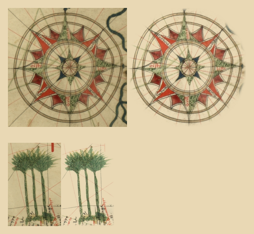

# The Aguiar 1492 chart's rose and palms as patches (#111)

`rose-aguiar-b` and `palms-aguiar` of the `scanned` pack, re-keyed from ink levels to patches. The scan is
[Jorge_Aguiar_1492_MR.jpg](https://upload.wikimedia.org/wikipedia/commons/2/21/Jorge_Aguiar_1492_MR.jpg)
(Jorge de Aguiar, 1492, Beinecke Library, Yale; public domain), the whole coloured chart. Its paper, `#d3cfbb`
(`AGUIAR_CHART_PAPER`, the mean of the 80th to 90th percentile of the rose's pixels by brightness), is one constant,
shared by the town sprites of this scan when they are re-cut. This README takes a row per sprite; the towns' rows come
with their own PR.

`steps.png`: the raw crop on the left, the sprite on the right, both multiplied onto parchment at twice the width the
map draws them. `<id>.raw.png`, `.key.png` and `.cut.png` are the images behind it.

| Sprite | Crop (scan px) | Edge | Dropped fields |
|---|---|---|---|
| `rose-aguiar-b` | (4158,2444)-(4502,2788), 20 px wider each side than before: the old crop met the outer ring | circle, radius 160 about the crop centre, feathered 2 px (`circleFeather`) | `dark`, `level`, eight `clean` boxes |
| `palms-aguiar` | (2520,2945)-(2740,3290): the old crop stopped 40 px short of the roots | polygon at the top right only, feathered 2 px | `level`, two `erase` boxes |

`figure` holds the old box on both, so each keeps its `sizePx` and anchor with the extra surroundings round it.

## `rose-aguiar-b`

Visual pass: the star, the three rings, the vellum between the rhumbs, the red, green and blue washes and the wind
names (`ocsti`, `leste` and the rest) all survive, as drawn. Absent from the sprite, and why:

- the river and coast beyond the ring, and the rhumb lines running off: surround, outside the circle.
- a fleck of the river at the east rhumb tip: the tip meets the river, so the circle (radius 160, past the 157 px tip)
  takes a little of it; trimming it would cut the tip.

## `palms-aguiar`

The old `erase` boxes were one on a neighbouring figure and one on lettering. Lettering now stays as drawn.
Visual pass: the three palms, the ground at their roots, the rhumb lines and the coast lettering at the foot all
survive. Absent from the sprite, and why:

- the red bars of the figure above right: a neighbouring figure, not the palms, cut by the polygon, whose edge sits
  just outside the fronds.
- the coast and its lettering below y 3290: outside the crop; the ground under the trees is whole.
