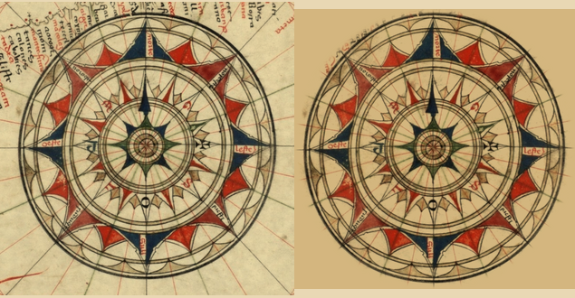

# The Aguiar 1492 rose as a patch (#111)

`rose-aguiar` of the `scanned` pack, re-keyed from ink levels to a patch. The scan is
[Jorge_Aguiar_Wind_rose.jpg](https://upload.wikimedia.org/wikipedia/commons/8/8f/Jorge_Aguiar_Wind_rose.jpg)
(Jorge de Aguiar, 1492, Beinecke Library, Yale; 711 x 720, public domain); crop (25,50)-(695,720), widened from
(55,80)-(665,690) because the old crop met the outer ring at its edge.

`steps.png`: the raw crop on the left, the sprite on the right, both multiplied onto parchment at the width the map
draws them. `rose-aguiar.raw.png`, `.key.png` and `.cut.png` are the images behind it.

It was keyed by ink levels with nine erase-by-closing boxes over the wind names, which thinned the red, blue and
green washes and took the lettering out. Now the whole disc inside the outer ring is the sprite, its paper
(`#e9e6d2`, the vellum's own) divided out so the renderer's multiply sinks it into the parchment. The `dark`, `level`
and `clean` fields are gone: `norte`, `oeste`, `leste`, `sull` and the petal inscriptions stay as drawn.

**Edge: a feather, not erase boxes.** The ring is the only outline (a circle of radius 308, centre (335,331) in the
crop, just outside the heavy outer ring), feathered 4 px (`circleFeather`).

Visual pass: the star, the three rings, the vellum between the rhumbs, the washes and the lettering all survive.
Absent from the sprite, and why:

- the rhumb lines running out past the ring, and the coast lettering at the top left and top right: outside the ring, so
  surround. A sliver of the top-left lettering's feather remains inside the circle where the text meets the ring.
- the scan's paper tone outside the ring: surround.
