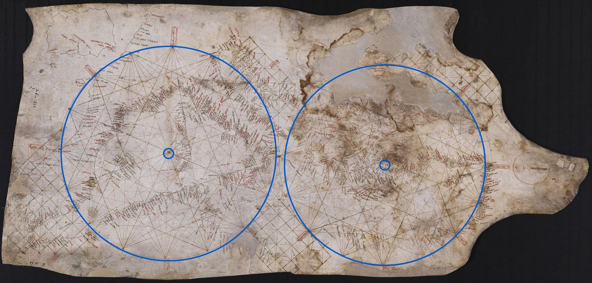
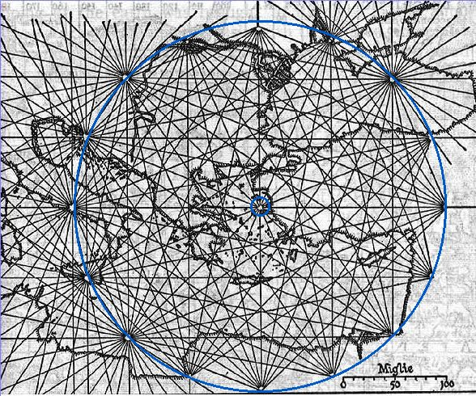
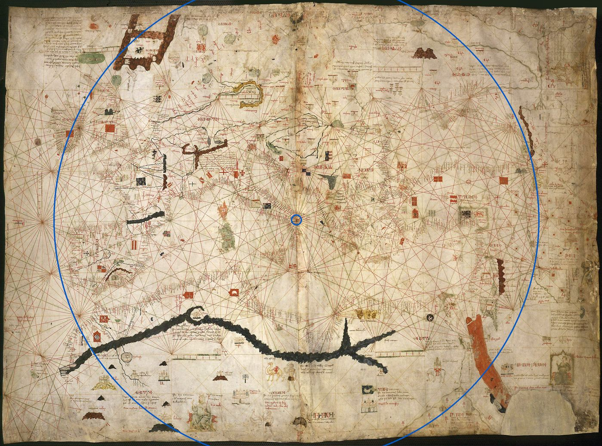
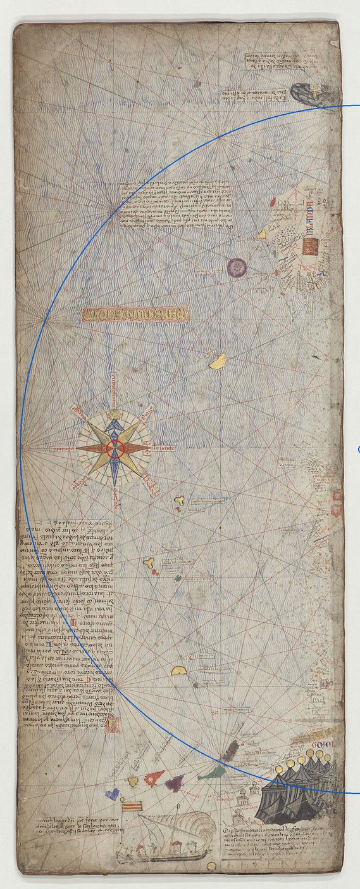
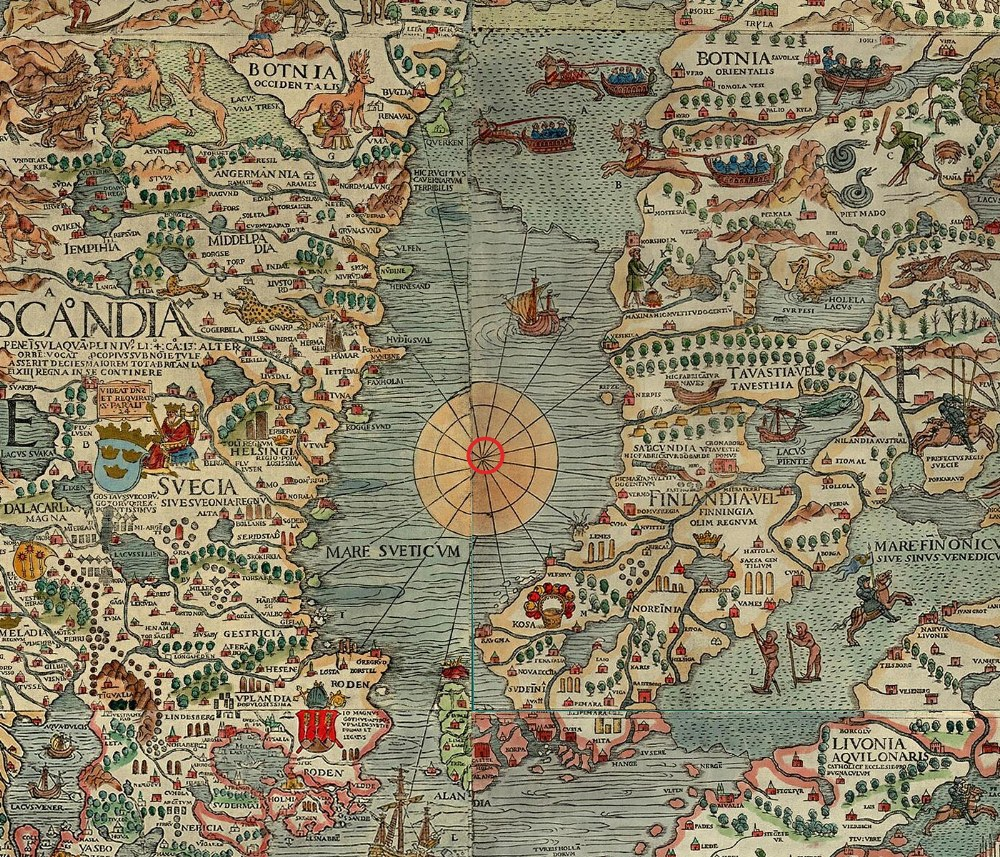
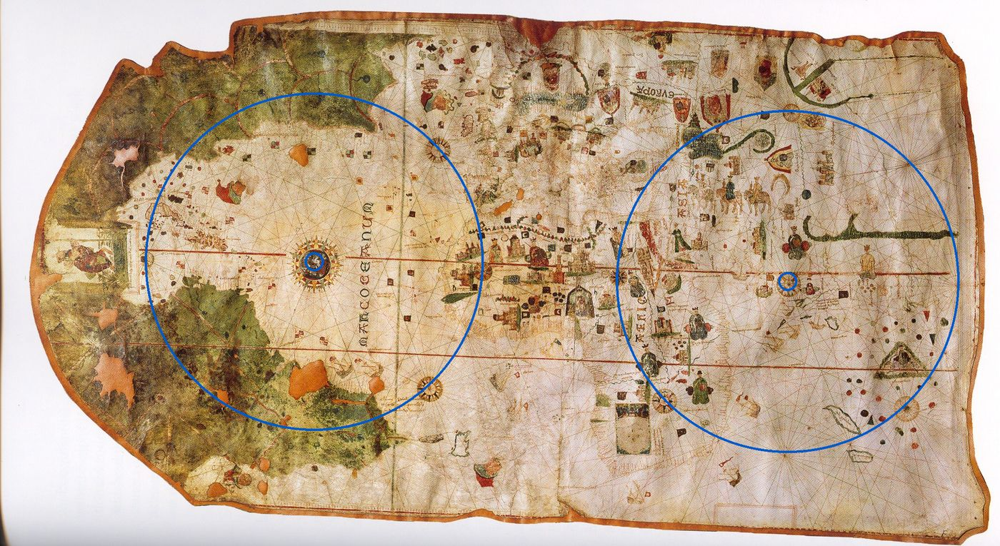

# The historical centres, read off the scans

The curated sheets in [the atlas design](README.md) put each circle where the chart's own circle
stood. This file reads those circles off public scans, one chart at a time, and moves each centre
onto the modern earth. Scans read 2026-10-14.

## Method

The same three steps for every chart.

**The circle.** On the scan, the nodes of the network are the points where sixteen or thirty-two
lines meet. Their pixel positions are read off a gridded crop, and a circle is fitted to them by
least squares. The fit's centre is checked against the hub the lines visibly run from. Each image
below draws the fitted circle in blue over the scan.

**The transfer.** Four or five coastal landmarks that the chart draws recognisably (islands above
all) are read off the same scan. A similarity transform (one scale, one turn, one shift) from scan
pixels to modern longitude and latitude is fitted to them, in a plane where a degree of longitude
is shortened by the cosine of the middle latitude. The transform carries the centre and the radius
across.

**The error.** The transform's root-mean-square residual over its landmarks is the floor. Where a
chart has too few sure landmarks for a fit, the position is read by eye against the nearest coasts
and the error says so.

The turn the fit finds is a check on the whole method: on the Carte Pisane it comes out at
8.2°, inside the 8° to 10° Gaspar measures for the portolan charts' magnetic tilt.

Scans are the Wikimedia Commons copies of each library's digitisation, at the resolution
named in each section; reading at a library's full resolution would tighten every number.

## Summary

| sheet | the guess | read off the scan | radius | error |
|---|---|---|---|---|
| Mediterranean, west (Carte Pisane) | 8°E 39°N | 7.4°E 40.0°N, west of Sardinia | 8.0° | ±0.5° |
| Mediterranean, east (Carte Pisane) | 26°E 36°N | 27.4°E 36.8°N, the Dodecanese by Kos | 7.5° | ±0.5° |
| Levant and Black Sea (Vesconte 1311) | 30°E 40°N | 25.2°E 37.5°N, the Cyclades | 3° | ±0.7°, from a tracing |
| Europe and the Mediterranean (Dulcert 1339) | 5°E 40°N | 14.5°E 40.0°N, the south Tyrrhenian | 17° | ±1.5° |
| The known world of 1375 (Catalan Atlas) | 20°W 37°N | rose 20.7°W 42.1°N; network centre 5.4°W 42.3°N | 16° | ±2° |
| Scandinavia and the Baltic (Carta Marina) | 22°E 60°N | 19.5°E 62°N, the Bothnian Sea | no ring | ±1° |
| The Atlantic and the Americas (de la Cosa) | 35°W 30°N | 45°W 23.4°N, on the Tropic of Cancer | 360 px, not in degrees | latitude ±0.5°, longitude ±10° |

The radius is in degrees of a great circle on the modern earth, from the same transform; de la Cosa's
stays in pixels (see its section).

## Carte Pisane: two circles

The scan has south up and is turned 180° for reading. Eight nodes of each ring fit a circle to
within 6 px: the west ring 701 px in radius, round the hub its lines run from, the east 655 px.
The two rings come within about 50 px (half a degree) of each other between Sicily and Greece, so
"tangent" stands. The transfer is fitted to Mallorca, Port-Vendres and the middles of Sardinia,
Crete and Cyprus: residuals 0.1° to 0.3°, 0.21° rms, 87.5 px a degree, the scan turned 8.2°.

- **Scan.** BnF, GE B-1118 (RES), Gallica
  [btv1b52503226n](https://gallica.bnf.fr/ark:/12148/btv1b52503226n), via
  [Commons](https://commons.wikimedia.org/wiki/File:Carte_marine_de_l%27oc%C3%A9an_Atlantique_Est,_de_la_mer_M%C3%A9diterran%C3%A9e_et_d%27une_partie_de_la_mer_Noire,_connue_sous_le_nom_de_Carte_Pisane_-_btv1b52503226n_(1_of_2).jpg),
  3840 px wide.
- **West.** **7.4°E 40.0°N**, about 0.8° off Sardinia's west coast; radius 8.0°.
- **East.** **27.4°E 36.8°N**, the south-east Aegean by Kos; radius 7.5°.
- **Error.** ±0.5°: the fit's 0.2° plus the reach from the landmarks to the centres.

## Pietro Vesconte, 1311

No digitisation of Archivio di Stato di Firenze, CN 1, is on Commons, so the source is a published
line tracing of its network, credited to the Archivio; it shows the Aegean part of the chart only.
Eight nodes lie 222 to 232 px from the hub among the Cyclades. A tracing names too few landmarks
for a fit, so the position is read against Crete's north coast at the foot and the large island at
the top (Lemnos or Thasos), with the tracing's own scale of miles as a cross-check.

- **Scan.** A line tracing, via
  [Commons](https://commons.wikimedia.org/wiki/File:1311_portolan_of_Pietro_Vesconte.jpg),
  588 px wide.
- **Position.** **25.2°E 37.5°N**, the Cyclades by Tinos and Mykonos; radius about 3° (230 px).
- **Error.** ±0.7°, mostly from which northern island the tracing draws.
- **Open.** Whether the chart has a larger circle, out to the Black Sea, needs the Archivio's scan.

## Angelino Dulcert, 1339

One great circle, its hub at (1305, 968) px. Five sure nodes (west, east, the two north-west and
north-east, south-west) lie 1025 to 1128 px out, so the radius is 1070 ± 50 px; the east node falls
just beyond the Levant coast, the west in the Atlantic off Iberia.

The transfer is by eye. Sardinia is the one island drawn plainly at this resolution. The position
is read against the Italian coast's run of names, which the hub sits just off, and the scale from
the east node's place beyond the Levant: 1070 px to 17°, about 63 px a degree. The radius rests on
that same scale, so it is not independent of the position. Carried from Sardinia's middle
(9.0°E 40.1°N) instead, the hub's offset of 306 px east and 80 px north comes to 15.6°E 40.7°N
after the chart's 8° turn, inland of Salerno: at the circle's scale the chart does not set Sardinia
and the Italian coast at their modern spacing. The coastal reading is kept; the 1° between the two
readings sits inside the error.

- **Scan.** BnF, GE B-696 (RES), via
  [Commons](https://commons.wikimedia.org/wiki/File:Map_of_Angelino_Dulcert_cropped.jpg),
  2651 px wide.
- **Position.** **14.5°E 40.0°N**, the south Tyrrhenian off Campania and Calabria; radius about 17°.
- **Error.** ±1.5°, by eye.

## The Catalan Atlas, 1375

The BnF's "Feuille 5" is the Atlantic panel: Ireland at the top, the Canaries at the foot. Five
nodes down its west side fit a circle to within 10 px, radius 914 px, centred on the panel's east
edge at the rose's own height. So the network's centre lies on the join with sheet 6, over Iberia,
and the rose is not that centre: it sits on the line from the centre to the west node, 0.72 of the
way out. The transfer is fitted to the Canaries, Ireland and the Portuguese coast: 1.6° rms.

- **Scan.** BnF, Espagnol 30, Gallica
  [btv1b55002481n](https://gallica.bnf.fr/ark:/12148/btv1b55002481n), sheet 5, via
  [Commons](https://commons.wikimedia.org/wiki/File:Catalan_Atlas_BNF,_sheet_5.jpg),
  960 px wide.
- **Rose.** **20.7°W 42.1°N**, open Atlantic west of Galicia.
- **Network centre.** **5.4°W 42.3°N**, over northern Iberia; radius 16°.
- **Error.** ±2°.

## Olaus Magnus, Carta Marina, 1539

The Commons file is credited to a Plymouth Marine Laboratory page and does not say whether it is
the Munich or the Uppsala copy. The chart has no ring: its four roses (Mare Glaciale, west of the
Faroes, the North Sea, the Gulf of Bothnia) are hubs of lines with no ring of sixteen nodes. The
central one, the hub the sheet follows, is read by eye between the Medelpad and Hälsingland coast
(Middelpadia and Helsingia on the map) and the Ostrobothnian shore, north of where Olaus draws
Åland.

- **Scan.** [Commons](https://commons.wikimedia.org/wiki/File:Carta_Marina.jpeg), 5016 px wide,
  read at 3840.
- **Position.** **19.5°E 62°N**, the Bothnian Sea; no ring.
- **Error.** ±1°, by eye.

## Juan de la Cosa, 1500

The scan is a photograph of the chart, credited to a blog page. Two rings of the same radius on
the chart, about 360 px, each run through four drawn roses at its nodes. The rings are separate,
their centres about 1000 px apart, and both centres sit on the red line of the Tropic of Cancer.
The western centre is the rose with the Virgin and Child; the eastern is a plain hub east of
Arabia.

Latitude comes off the chart's own two lines, the Tropic of Cancer and the equator below it. The
western longitude is by eye, carrying the Old World's scale (Cape Blanco to the Red Sea) west; the
eastern is a by-eye placement east of Arabia, not measured. The chart's scale is not uniform
between the rings (the New World is drawn at a larger scale than the Old), so 1000 px, 2.8 radii,
spans the 110° of longitude between the two centres, and no one radius in degrees fits both rings.
The radius is given in pixels; each ring's radius in degrees waits on a fit to its own coasts.

- **Scan.** Museo Naval, Madrid, via
  [Commons](https://commons.wikimedia.org/wiki/File:1500_map_by_Juan_de_la_Cosa_rotated.jpg),
  2127 px wide.
- **West.** **45°W 23.4°N**, mid-Atlantic on the Tropic of Cancer.
- **East.** About **65°E 23.4°N**, the Arabian Sea; its longitude by eye, not measured.
- **Radius.** About 360 px on the chart for both rings; not converted to degrees.
- **Error.** Latitude ±0.5°; the western longitude ±10°.

## The design doc's three unverified claims

The design doc's sources list three claims as unverified. What the scans and sources show:

- **De la Cosa's network.** Two equal, separate rings, each centred on the Tropic of Cancer; the
  rose with the Virgin and Child sits on the Tropic too, not the equator.
- **The Catalan Atlas's rose.** On the Atlantic panel, which Gallica labels "Feuille 5" of 12.
- **Pujades on Vesconte.** Wikipedia's sentence gives no page and is tagged "[clarification needed]".

The Wikipedia article reports that Pujades (2007) shows an image of Vesconte drawing a chart and
that "he started by drawing first the rhumbline grid". Pujades's own text was not reached. Campbell
(1987, pp. 390 to 391) carries the order of work on its own.

## Sources

Consulted 2026-10-14.

- The scans linked in each section, through Wikimedia Commons.
- Wikipedia, "Rhumbline network": <https://en.wikipedia.org/wiki/Rhumbline_network>.
- Gaspar (2008), cited in [the design doc](README.md): the 8° to 10° tilt the Carte Pisane fit is
  checked against.
