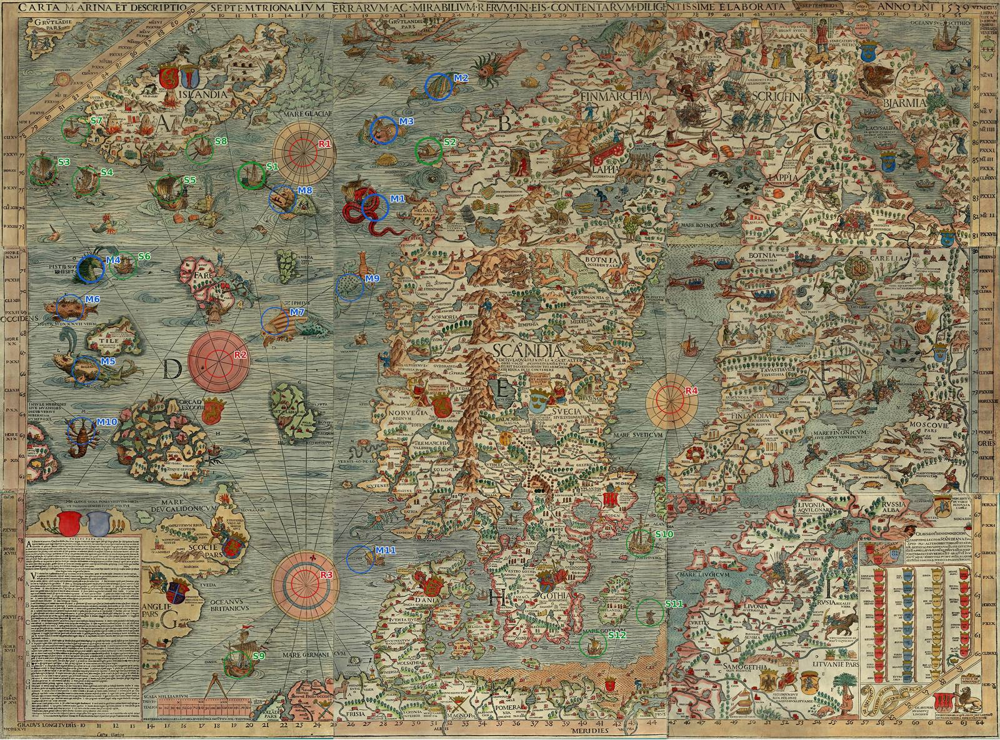

# The curated charts' own figures

A curated sheet whose chart has been read draws that chart's own roses, beasts and ships, each where the
chart puts it, in place of the seeded ones ([#146](https://github.com/mark-brannan/portolani/issues/146)),
unless the reader turns historical accuracy off. The figures live in `CURATED` in
`scripts/atlas.mjs` as `{ kind, sprite, lon, lat }`. A figure is drawn on its sheet's own ground: inside
the sheet's extent and out of a smaller sheet's shadow (the frame rule in [README.md](README.md)).

A figure with no cropped sprite takes a **stand-in**: a sprite of the same kind in the sheet's style
(the Carta Marina's crops for the Carta Marina), chosen by the figure's place in its chart's list, so it
keeps its stand-in from any view. Where the style has none of that kind (the Carta Marina's roses, the
Catalan Atlas's ship) the stand-in is one of the page's chosen roses or ships.

## Carte Pisane, Vesconte 1311, Dulcert 1339

None. The Pisane and Dulcert draw hubs only (Dulcert's flags, kings and towns stand on land); no rose of
Vesconte's is known. Each has an empty set, so these sheets draw no roses, beasts or ships.

## Catalan Atlas, sheet 5

| | figure | lon, lat | sprite | note |
|---|---|---|---|---|
| R1 | the rose | -20.7, 42.1 | `rose-catalan` | from centres.md |
| S1 | ship at the foot, off Cape Bojador | -15.5, 26.1 | stand-in | placed by the cape, not read in pixels; no crop yet |

Sheets 6 to 12 are not read.

### Landmarks, sheet 5

Read off the Commons scan at full size (6454 x 15862, `Catalan_Atlas_BNF,_sheet_5.jpg` in scripts/sources.json)
on 2026-10-21, by eye, about ±40 px; each placed by its own lettering on the chart (Lumenegh by the Shannon,
Lixbona on the Tagus, Mogador, caua de guer, caua de Non, insula de legname, the Canaries by name). The sheet
is north up and takes one similarity, fitted by least squares from scan pixels to longitude and Mercator
latitude, as the Carta Marina's are:

| fit | landmarks | scale | turn | residual, RMS | worst |
|---|---|---|---|---|---|
| sheet 5 | L1 to L19 | 0.00331 °/px | 0° | 127 km | El Hierro, 284 km |

The chart strings the Canaries out west to east, about half again their true span, and sets Ireland a little
south and west, so those are the worst rows. The scan's corners land at 27.0°W to 5.6°W, 21.8°N to 59.7°N.

| | landmark | scan px | lon, lat | fit puts it at | off by |
|---|---|---|---|---|---|
| L1 | Shannon mouth | 4975, 4710 | -9.75, 52.58 | -10.5, 50.9 | 199 km |
| L2 | Cape Finisterre | 5425, 8290 | -9.27, 42.88 | -9.1, 42.8 | 21 km |
| L3 | Douro mouth, Porto | 5650, 9030 | -8.67, 41.14 | -8.3, 41.0 | 37 km |
| L4 | Mondego mouth | 5480, 9200 | -8.87, 40.15 | -8.9, 40.5 | 42 km |
| L5 | Tagus mouth, Lisbon | 5435, 9695 | -9.30, 38.68 | -9.0, 39.3 | 71 km |
| L6 | Cape Cantin | 5440, 12000 | -9.27, 32.55 | -9.0, 33.1 | 69 km |
| L7 | Mogador island | 5390, 12280 | -9.78, 31.50 | -9.2, 32.4 | 111 km |
| L8 | Cape Ghir | 5420, 12650 | -9.89, 30.63 | -9.1, 31.3 | 109 km |
| L9 | Cape Nun | 5200, 13190 | -11.08, 28.75 | -9.8, 29.8 | 169 km |
| L10 | Porto Santo | 3420, 11790 | -16.34, 33.07 | -15.7, 33.7 | 94 km |
| L11 | Madeira | 3210, 12000 | -16.95, 32.75 | -16.4, 33.1 | 68 km |
| L12 | Desertas | 3500, 12290 | -16.52, 32.50 | -15.4, 32.3 | 105 km |
| L13 | Selvagens | 3800, 12850 | -15.87, 30.14 | -14.4, 30.7 | 154 km |
| L14 | Lanzarote | 4080, 13450 | -13.63, 29.05 | -13.5, 29.0 | 12 km |
| L15 | Fuerteventura | 3850, 13820 | -14.02, 28.40 | -14.3, 28.0 | 55 km |
| L16 | Gran Canaria | 3200, 14020 | -15.60, 27.96 | -16.4, 27.4 | 104 km |
| L17 | Tenerife | 2750, 13900 | -16.60, 28.27 | -17.9, 27.7 | 142 km |
| L18 | La Gomera | 2390, 13990 | -17.23, 28.10 | -19.1, 27.5 | 197 km |
| L19 | El Hierro | 1900, 14180 | -18.00, 27.75 | -20.7, 26.9 | 284 km |

Left out of the fit: "Illa de Stillanda", Iceland, drawn east of Ireland at 5600, 1700, which the fit puts at
8.5°W 56.7°N, 1059 km from where it lies; Hy-Brasil, the round island west of Ireland, and the other islands
of legend; and the islands between Galicia and Madeira (insule de corvi marini, insula de brazi), which may be
the Azores but are too far from them to read as any one. The rose at 2000, 7950 lands at 20.4°W 43.6°N by this
fit, within centres.md's ±2° of R1.

The fit lays the scan over the map: [docs/overlay/README.md](../overlay/README.md).

## Carta Marina, 1539

Read off the Commons scan at full size (5016 x 3715, `Carta_Marina.jpeg` in scripts/sources.json) on
2026-10-15, by eye, about ±30 px. The chart is not one similarity (Scandinavia is turned), so two are fitted
by least squares, from scan pixels to longitude and Mercator latitude, and each figure takes its own side's:

| fit | landmarks | scale | turn | residual, RMS | worst |
|---|---|---|---|---|---|
| west | Iceland, Faroes, Shetland, Orkney | 0.0113 °/px | 48° | 101 km | Shetland, 125 km |
| Baltic | Åland, Stockholm, Gotland, Öland, Saaremaa, Riga, Danzig | 0.0100 °/px | 3° | 47 km | Åland and Danzig, 59 km |

The west fit's four landmarks lie in one narrow column of the scan, and the chart draws Iceland well east of
where it lies, so that fit is the weaker one. Figures at x > 2700 px take the Baltic fit.

| | figure | scan px | fit | lon, lat | sprite | on the map |
|---|---|---|---|---|---|---|
| R1 | Mare Glaciale | 1521, 767 | west | -10.5, 65.8 | stand-in | off the sheet: west of its 5°W edge |
| R2 | "D", west of the Faroes | 1098, 1826 | west | -4.7, 60.7 | stand-in | drawn |
| R3 | North Sea | 1530, 2931 | west | 7.8, 58.3 | stand-in | lands on southern Norway in the fit; drawn, as a rose may stand on land |
| R4 | Bothnian Sea | 3361, 2006 | baltic | 20.6, 62.4 | stand-in | drawn |
| M1 | serpent-a | 1882, 1042 | west | -5.5, 66.2 | `serpent-a` | off the sheet: west of its 5°W edge |
| M2 | whale-b | 2200, 436 | west | -8.2, 69.0 | `whale-b` | off the sheet: west of its 5°W edge |
| M3 | cete-e | 1926, 654 | west | -8.4, 67.5 | `cete-e` | off the sheet: west of its 5°W edge |
| M4 | pistrix-c | 455, 1350 | west | -13.6, 59.7 | `pistrix-c` | off the sheet: west of its 5°W edge |
| M5 | Balena and Orcha | 429, 1859 | west | -9.5, 57.6 | stand-in | off the sheet: west of its 5°W edge |
| M6 | spiny fish (K) | 351, 1547 | west | -12.7, 58.5 | stand-in | off the sheet: west of its 5°W edge |
| M7 | Ziphius | 1378, 1612 | west | -4.5, 62.5 | stand-in | drawn |
| M8 | whale by the Mare Glaciale rose | 1417, 1001 | west | -9.3, 64.7 | stand-in | off the sheet: west of its 5°W edge |
| M9 | spotted serpent | 1755, 1443 | west | -3.1, 64.5 | stand-in | drawn |
| M10 | lobster | 408, 2163 | west | -7.1, 56.3 | stand-in | off the sheet: west of its 5°W edge |
| M11 | Vermis 40 pe lo | 1807, 2808 | west | 8.9, 60.0 | stand-in | lands on Norway or Jutland in the fit; left out |
| S1 | ship-a | 1260, 881 | west | -11.5, 64.5 | `ship-a` | off the sheet: west of its 5°W edge |
| S2 | ship-b | 2150, 758 | west | -5.9, 67.9 | `ship-b` | off the sheet: west of its 5°W edge |
| S3 | ship | 214, 858 | west | -19.6, 60.6 | stand-in | off the sheet: west of its 5°W edge |
| S4 | ship | 429, 910 | west | -17.5, 61.3 | stand-in | off the sheet: west of its 5°W edge |
| S5 | ship | 845, 949 | west | -14.1, 62.8 | stand-in | off the sheet: west of its 5°W edge |
| S6 | ship | 617, 1332 | west | -12.5, 60.5 | stand-in | off the sheet: west of its 5°W edge |
| S7 | ship | 377, 650 | west | -20.1, 62.0 | stand-in | off the sheet: west of its 5°W edge |
| S8 | ship | 1001, 754 | west | -14.5, 64.0 | stand-in | off the sheet: west of its 5°W edge |
| S9 | ship, North Sea | 1191, 3339 | west | 8.7, 55.1 | stand-in | lands on Norway or Jutland in the fit; left out |
| S10 | Navis Svetica | 3210, 2727 | baltic | 19.5, 58.8 | stand-in | drawn |
| S11 | ship, Baltic | 3260, 3076 | baltic | 20.1, 57.0 | stand-in | drawn |
| S12 | ship, Baltic | 2974, 3234 | baltic | 17.4, 56.0 | stand-in | drawn |

Lake Vänern's ships are inland and left out. The sheet's extent (README.md, "The curated sheets") stops at
5°W, so 17 of its 27 figures, the four cropped ones among them, lie off it and are not drawn until that
edge moves west to take in Iceland.

The two fits also lay the whole scan over the map, refitted from this table: [docs/overlay/README.md](../overlay/README.md).

## Juan de la Cosa, 1500

Not read in place: two rings of roses (the west centre's Virgin and Child, small node roses; the east
ring's node roses), its beasts and ships not read at 1400 px. With no set, the sheet keeps the seeded figures.
