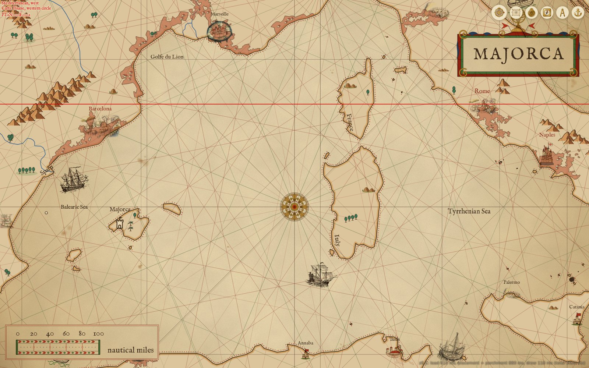
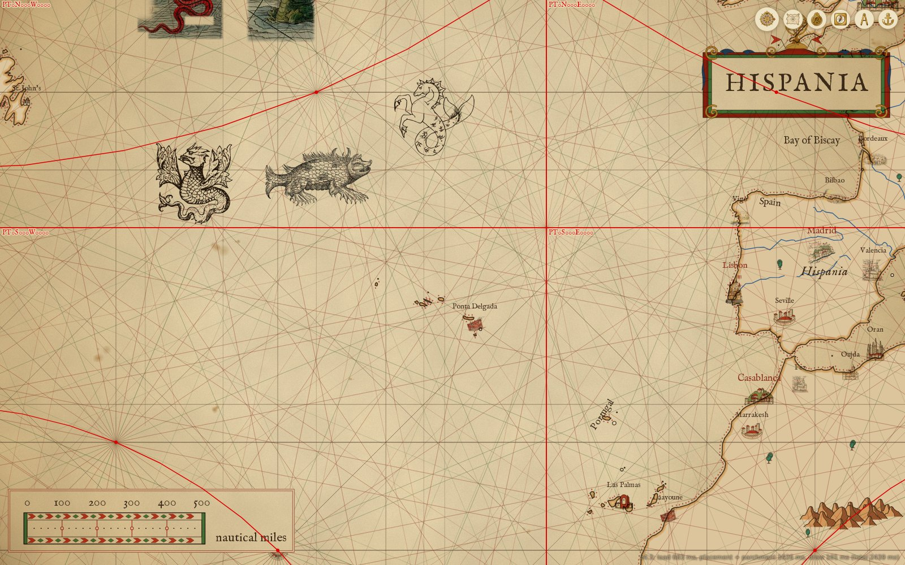
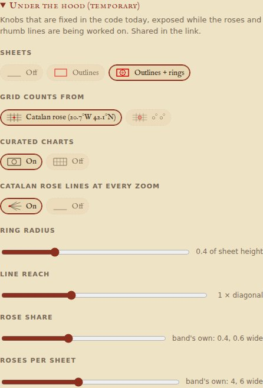

# Under the hood

A temporary developer view, there while the roses and rhumb lines are being worked on: the atlas's sheets drawn in red, and the knobs fixed in the code exposed in the link and in the settings drawer's last section, "Under the hood (temporary)". Every one is off, or at the code's own value, by default, so a link without them draws as before.

| Hash | Default | What it changes | Constant | For |
|---|---|---|---|---|
| `debug=sheets` | off | Each sheet at this view outlined in red, named; curated shadows dashed | `drawSheetsDebug` | #107, #199 |
| `debug=sheets,rings` | off | And each hidden circle: hub hollow, sixteen nodes filled | `drawSheetsDebug` | #107, #199 |
| `tune=radius:` | 0.4 | A grid sheet's hidden circle, of its height (0.25 to 0.8) | `SHEET_RADIUS` | #107 |
| `tune=reach:` | 1 | Times each sheet's diagonal, and the rose's (0.5 to 2) | `sheetReach` | #199 |
| `tune=origin:` | `rose` | Grids count from the Catalan rose, or `zero` (0°E 0°N, NOAA's own) | `ROSE`, `ORIGINS` | #138 |
| `tune=curated:` | 1 | 0: grid cells everywhere; the world band stays one sheet | `sheetsFor` | #199 |
| `tune=roselines:` | 1 | 0: drops the Catalan rose's extra hub of 32 lines | `latticeOf` | #138, #199 |
| `tune=roseshare:` | band's own (0.4; 0.6 wide) | Rose share of a sheet's allotment, every band (0 to 1) | `ROSE_SHARE`, `WIDE.roseShare` | #162 |
| `tune=sheetroses:` | band's own (4; 6 wide) | Most roses a sheet holds, every band (1 to 8) | `SHEET_ROSES`, `WIDE.sheetRoses` | #162 |

Knobs go in one `tune=` as comma-separated `name:value`, e.g. `#tune=radius:0.5,reach:1.5,origin:zero`. A value out of range or malformed falls back to the default; a knob at its default is left out of the link. Headless, `createScene(env, { debug: ['sheets', 'rings'], tune: { radius: 0.5 } })`; the knobs and their ranges are `TUNE_KNOBS` in scripts/scene.mjs, whose header comment says how each works.

The overlay is drawn over everything, in the same pass as the rhumb lines, so it moves with a drag as they do; it places nothing and clears nothing.

[View 4 of #199](https://mark-brannan.github.io/portolani/#map=6.14/40.474/7.400&debug=sheets,rings) (`#map=6.14/40.474/7.400&debug=sheets,rings`): the Carte Pisane's western sheet holds the view, and the overview cell north of it still reaches down to 42.1°N, the rose's row.

[View 2 of #199](https://mark-brannan.github.io/portolani/#map=4.33/39.525/-26.502&debug=sheets,rings) (`#map=4.33/39.525/-26.502&debug=sheets,rings`): four ocean-band cells cornered on the Catalan rose, and their rings.

The drawer's section:

