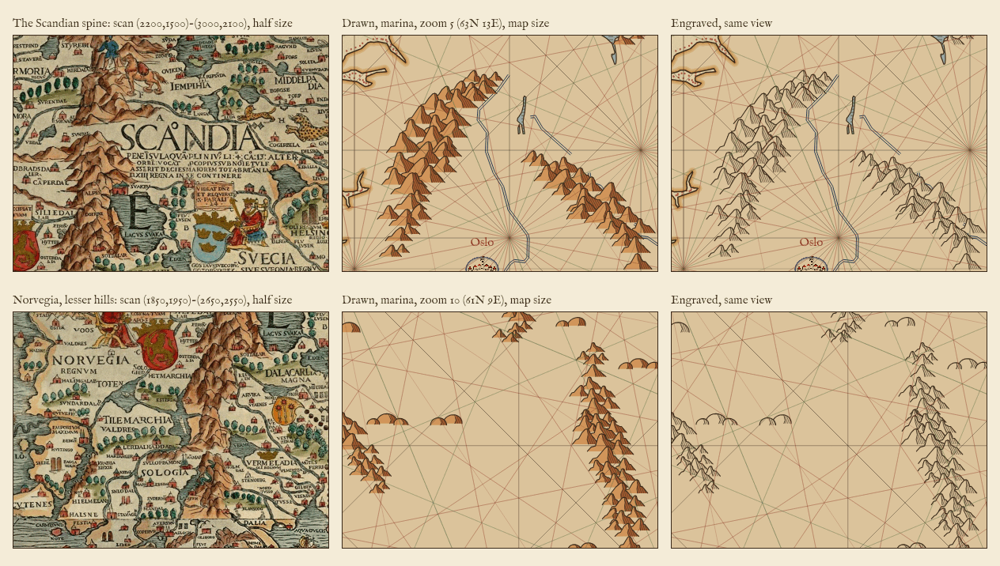

# Carta Marina comparisons

Sheets that set the scan of Olaus Magnus's Carta Marina (1539) beside what the chart draws in
code, so a review can judge the likeness. The scan is
[Carta_Marina.jpeg](https://upload.wikimedia.org/wikipedia/commons/e/ea/Carta_Marina.jpeg)
(5016 x 3715, public domain, sha256 `1fd3debb10d5f96ca117b0747c99dba8f17b9bc8d7543da68b03b19a1a7a0571`); crop boxes are in its px, as (x0,y0)-(x1,y1).

## buildings.png

Each row is a crop of the scan beside the buildings of `scripts/buildings.mjs`, both magnified 2x,
and under each building the same glyph at map size (18 px, the height a lesser place stands at
from zoom 9). The last strip is the chart itself: Genoa, a lesser place, at zoom 10 (8.7 E 44.3 N).

| Row | Scan crop | Drawn |
| --- | --- | --- |
| 1 | Svecia, (2860,2040)-(3080,2180): houses at Mo, Noral, Soderala | `house`, `church` |
| 2 | Vplandia, (2760,2460)-(3000,2600): churches, Arosia, round towers | `church`, `castle`, `round-tower` |
| 3 | Lappia, (3080,960)-(3320,1100): tents at Bircarli | `tent`, `house` |

## trees.png

Each row is a crop of the scan beside the trees of `scripts/trees.mjs`, both magnified 3x; the
last strip is the chart itself at map size (`trees=marina`, 15.5 E 59.5 N, zoom 9).

| Row | Scan crop | Drawn |
| --- | --- | --- |
| 1 | Svecia, (2850,2185)-(2950,2235): a row and a clump | `marina`: rows and a forest clump |
| 2 | Lappia, (2950,1085)-(3050,1135): a row of oval crowns | `marina`: ovals and conifers |
| 3 | Svecia, (2790,2160)-(2890,2210): Orsa's rows | `ink` |

## Hills and mountains

`relief.png` sets two crops of the scan, shown at half size, beside the relief `scripts/relief.mjs`
draws, at map size (one map pixel to one sheet pixel), in both styles, `marina` and `engraved`:

| Row | Scan crop, scan px (x0,y0)-(x1,y1) | Drawn view, zoom/lat/lon | Map crop, px (x, y, w, h) |
| --- | --- | --- | --- |
| The Scandian spine | (2200,1500)-(3000,2100) | 5/63/13 | 520, 480, 400, 300 |
| Norvegia, the lesser hills | (1850,1950)-(2650,2550) | 10/61/9 | 420, 330, 400, 300 |

The drawn views are rendered with the continents and Latin regions on and rivers and lakes in the Carta Marina style.

## Monster and ship sprites as patches (#111)

The six Carta Marina sprites of the `scanned` pack are cut as patches: the whole crop, sea and swell
and ripples with it, its edge feathered, the paper divided out so the renderer's multiply sinks it
into the parchment. They were cut by ink coverage, which dropped the sea round each figure. Every
crop box now reaches well below the figure so the bottom edge keeps the most water.

Rebuild everything here (the other sprites in the pack are untouched and rebuild byte-identical) with:

    node scripts/build-packs.mjs --only scanned --keep docs/carta-marina

`steps.png` is a row per sprite: the raw crop, the key (white where the sprite is opaque), the cut
multiplied onto parchment at 1:1, and the cut at the width the map draws it. `<id>.raw.png`,
`<id>.key.png` and `<id>.cut.png` are the three images behind it. The monster or ship keeps the size
and anchor it had; the extra water is drawn round it (`figure` in the build script is the old tight box).

| id | what | crop (scan px) | in the raw, absent from the sprite, and why |
|---|---|---|---|
| serpent-a | sea serpent coiled round a ship | 1670,874 to 2065,1215 | the ship and boat beside it at the top right: neighbouring figures (the cut fades into the sea); "GOTHI", "SOOPEDVM", a "D" and the coast corner at the foot: lettering and land |
| whale-b | the striped whale with its swell | 1996,356 to 2362,590 | the coast house in the bottom-right corner: a neighbour |
| pistrix-c | the spiny sea-beast | 372,1210 to 566,1480 | two letters of "STR&SIVE" at the left edge: lettering |
| cete-e | the whale that has seized a ship | 1772,572 to 2060,775 | a "C" and the end of "CETE": lettering |
| ship-a | the three-master | 1130,780 to 1335,1050 | an "L" beside the foremast and "ANGLI" under the hull: lettering |
| ship-b | the smaller ship under sail | 2050,690 to 2210,840 | the islet "HUST" at the foot, the end of "QUEDEFIORD" and "NA": land and lettering. The tiny boat under the hull stays: it is part of its water |

Still cut by ink, to follow: the roses, cartouche, palms, scale, Aguiar towns, Paré monsters and
Master W ships (`docs/towns-aguiar` for the towns).
