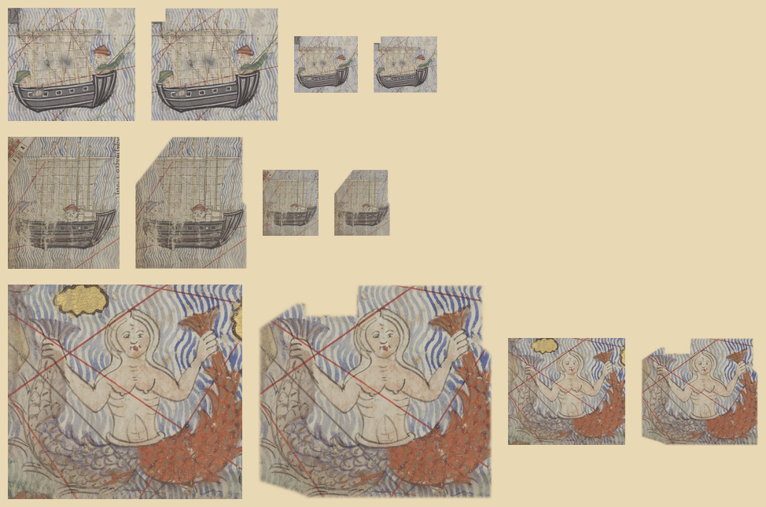
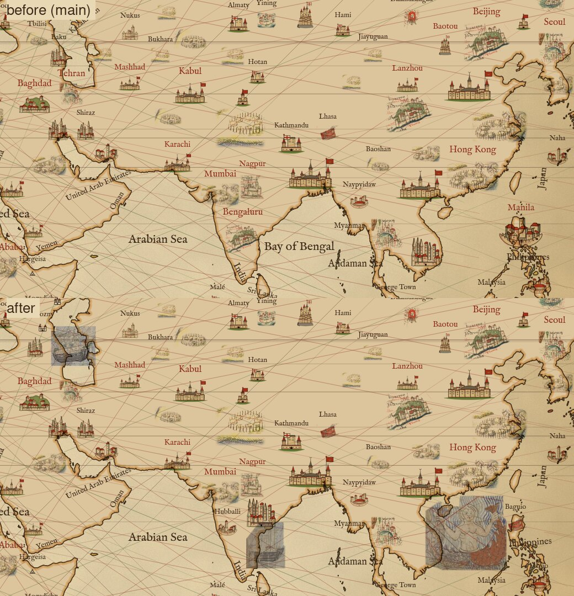
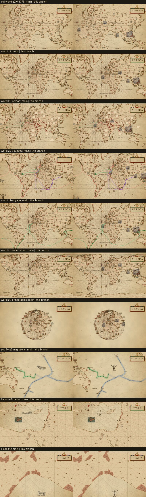

# The Catalan Atlas's ships and siren: patches from sheets 9, 11 and 12

The Catalan Atlas (Cresques Abraham, 1375; BnF Gallica btv1b55002481n, public domain) draws few figures at sea past
its one rose on sheet 5: a ship in the Caspian, a junk off India, a siren among the islands of the Indian Ocean, and on
sheet 10 two ships and two fish by the pearl fishers. Where each lies and which are drawn is in
[docs/atlas/ornaments.md](../atlas/ornaments.md#figures-sheets-6-to-12). Three are cut into the `scanned` pack, style
`catalan`, each a patch as the rose is ([docs/catalan-rose](../catalan-rose/README.md)): the whole crop with the sea
round it, its edge feathered, divided by the map's parchment (`#e9d8b4`) so the renderer's multiply lands the scan's
colours as they are.

| sprite | kind | sheet | crop, scan px | drawn at |
|---|---|---|---|---|
| `catalan-ship` | ship | 9, `Catalan_Atlas_BNF,_sheet_9.jpg` | (2620, 4625)-(4100, 5940), turned a half turn | 50.6°E 41.1°N, the Caspian |
| `catalan-junk` | ship | 11, `Catalan_Atlas_BNF,_sheet_11.jpg` | (420, 13640)-(1850, 15330) | 81.2°E 13.2°N, the Bay of Bengal |
| `catalan-siren` | monster | 12, `Catalan_Atlas_BNF,_sheet_12.jpg` | (800, 14090)-(1970, 15160) | 113.1°E 15.8°N, the South China Sea |

The figures are new decorations, so they are on by default: `catalan-siren` joins the default monsters with the Carta
Marina and Paré families, and both ships join every other ship. With the chart's own figures drawn (historical accuracy,
the default) the Catalan sheet's ship off Cape Bojador on sheet 5, which has no crop, now stands in a Catalan ship (the
junk) where it stood in one of the page's ships.

`steps.png`, one row per sprite: the raw crop, the sprite multiplied onto parchment, at twice the width the map draws it
and then at that width (81, 71 and 149 px). `<id>.raw.png` (kept at half size), `<id>.key.png` and `<id>.cut.png` are
the build's kept images:

    node scripts/build-packs.mjs --only scanned --keep docs/catalan-figures catalan-

`window-z3.jpg` is the Catalan sheet's window at map size (zoom 3, 60°E 30°N, crop 1040 x 540 at 560, 250), main above
and this branch below: the Caspian ship, the junk and the siren where the chart puts them.

`goldens.jpg` is each golden that changes, main on the left. The world views draw the three figures where the chart
puts them; the others (the Pacific, the Levant, the Ligurian coast) change because the siren joins the default monsters,
so the seeded beasts are drawn from a pool one larger.

## In the raw but not in the sprite, and why

`catalan-ship`:

- the Mongol banner by the mast tips (the box at top left once turned): another figure, erased;
- the sea under the hull is a band about 130 px deep at full size, a ninth of the figure's height: the chart's lettering
  naming the sea runs across the sea just past it, so the crop stops there.

The scan draws the ship upside down, hull above sail (the eastern sheets are read from the atlas's far side), so the cut is
turned a half turn and sails upright on a north-up map.

`catalan-junk`:

- the coast and its town at top left: land and another figure, cut by the polygon's diagonal;
- the column of lettering beside the stern: lettering. The sea under the hull runs to the foot of the page.

`catalan-siren`:

- the gilt island over her raised left hand and the one beside her raised red tail, and the edge of the painted island at
  the left: other figures, which the polygon runs between;
- the block of lettering above her, on the sea of the islands of the Indies and its sirens: lettering, above the crop;
- the sea below her tails past about 30 px under the lowest fin: a gilt island lies there. Taking the sea down to the
  foot of the page on either side of it was tried; the patch then had two legs and a bite out of it.

## Colour

Sheets 6 to 12 are sRGB (sheet 5 is Adobe RGB, so its manifest entry names a `colorspace`; these need none).
