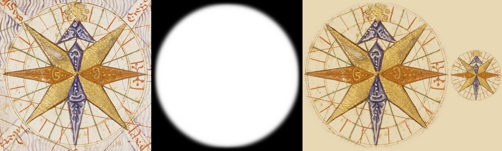

# The Catalan Atlas rose as a patch (#111)

`rose-catalan` of the `scanned` pack, re-keyed from ink coverage to a patch. The scan is
[Compass_rose_from_Catalan_Atlas_(1375).jpg](https://upload.wikimedia.org/wikipedia/commons/d/d2/Compass_rose_from_Catalan_Atlas_%281375%29.jpg)
(Cresques Abraham, BnF Gallica; 570 x 618, public domain); crop (120,185)-(440,505).

`steps.png`, left to right: the raw crop; the key (white where the sprite is opaque); the cut multiplied onto
parchment at 1:1; the cut at the width the map draws it (110 px). `rose-catalan.raw.png`, `.key.png` and `.cut.png`
are the three images behind it.

It was cut by ink coverage, which dropped the vellum between the rhumbs and thinned the blue, ochre and gilt
washes. Now the whole disc inside the ring is the sprite, its paper (`#e9dfcf`, the vellum's own) divided out so the
renderer's multiply sinks it into the parchment.

**Edge: a heavier feather, not erase boxes.** The ring is the only outline (a circle at its outer edge) and its blur is
4 px instead of 2 (`circleFeather`). Nothing is erased, so no pale hole is left where lettering was; the lettering and
waves outside the ring are cut by the circle, and its feather fades them out rather than ending them on a line.
A colour mask was not needed: the ring itself separates subject from surround.

| in the raw | absent from the sprite | why |
|---|---|---|
| the sea's blue waves round the ring | all of it | surround, outside the subject's ring |
| lettering of the neighbouring winds at three corners | all of it | lettering, outside the ring |
