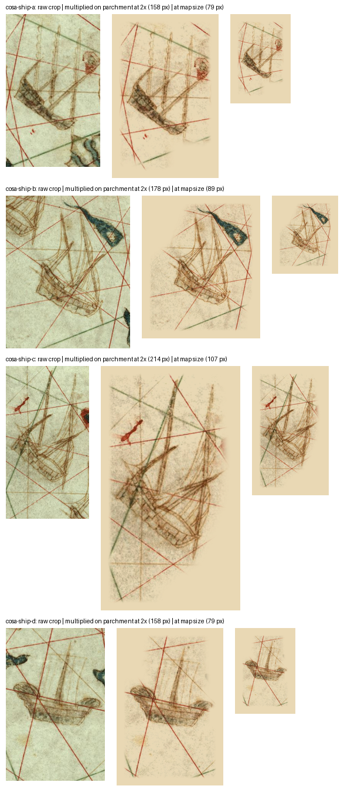
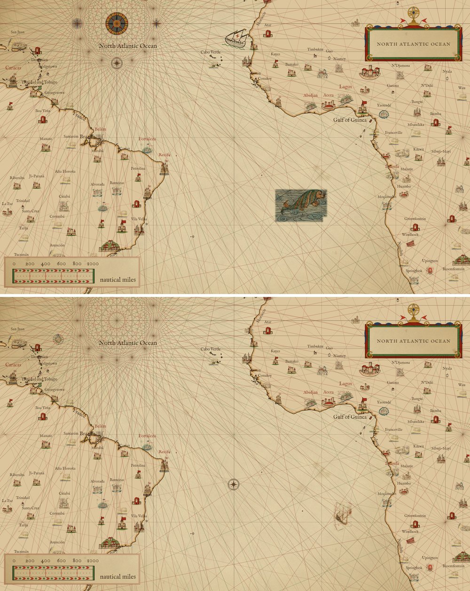
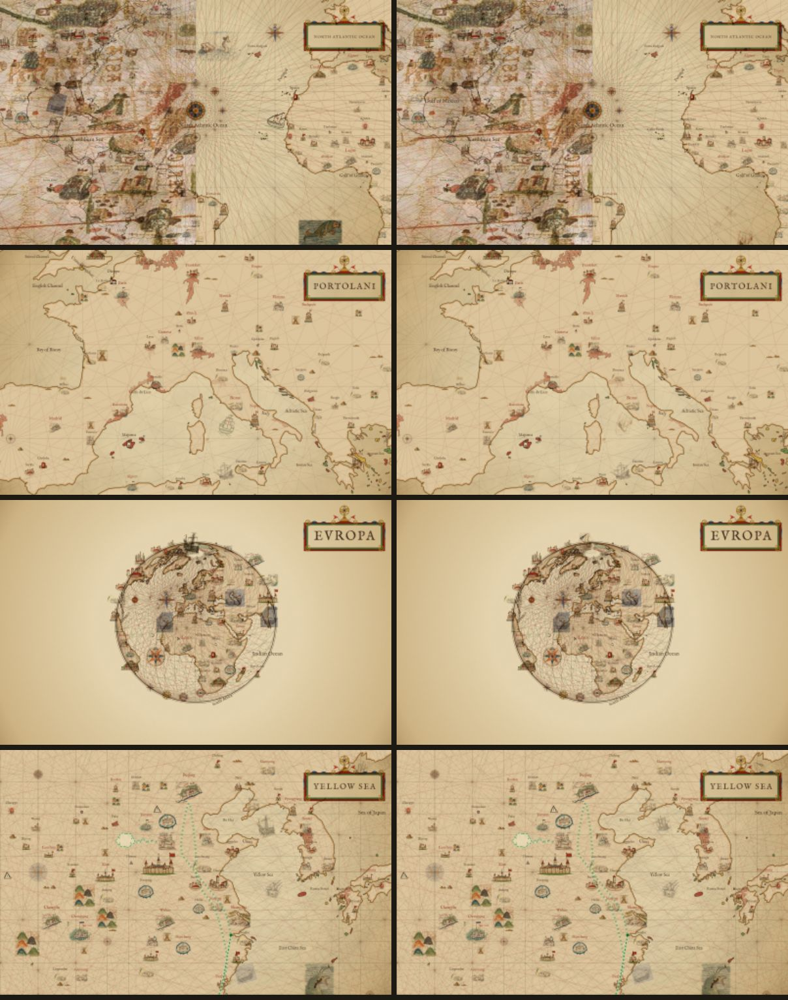

# Juan de la Cosa's ships: patches from the fleet off India

Juan de la Cosa's chart of 1500 (Museo Naval, Madrid; public domain) draws few figures at sea, and no beast: roses, the
four wind heads of the Atlantic, and ships. Where each lies, and which fall on the sheet's extent, is in
[docs/atlas/ornaments.md](../atlas/ornaments.md#juan-de-la-cosa-1500). The full chart's only scan is 2127 px wide, where
a ship is a sketch some 40 px tall; the Museo Galileo's detail of the Indian Ocean
(`1500_map_by_Juan_de_la_Cosa-India.jpg`, 1287 x 1073 in scripts/sources.json) draws the four ships of the Portuguese
fleet at about seven times that. The four are cut into the `scanned` pack, style `de-la-cosa`, each a patch as the
Catalan figures are ([docs/catalan-figures](../catalan-figures/README.md)): the whole crop with the sea round it, its
edge feathered, divided by the detail's own vellum (`#d0d5b2`, the mean of the 80th to 90th percentile of its pixels by
brightness, greener than the map's parchment) so the renderer's multiply sinks the patch into the parchment.

| sprite | kind | crop, scan px | turned | drawn at |
|---|---|---|---|---|
| `cosa-ship-a` | ship | (290, 392)-(650, 615) | a quarter clockwise | 79 px |
| `cosa-ship-b` | ship | (300, 600)-(748, 965) | a quarter clockwise | 89 px |
| `cosa-ship-c` | ship | (40, 800)-(540, 1073) | a quarter clockwise | 107 px |
| `cosa-ship-d` | ship | (735, 500)-(995, 900) | no | 79 px |

The chart is drawn west up, and three of the four ships are drawn that way, masts to the west. Each of those cuts is
turned a quarter clockwise so the ship stands upright on a north-up map, as it reads with the sheet turned west up. Their
sea lies east of the hull on the scan, under it once turned, so each crop reaches furthest east. The fourth ship, by
Ceylon, is drawn north up and is kept as drawn.

The ships are new decorations, so they are on by default: every ship is in the default selection. The fleet lies east
of the de la Cosa sheet's extent (20°E), so none of the four is drawn where the chart puts it. The sheet now has its own
set (historical accuracy, the default): four roses of its west ring and one ship in the South Atlantic, which stands in
one of the four, and no beasts, since the chart draws none at sea. The roses stand in the page's ring roses.

`steps.png`, one row per sprite: the raw crop (turned as the sprite is), the sprite multiplied onto parchment
(`#e9d8b4`) at twice the width the map draws it, and at that width. `<id>.raw.png`, `<id>.key.png` and `<id>.cut.png`
are the build's kept images:

    node scripts/build-packs.mjs --only scanned --keep docs/de-la-cosa-figures cosa-

## In the raw but not in the sprite, and why

`cosa-ship-a`:

- the coast of India and its lettering at the top right of the scan: land and lettering, cut by the polygon;
- the blue islet at the bottom right of the scan: another figure, cut by the polygon. The sea under the hull stops there.

`cosa-ship-b`:

- the blue islet above the bow: another figure, cut by the polygon;
- the south ship's masts at the bottom left of the scan: another figure, cut by the polygon. The long blue streamer at the
  masthead stays.

`cosa-ship-c`:

- the middle ship's hull and masts above it on the scan, and the red square by its own masts: other figures, cut by the
  polygon. The red islet among its masts stays: an erase box there left a pale hole in the rigging.

`cosa-ship-d`:

- the blue islet at its stern and the coast of Ceylon at its bow: other figures, cut by the polygon and a box at the bow.

Lettering on the chart is out of scope here.

`window-z3.5.jpg` is the de la Cosa sheet at map size (zoom 3.5, 20°W 2°S, scaled to 1000 px), main above and this
branch below: the seeded beast, ship and roses give way to the chart's own node roses and its South Atlantic ship, off
Namibia, drawn as `cosa-ship-a`.

`goldens.jpg` is each golden that changes, main on the left. `pieces-z3.2-wipe` lies on the de la Cosa sheet, which now
draws its own figures; the others change because four ships join the default ships, so the seeded ships are drawn from
a pool four larger.
