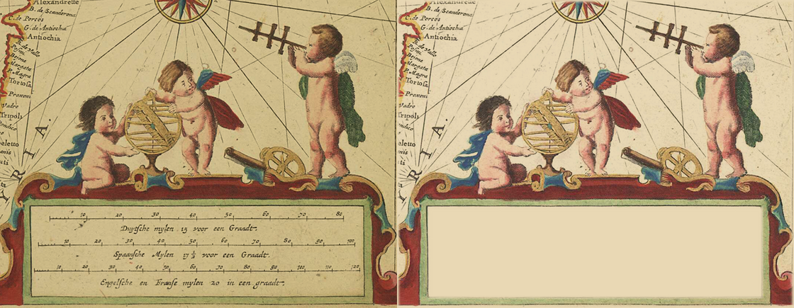

# The de Wit cartouche as a patch (#111)

`cartouche-dewit` of the `scanned` pack, re-keyed from ink coverage to a patch. The scan is
[Angel_cartouche_on_a_Mediterranean_map_by_de_Wit.tiff](https://commons.wikimedia.org/wiki/File:Angel_cartouche_on_a_Mediterranean_map_by_de_Wit.tiff)
(Frederik de Wit, hand-coloured; 1,229 x 1,039, public domain); crop (150,200)-(1229,1039).

`steps.png`, left to right: the raw crop multiplied onto parchment at the width the map draws it (the cartouche itself is
354 px across with its surroundings; the old tight box keeps 340 px as `figure`), then the cut multiplied onto the same
parchment. `cartouche-dewit.raw.png`, `.key.png` and `.cut.png` are the three images behind it.

The whole crop is the sprite: its paper (`#e3dfc4`, the tablet's own) divided out so the renderer's multiply sinks it into the
parchment, its edge feathered outside the figure. The right and bottom edges are the scan's own edge.

Visual pass (`steps.png`): the three putti, the armillary sphere, the cannon, the sextant, the scrollwork with its gilt,
blue and red wash, the green tablet border, the rhumb lines, the wind rose at the top and the coast lettering at the left
(SYRIA, Antiochia and the rest, now left as surroundings) all survive. Absent from the cut, and why:

- the three scale bars and their Dutch, Spanish and English lettering inside the tablet: the renderer letters the map's title
  on the tablet (`panel`), and the scan's own lettering would show through under it; only the tablet's paper is cleared
  (236,764)-(1142,1010), so its green border stays;
- the scan's ageing stain across the paper: it is the paper colour, divided out by design.
