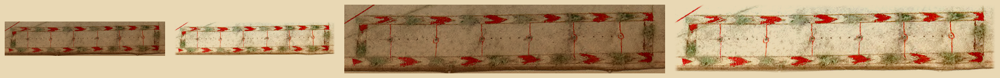

# The Genoese scale bar as a patch (#111)

`scale-genoese` of the `scanned` pack, re-keyed from ink coverage to a patch. The scan is
[Mediterranean_chart_fourteenth_century2.jpg](https://upload.wikimedia.org/wikipedia/commons/5/5c/Mediterranean_chart_fourteenth_century2.jpg)
(anonymous, probably Genoese, c. 1320-1350; Library of Congress 2003630429; 5,486 x 4,009, public domain); crop (3690,3797)-(4420,3955).

`steps.png`, left to right: the raw crop multiplied onto parchment at the width the map draws the bar (the bar itself is
260 px across; the crop reaches 18 px past it, so 274 px); the cut multiplied onto parchment at the same width; the raw
and the cut again at twice that. `scale-genoese.raw.png`, `.key.png` and `.cut.png` are the three images behind it.

It was cut by ink coverage (levels 8 to 50 %, minimum of R, G, B), which dropped the vellum between the rules, thinned the
green and red washes and left the bar as a loose set of marks. Now the whole crop is the sprite, its paper (`#a48c75`,
the chart's own vellum inside the bar) divided out so the renderer's multiply sinks it into the parchment.

**Edge: the crop is the outline.** The old box ran along the bar's border; the new one stands 15 to 20 px outside it,
so the 6 px edge fade falls on bare vellum and the bar's border and corner arrowheads stay whole. Nothing is erased
and there is no lettering on the bar. Neighbouring features that fall in the margin (a rhumb line entering at the top
left, the chart's edge below) come with it as surroundings.

Visual pass (`steps.png`): the two arrow rails, the green wash between them, the four red division lines and their
rings, the dotted ruler and the border all survive. Absent from the cut, and why:

- the chart's grey-brown ageing stain across the vellum: it is the paper colour, divided out by design;
- nothing else: no ink in the raw is missing from the sprite.

The scene draws the scale from the `vivid` pack's `scale-genoese`, not this one, so no golden image moves.
