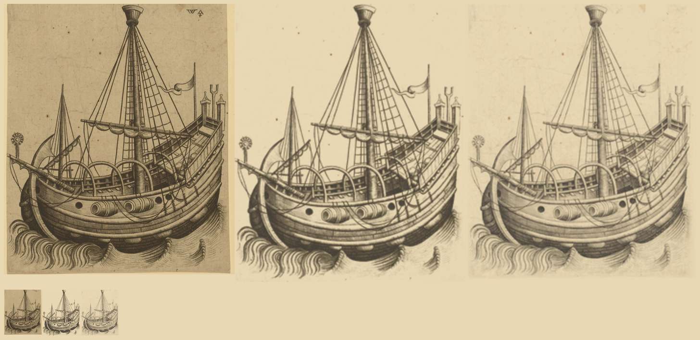

# Master W's herring buss, `ship-w-buss`: ink kept (#111)

`ship-w-buss` of the `scanned` pack. The scan is Master W's engraving of a herring buss
([Rijksmuseum RP-P-2014-30](https://www.rijksmuseum.nl/en/collection/RP-P-2014-30), 1830 px wide); crop (60,140)-(1780,2160).

`steps.png`: left to right, the raw crop, the ink sprite (the one shipped) and the patch candidate, each multiplied
onto parchment; the top row is 6x, the bottom row the width the map draws them (80 px).
`ship-w-buss.raw.png` and `.key.png` (both shrunk to 700 px wide), with `.cut.png`, are the images behind the ink sprite; `.patch.cut.png` is the candidate
(`key: 'patch'`, paper `#d6cdbc` measured from the open sky, a feathered inset mask on the plate edge).

**Call: keep `ink`.** The plate is ink alone on paper, and the visual pass found nothing the ink key loses that is
worth keeping. The patch candidate comes out paler and greyer at map size, and the plate's uneven paper tone and foxing
show as a faint rectangle round the ship on parchment.

**Water.** The ink sprite's crop already reaches the plate's foot, so the waves under and beside the hull are kept; no
widening is needed.

Absent from the sprite, and why:

- the paper's mottled tone, foxing and the plate's pale margin: surround, and ink alone is what is wanted here.
- the WA monogram at the top right: the engraver's mark, not the ship's; an erase box cuts it.
- the faintest hatching in the water at the lower right: it reads as grey noise at 80 px, where the keyed waves carry the sea.
