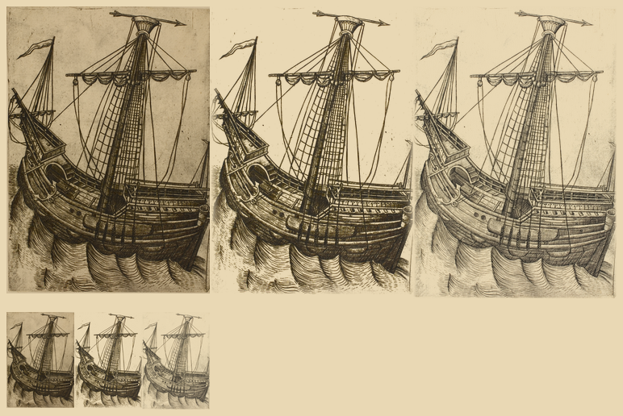

# Master W's ship, `ship-w-key`: ink kept, the waves widened (#111)

`ship-w-key` of the `scanned` pack. The scan is Master W's engraving of a ship
([Art Institute of Chicago 27881](https://www.artic.edu/artworks/27881), 2139 px wide); crop (10,20)-(2110,2990).

`steps.png`: left to right, the raw crop, the ink sprite (the one shipped) and the patch candidate, each multiplied
onto parchment; the top row is 3x, the bottom row the width the map draws them (84 px).
`ship-w-key.raw.png` and `.key.png` (both shrunk to 700 px wide), with `.cut.png`, are the images behind the ink sprite; `.patch.cut.png` is the candidate.

**Call: keep `ink`** (undo: `key: 'patch', paper: '#d2c9bb'` on the sprite, with no `level`, `bolden` or `dark`). The plate
is ink alone on paper, and the visual pass found nothing the ink key loses that is worth keeping. The patch candidate
(paper `#d2c9bb`, measured from the open sky, the whole crop feathered) makes the sprite worse: the engraved lines come
out lighter and greyer at map size, and the plate's uneven paper tone shows as a faint rectangle round the ship on parchment.

**Edge.** The old mask cut the foot of the crop on a diagonal, so the waves round the hull faded away on the left. Those
waves are the ship's water, so the mask is now an inset rectangle (feather 40 px) that trims only the plate mark at the
crop's edge; the waves reach the foot of the sprite.

Absent from the sprite, and why:

- the paper's mottled tone and foxing across the sky: surround, and ink alone is what is wanted here.
- the plate mark and the grey stain at the crop's left edge: not the ship's; the inset mask cuts them.
