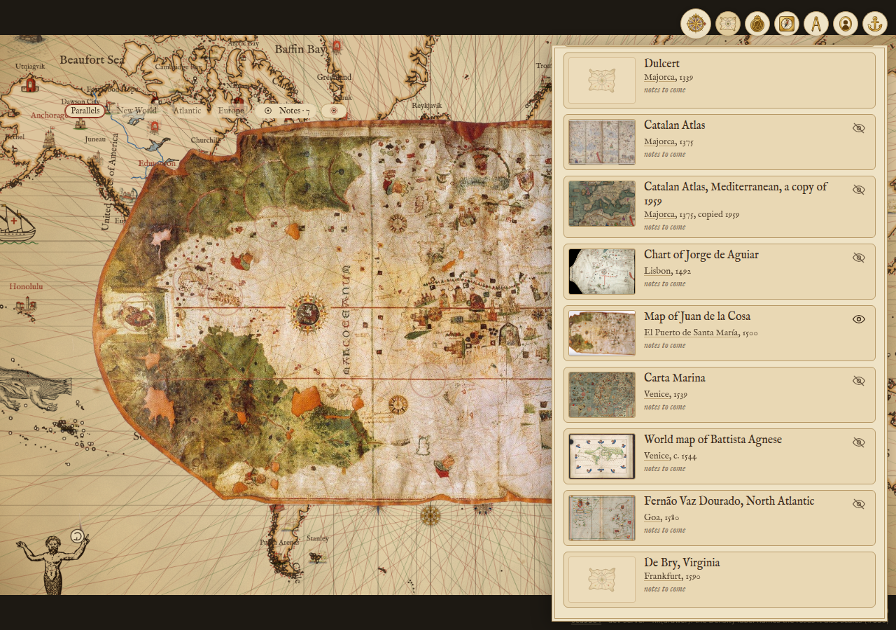
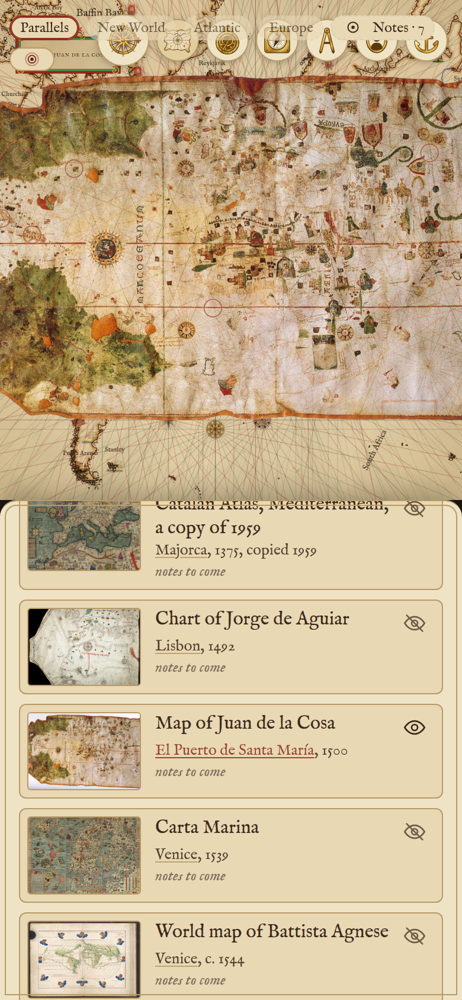
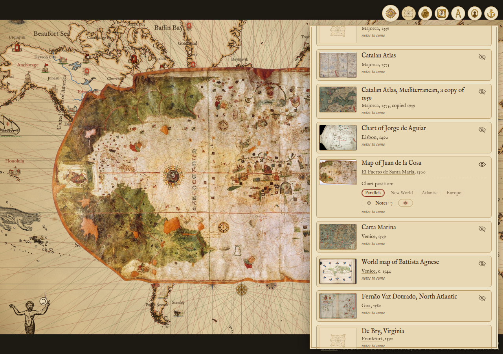
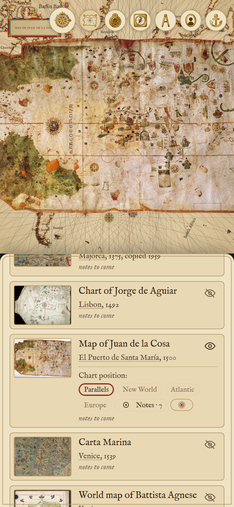
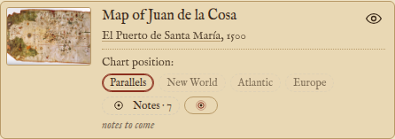
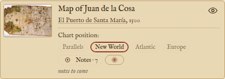

# Mockup: a chart's position chips in its own row

Not for merge. Renders for the user's pick of `docs/spec/design.md`, "A chart's position chips, and the line each was
fitted to" (where the chips live; a phone) and "the user asks for the notes back" (the Notes chip beside them).

`public/mockup-chart-position.mjs`, loaded only under `?mock=row`, moves the live chip cluster off the map into the
shown chart's row in the Charts drawer, under the city and year, after a "Chart position:" line. It moves the live
element, so every chip still works and still lights where the sheet lies; nothing else on the page changes.

| | Wide screen, 1280 px | Phone, 390 px |
|---|---|---|
| Today: the chips float over the sheet's top left corner |  |  |
| Mockup: the chips in the chart's row |  |  |

The row alone, before and after a click on "New World": the lit chip moves, the chips and the drawer stay.

| Parallels lit | New World clicked |
|---|---|
|  |  |

Not shown: the line each chip draws over the sheet (the second scenario); it is unbuilt and needs no layout pick.

Re-render, with `npm run dev -- --port 10398` serving:
`CHROME=~/.cache/ms-playwright/chromium-1243/chrome-linux64/chrome node docs/mockups/chart-position/shoot.mjs docs/mockups/chart-position 10398`
