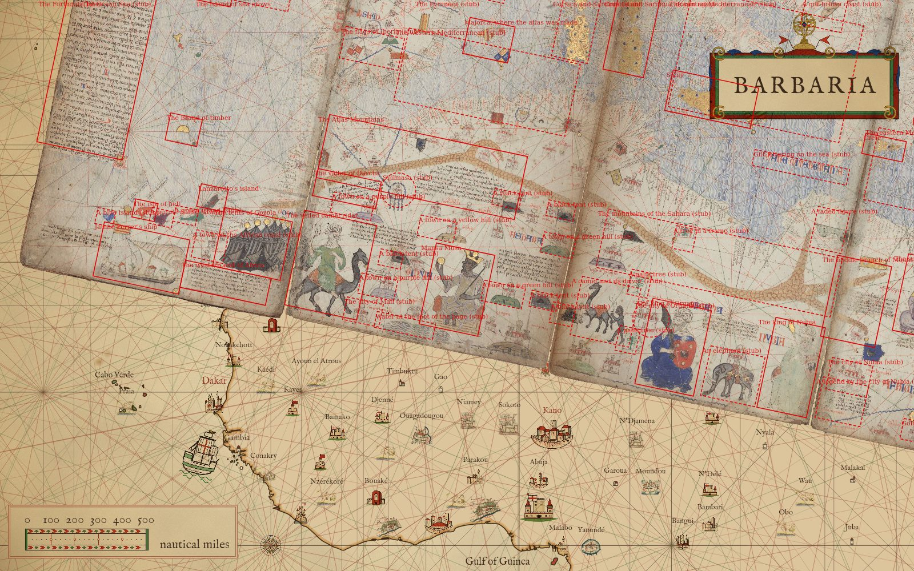
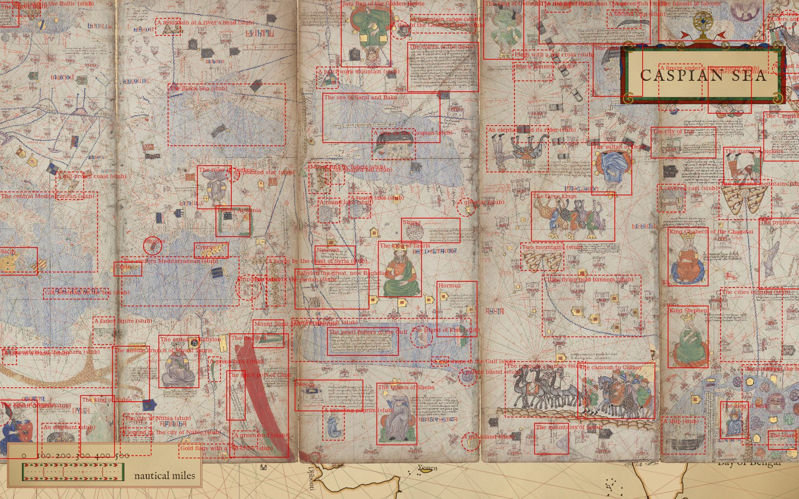
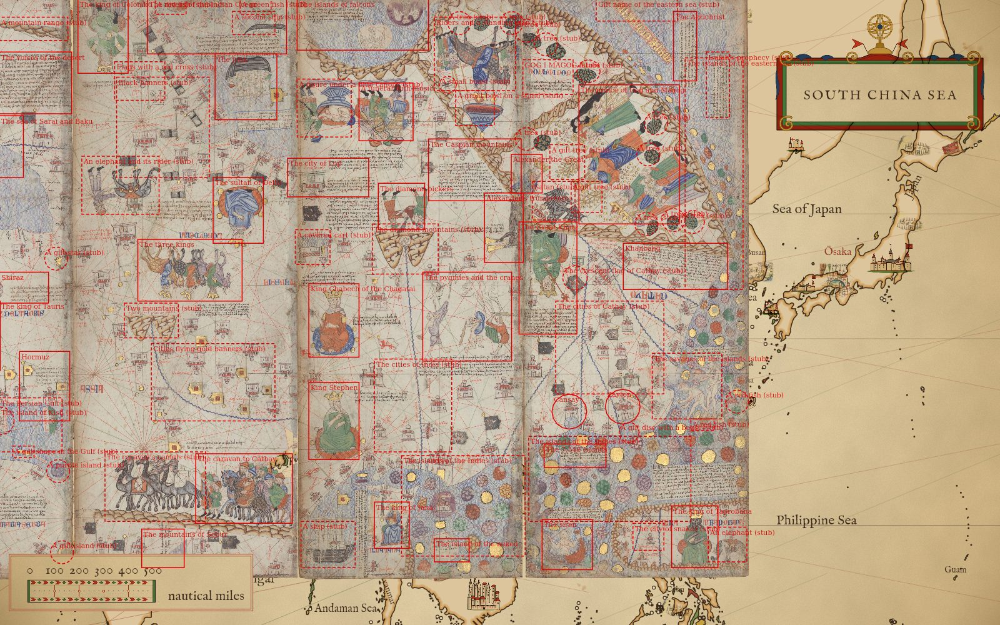
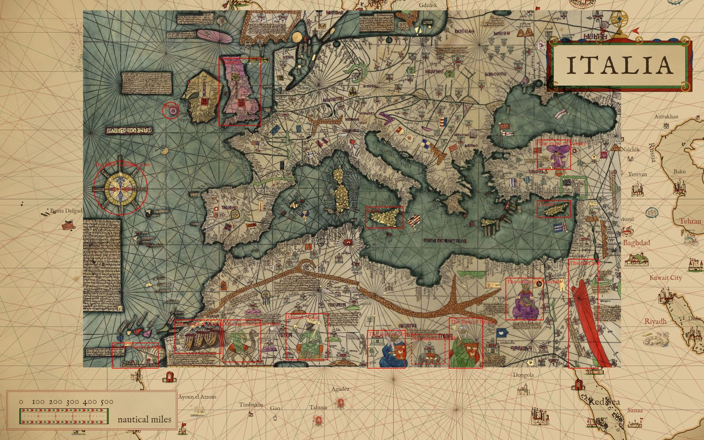

# Notes on the laid charts

A note is a point of interest on a chart laid over the map: a click or tap on its figure opens a tile with what
the maker drew, what was really there, and a source. Nothing is lettered beside the figure. The notes live in
`scripts/notes.mjs` (`NOTE_SETS`, one list per overlay id).

## A note's figure is its hit box

Each note has a `size`: the figure's whole box in the scan's px, `[w, h]` round its `at.px`, or a radius. A set
gives a default for notes without one. The box rides on the sheet wherever it lies, dragged, turned or resized,
and on the warped pieces through the piece that holds the figure (`noteMarks`). A click or tap anywhere inside
it opens the note. Where boxes nest, the smallest wins, so a figure inside a sea opens the figure and the rest of
the sea opens the sea. A small drawn mark (a voyage's event, a sight) within reach of the click still wins
over a box (`pickMark`). A press inside a box that moves past the tap slop drags the sheet, as before.

The rule (the user's, for every chart): the inner map should be mostly clickable, and anything that could be a
note is one. A note with no copy yet is a stub: its title alone, `drawn` and `real` empty, and the tile shows the
title. Stubs are taken out only on a later walk of the map.

Each Catalan note also records `up`: which way its figure reads on the scan, in degrees clockwise from the
sheet's top, 0 upright and 180 upside down. The far east of the atlas is mostly drawn upside down. Nothing turns
the view to a figure yet; `up` is recorded for that.

## The Catalan Atlas, 1375

Every large figure on BnF sheets 5 to 12 is a note: the rulers (Mansa Musa, the king of Organa, the king of
Nubia, the sultan of Babylon, the ruler of Turkey, Jani Beg, the king of Tauris, the Queen of Sheba, the king of
Colombo, the sultan of Delhi, King Chabech, King Stephen, the king of Jana, the Great Khan, the prince of Gog and
Magog, the king of Taprobana), the Magi, the caravan to Cathay, the veiled camel rider, the elephants, the
junks and the divers, the pygmies, Alexander, Satan and the trumpeters, the siren, the compass rose, the trees,
tents, hill towns, islands, ranges and seas. Legends are quoted from the Cresques Project's English translation,
cited by number. Each `px` was read by eye on gridded crops of the Commons scans, about ±100 px, in the page's
own px; `page(n, x, y)` adds the page's offset in the open atlas (`CATALAN_PAGE_X`, checked against
overlays.json in test/notes.test.mjs).

The 1959 copy of the atlas's Mediterranean has 15 notes on the figures it shows legibly, each taking its words
from the same figure's note in the atlas.

Each picture is `npm run render -- --view lon,lat,zoom --overlay <id> --sheet <the page's snap> --notes`: the
sheet laid at that page's snap, each note's hit box in red with its title, a stub's box dashed and marked.

Sheets 5 to 8, the Mali page in the middle: Mansa Musa, the camel rider, the king of Organa, the elephant, the
king of Nubia.

Sheets 8 to 11, the Persia page in the middle: Jani Beg, the king of Tauris, the Queen of Sheba, the Magi, the
sultan of Delhi, the caravan.

Sheets 10 to 12: King Chabech, King Stephen, the pygmies, Gog and Magog, the Great Khan, Taprobana.

The 1959 copy, laid at its own placement.

## What is rough

- Places are read by eye, about ±100 px; boxes are generous rather than tight.
- `up` for Gog and Magog, Alexander and the two eastern-sea legends is read off slanting work.
- Some stubs are named by what they look like, not what they are ("A patchwork mountain", "A fan-shaped hill",
  "A great bowl on a stand", "A faded figure").
- The king of Nubia is read as the figure beside "NUBIA" on sheet 7; the legend of Nubia (V.14) sits on sheet 8.
- No scale bar was found on the eight pages, so none is a note.

### Sheet 5: 19 notes, 12 with copy

| note | page px | box | up | copy |
|---|---|---|---|---|
| The wonders of Ireland | 3400, 3600 | 2200 × 800 | 180 | yes |
| Stillanda | 5300, 1550 | 900 × 600 | 0 | yes |
| Brasil | 4240, 4780 | r 260 | 0 | yes |
| The island of sea crows | 3253, 8908 | 800 × 500 | 0 | yes |
| The island of timber | 3220, 11980 | 700 × 600 | 0 | yes |
| The Fortunate Isles | 1100, 11000 | 1900 × 3800 | 180 | yes |
| The isle of hell | 2760, 13870 | 500 × 400 | 0 | yes |
| Lanzarotto's island | 4140, 13300 | 600 × 500 | 0 | yes |
| Jaume Ferrer's ship | 2900, 14900 | 1900 × 1200 | 0 | yes |
| The western end of Africa | 4800, 15050 | 1900 × 600 | 0 | yes |
| The tents of Gozola | 5200, 14100 | 1500 × 1300 | 0 | yes |
| The first compass rose | 2000, 8000 | r 760 | 0 | yes |
| Gilt lettering in the Atlantic | 2400, 5600 | 2000 × 320 | 180 | no |
| A flag in Ireland | 5550, 4250 | r 260 | 0 | no |
| A purple island | 3150, 13950 | 500 × 350 | 0 | no |
| A green island | 3650, 13800 | 500 × 350 | 0 | no |
| A blue island | 1950, 14200 | 400 × 350 | 0 | no |
| A town on the African coast | 4300, 14350 | 700 × 600 | 0 | no |
| The Ocean Sea | 2600, 6500 | 4600 × 5000 | 0 | no |

### Sheet 6: 28 notes, 7 with copy

| note | page px | box | up | copy |
|---|---|---|---|---|
| Mansa Musa | 3900, 14150 | 1300 × 1800 | 0 | yes |
| The veiled camel rider | 1100, 14200 | 1600 × 2100 | 0 | yes |
| The Atlas Mountains | 2600, 11700 | 4400 × 1400 | 0 | yes |
| The valley of Darcha | 1100, 12500 | 1400 × 600 | 0 | yes |
| Norway | 2100, 1200 | 3000 × 1600 | 180 | yes |
| England | 1000, 3800 | 1700 × 3000 | 0 | yes |
| Majorca, where the atlas was made | 3450, 8700 | 1000 × 800 | 0 | yes |
| Sijilmasa | 2200, 12300 | r 380 | 0 | no |
| The city of Mali | 2000, 15050 | 800 × 500 | 0 | no |
| A black tent | 2350, 13800 | 500 × 350 | 0 | no |
| A black tent | 4550, 12000 | 600 × 350 | 0 | no |
| A black tent | 5750, 12000 | 600 × 350 | 0 | no |
| A black tent | 5800, 14000 | 600 × 350 | 0 | no |
| A town on a purple hill | 1300, 12850 | 900 × 450 | 0 | no |
| A town on a yellow hill | 3200, 12950 | 800 × 450 | 0 | no |
| A town on a green hill | 4900, 14050 | 900 × 450 | 0 | no |
| A town on a green hill | 5850, 12750 | 700 × 450 | 0 | no |
| A town on a purple hill | 2200, 14450 | 800 × 450 | 0 | no |
| Water at the foot of the page | 2950, 15150 | 1300 × 350 | 0 | no |
| A gilt round island | 3400, 1700 | r 320 | 0 | no |
| A green disc by Scotland | 1000, 2500 | r 260 | 0 | no |
| A flag over Flanders | 2450, 3300 | r 280 | 0 | no |
| The flags of France | 2900, 5350 | 1300 × 450 | 0 | no |
| The Alps | 4400, 5300 | 1900 × 1100 | 0 | no |
| The Pyrenees | 2600, 7600 | 2000 × 500 | 0 | no |
| Corsica and Sardinia | 5250, 7800 | 800 × 1900 | 0 | no |
| The flags of Iberia | 1000, 9400 | 1300 × 700 | 0 | no |
| The western Mediterranean | 3600, 9600 | 3800 × 1600 | 0 | no |

### Sheet 7: 19 notes, 6 with copy

| note | page px | box | up | copy |
|---|---|---|---|---|
| The king of Organa | 2900, 14400 | 1300 × 1900 | 0 | yes |
| The king of Nubia | 5500, 14300 | 1100 × 2000 | 0 | yes |
| The frozen Baltic | 1600, 950 | 2700 × 800 | 180 | yes |
| Bohemia's ring of hills | 1300, 2800 | 1300 × 1300 | 0 | yes |
| Sicily | 2600, 8950 | 1900 × 900 | 0 | yes |
| Corsica and Sardinia, drawn again | 600, 7800 | 900 × 2000 | 0 | yes |
| An elephant | 4300, 14750 | 1200 × 1100 | 0 | no |
| A camel and its driver | 1300, 13950 | 1300 × 1300 | 0 | no |
| A palm tree | 1900, 13200 | 450 × 550 | 0 | no |
| A palm tree | 1900, 14450 | 450 × 550 | 0 | no |
| A tree in a frame | 2650, 12050 | 450 × 500 | 0 | no |
| The mountains of the Sahara | 3500, 12400 | 5200 × 1300 | 0 | no |
| The city of Organa | 2300, 13900 | r 400 | 0 | no |
| A black tent | 400, 14200 | 500 × 450 | 0 | no |
| A faded figure | 5700, 11200 | 700 × 900 | 0 | no |
| An island in the Baltic | 3200, 650 | 900 × 700 | 0 | no |
| A gilt-brown coast | 4600, 6500 | 900 × 900 | 0 | no |
| Gilt lettering on the sea | 4800, 10000 | 2100 × 350 | 0 | no |
| The central Mediterranean | 3600, 8000 | 3800 × 2600 | 0 | no |

### Sheet 8: 22 notes, 10 with copy

| note | page px | box | up | copy |
|---|---|---|---|---|
| The sultan of Babylon | 2350, 12200 | 1300 × 1700 | 0 | yes |
| The Red Sea | 4950, 13300 | 1900 × 4000 | 0 | yes |
| Mount Sinai and St Catherine | 5250, 11300 | 1000 × 900 | 0 | yes |
| The spice port of Chos | 4200, 13300 | 600 × 1600 | 0 | yes |
| The middle branch of Mount Tauris | 800, 12600 | 1200 × 1800 | 0 | yes |
| The ruler of Turkey | 3500, 6550 | 1100 × 1400 | 180 | yes |
| Lesser Armenia | 4100, 7650 | 1100 × 1000 | 0 | yes |
| Cyprus | 3400, 8600 | 1100 × 500 | 0 | yes |
| Rhodes | 1500, 8450 | r 300 | 0 | yes |
| Crete | 700, 9200 | 900 × 450 | 0 | yes |
| The city of Nubia | 1000, 14250 | 900 × 700 | 0 | no |
| A legend by the city of Nubia | 950, 14800 | 1000 × 900 | 0 | no |
| A green bird | 3500, 12450 | 400 × 800 | 0 | no |
| A green bird | 4500, 14700 | 800 × 500 | 0 | no |
| Gold flags with a red cross | 3250, 15100 | 1800 × 450 | 0 | no |
| Jerusalem | 4600, 9800 | r 420 | 0 | no |
| The lakes of the Jordan | 4950, 9950 | 450 × 1100 | 0 | no |
| A range by the coast of Syria | 5500, 9600 | 600 × 1600 | 0 | no |
| A mountain at a river's head | 2000, 1350 | 800 × 550 | 0 | no |
| A six-pointed star | 4100, 6150 | r 220 | 0 | no |
| The Black Sea | 3900, 4200 | 3800 × 2000 | 0 | no |
| The eastern Mediterranean | 2400, 9600 | 3800 × 1600 | 0 | no |

### Sheet 9: 26 notes, 11 with copy

| note | page px | box | up | copy |
|---|---|---|---|---|
| Jani Beg of the Golden Horde | 2500, 1450 | 1600 × 2400 | 180 | yes |
| The voices of the desert | 5000, 2650 | 2300 × 1600 | 180 | yes |
| The sea of Sarai and Baku | 3000, 4300 | 3800 × 1600 | 180 | yes |
| The king of Tauris | 3600, 9200 | 1400 × 1800 | 0 | yes |
| Shiraz | 4600, 7950 | 1900 × 800 | 0 | yes |
| Nineveh | 1500, 8750 | 1300 × 600 | 0 | yes |
| Babylon the great, now Baghdad | 1400, 9850 | 2400 × 1300 | 0 | yes |
| The pearl fishers of the Gulf | 2400, 11550 | 2300 × 900 | 0 | yes |
| Hormuz | 5450, 10500 | 1300 × 1800 | 0 | yes |
| The Queen of Sheba | 3500, 13900 | 1300 × 2000 | 0 | yes |
| Mecca | 1300, 13300 | 2200 × 1000 | 0 | yes |
| A kneeling pilgrim | 1450, 14200 | 700 × 1100 | 0 | drawn only |
| A ship on the Caspian | 3400, 5150 | 1400 × 1000 | 180 | drawn only |
| A patchwork mountain | 1250, 3000 | 700 × 700 | 0 | no |
| A flag of the Golden Horde | 3600, 1450 | r 300 | 180 | no |
| A mountain range | 5000, 1250 | 2100 × 600 | 180 | no |
| A round lake | 1300, 7300 | 700 × 800 | 0 | no |
| A round lake | 2300, 7150 | 700 × 800 | 0 | no |
| A fan-shaped hill | 1500, 6150 | 600 × 600 | 0 | no |
| Mountains by Tabriz | 1000, 6250 | 700 × 1000 | 0 | no |
| The island of Kish | 4300, 11400 | r 360 | 0 | no |
| A gilt shape in the Gulf | 4900, 12200 | 550 × 300 | 0 | no |
| A gilt star | 5750, 7200 | r 300 | 0 | no |
| A purple island | 5800, 12700 | r 300 | 0 | no |
| A gilt island | 5900, 14800 | r 300 | 0 | no |
| The Persian Gulf | 3000, 11500 | 5800 × 1400 | 0 | no |

### Sheet 10: 16 notes, 7 with copy

| note | page px | box | up | copy |
|---|---|---|---|---|
| The king of Colombo | 1050, 1350 | 1300 × 2100 | 180 | yes |
| The junk | 4750, 2750 | 1600 × 1700 | 180 | yes |
| The divers of the Indian Ocean | 4000, 1150 | 3600 × 1500 | 180 | yes |
| The sultan of Delhi | 4550, 5950 | 1300 × 1700 | 180 | yes |
| The three kings | 3300, 7500 | 2700 × 1600 | 180 | yes |
| The caravan to Cathay | 4700, 13150 | 2500 × 1800 | 0 | yes |
| The mountains of Sebur | 2600, 14700 | 1100 × 1000 | 0 | yes |
| The caravan's camels | 2400, 13100 | 2600 × 1800 | 0 | drawn only |
| An elephant and its rider | 1500, 5300 | 2000 × 1500 | 180 | drawn only |
| A second ship | 4950, 1100 | 1100 × 600 | 180 | no |
| A red fish | 2800, 650 | 800 × 450 | 180 | no |
| A green fish | 5000, 650 | 800 × 450 | 180 | no |
| Flags with a red cross | 2000, 2600 | 1300 × 1000 | 180 | no |
| Two mountains | 2300, 8800 | 1400 × 900 | 180 | no |
| Black banners | 2600, 3800 | 2400 × 2600 | 180 | no |
| Cities flying gold banners | 3900, 10400 | 3200 × 2000 | 0 | no |

### Sheet 11: 22 notes, 11 with copy

| note | page px | box | up | copy |
|---|---|---|---|---|
| The islands of falcons | 2000, 1000 | 3400 × 1600 | 180 | yes |
| A funeral with music | 2600, 3400 | 1400 × 1500 | 180 | yes |
| The diamond pickers | 3000, 5850 | 1200 × 1200 | 180 | yes |
| Alexander's trumpeters | 5650, 6400 | 1000 × 1800 | 180 | yes |
| The Caspian mountains | 4900, 4900 | 2400 × 1600 | 180 | yes |
| The city of Lop | 1100, 5100 | 2100 × 1000 | 180 | yes |
| King Chabech of the Chagatai | 1250, 8800 | 1300 × 1900 | 0 | yes |
| King Stephen | 1250, 11400 | 1300 × 2000 | 0 | yes |
| The pygmies and the cranes | 4700, 8700 | 2300 × 2300 | 0 | yes |
| The king of Jana | 2750, 14100 | 900 × 1200 | 0 | yes |
| The island of the naked | 4300, 14750 | 900 × 600 | 0 | yes |
| A figure under a blue canopy | 1000, 3300 | 1400 × 1500 | 180 | no |
| The diamond mountains | 3100, 6950 | 1700 × 1300 | 180 | no |
| Riders and a standing man | 4900, 1900 | 2100 × 1900 | 180 | drawn only |
| A great bowl on a stand | 4900, 3300 | 1000 × 900 | 180 | no |
| A tree | 4500, 1100 | r 300 | 0 | no |
| A tree | 5850, 1100 | r 300 | 0 | no |
| A small beast | 4200, 2700 | r 220 | 180 | no |
| A covered cart | 700, 6900 | 900 × 900 | 180 | no |
| A ship | 1100, 14600 | 1400 × 1200 | 0 | no |
| The islands of the Indies | 4600, 13600 | 3200 × 2600 | 0 | no |
| The cities of India | 3300, 11000 | 2000 × 2400 | 0 | no |

### Sheet 12: 35 notes, 10 with copy

| note | page px | box | up | copy |
|---|---|---|---|---|
| The prince of Gog and Magog | 3100, 4500 | 2600 × 3600 | 225 | yes |
| Alexander the Great | 450, 5000 | 800 × 1000 | 270 | yes |
| The Great Khan | 1000, 7700 | 1500 × 2900 | 180 | yes |
| Khanbaliq | 4300, 7400 | 2700 × 1200 | 0 | yes |
| The Antichrist | 4550, 1700 | 600 × 1800 | 90 | yes |
| The 7,548 islands | 1700, 12300 | 1600 × 600 | 0 | yes |
| The siren | 1500, 14600 | 1300 × 1300 | 0 | yes |
| The king of Taprobana | 4800, 14400 | 1200 × 1600 | 0 | yes |
| Zayton | 2935, 11032 | r 450 | 0 | yes |
| Cansay | 1554, 11161 | r 450 | 0 | yes |
| Isaiah's prophecy | 5400, 2700 | 600 × 1700 | 90 | drawn only |
| The savages of the islands | 4600, 10500 | 1800 × 1700 | 0 | drawn only |
| The city of snakes | 3600, 14400 | 800 × 700 | 0 | drawn only |
| Satan | 1150, 5700 | 1100 × 1000 | 0 | drawn only |
| The crescent flag of Cathay | 1700, 7700 | r 320 | 0 | no |
| An elephant | 5650, 14600 | 1000 × 900 | 0 | no |
| A gilt tree | 1500, 4700 | 900 × 900 | 225 | no |
| A gilt tree | 2000, 5600 | 800 × 800 | 225 | no |
| A tree | 450, 1300 | r 300 | 0 | no |
| A tree | 950, 1650 | r 300 | 0 | no |
| A tree | 2050, 2350 | r 300 | 0 | no |
| A tree | 450, 4100 | r 300 | 0 | no |
| A tree | 3800, 3700 | r 300 | 0 | no |
| A tree | 3600, 4500 | r 300 | 0 | no |
| A tree | 3550, 6300 | r 300 | 0 | no |
| A tree | 4250, 6200 | r 300 | 0 | no |
| A tree | 4750, 6250 | r 300 | 0 | no |
| A red fish | 5900, 10900 | r 300 | 0 | no |
| A red fish | 5000, 11500 | 600 × 300 | 0 | no |
| A gilt disc with a beast | 3100, 11700 | r 260 | 0 | no |
| GOG I MAGOG | 1000, 2500 | 1300 × 900 | 180 | no |
| Gilt name of the eastern sea | 3300, 700 | 2100 × 700 | 180 | no |
| The islands of the eastern sea | 5300, 5000 | 1500 × 6000 | 0 | no |
| The islands of the Indies | 2600, 12900 | 4200 × 2200 | 0 | no |
| The cities of Cathay | 2600, 9500 | 2800 × 2400 | 0 | no |

### The 1959 copy: 15 notes

| note | px | box | up |
|---|---|---|---|
| The first compass rose | 950, 4300 | r 650 | 0 |
| Brasil | 2150, 2450 | r 200 | 0 |
| Jaume Ferrer's ship | 1300, 8300 | 1100 × 600 | 0 |
| The tents of Gozola | 2800, 7850 | 1100 × 800 | 0 |
| The veiled camel rider | 3850, 7950 | 900 × 1000 | 0 |
| Mansa Musa | 5400, 7850 | 1000 × 1100 | 0 |
| The king of Organa | 7300, 8150 | 900 × 900 | 0 |
| An elephant | 8300, 8150 | 800 × 700 | 0 |
| The king of Nubia | 9200, 8000 | 800 × 1200 | 0 |
| The sultan of Babylon | 10600, 6950 | 900 × 1000 | 0 |
| The Red Sea | 12000, 7300 | 700 × 2600 | 0 |
| The ruler of Turkey | 11300, 3500 | 800 × 700 | 180 |
| England | 3800, 2000 | 1000 × 1600 | 0 |
| Sicily | 7250, 5000 | 900 × 500 | 0 |
| Cyprus | 11300, 4800 | 800 × 400 | 0 |
