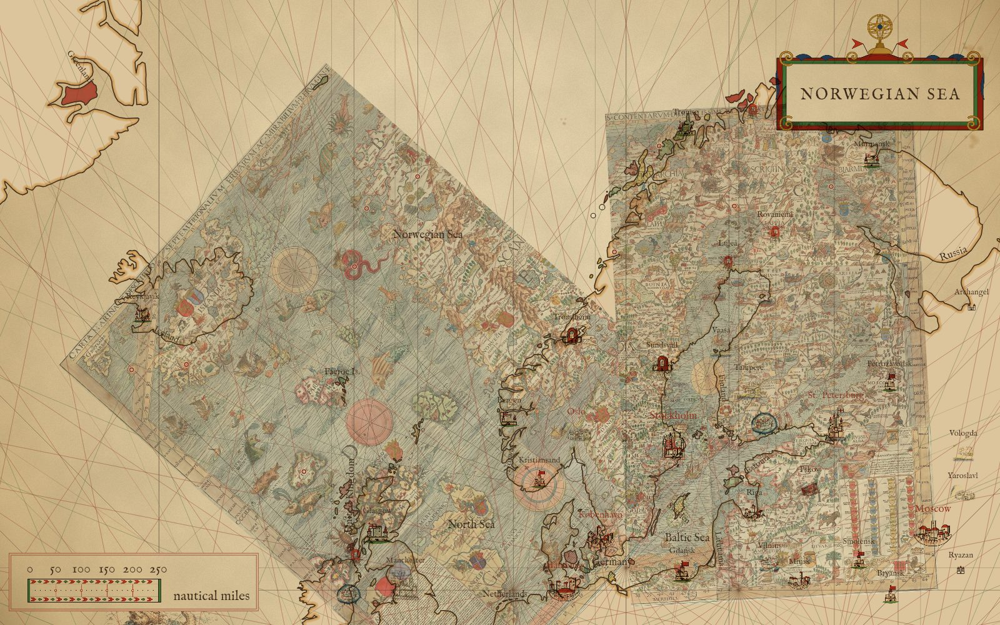
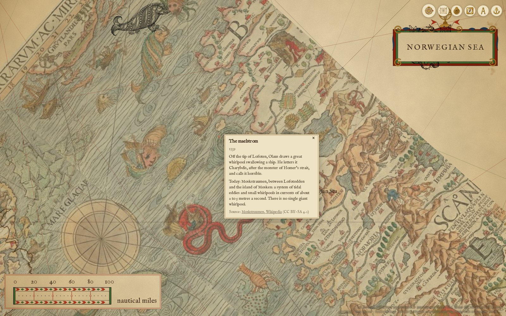

# Notes on a chart

A note is a short piece of history pinned to one figure of a chart's scan: what the maker drew there, and
what was really there. While the scan is laid over the map (docs/overlay/README.md), each note is a small
ring in the chart's red on its figure; nothing is lettered beside it. A click or tap on the ring opens the
page's tile: the note's title, its date, what the maker drew, a blank line, "Today: " and what was there,
and the source as a link with its licence.

Notes have no key of their own: they are on whenever the overlay is on (in pencil: a config default,
adjustable). A chart's notes are `data/notes/<overlay id>.json`; a chart without the file has none, and a
file that fails to load never stops the overlay or the map. The text ships before a human reads it
(docs/decisions.md, 2026-10-20); `checked` says how far each claim was confirmed, so the copy pass knows
what to re-check.



`npm run render -- --view 5,64.5,3.9 --overlay carta-marina:0.6 --out docs/notes/marks.jpg`



The page at `#map=5.60/67.300/-3.500&overlay=carta-marina`, the ring on the whirlpool clicked.

## The record

```json
{
  "id": "maelstrom",
  "title": "The maelstrom",
  "date": "1539",
  "drew": "Off the tip of Lofoten, Olaus draws a great whirlpool swallowing a ship. ...",
  "was": "Moskstraumen, between Lofotodden and the island of Mosken: ...",
  "source": { "title": "Moskstraumen, Wikipedia", "url": "https://en.wikipedia.org/wiki/Moskstraumen", "licence": "CC BY-SA 4.0" },
  "at": { "px": [2154, 852], "lonlat": [12.83, 67.80] },
  "checked": "web"
}
```

`drew` is two or three sentences, `was` one or two; no quotation is invented. `checked` is the research's:
**web** confirmed at the source given, **text** confirmed in the 1658 English *Historia*, **scan** read off
the chart's own lettering at low resolution (unverified wording), **mem** general knowledge not fetched.

## The two anchors

Every note carries both:

- **`at.px`**, the figure in the scan, in the full scan's pixels (5016 x 3715 for the Carta Marina), read
  by eye to about ±40 px. The ring is drawn here, taken through the fit of the overlay's piece that holds
  it, so it stays on the figure as drawn wherever the scan is warped, and moves with a better fit.
- **`at.lonlat`**, the real place, [lon, lat]; `null` for an island that is not there. It is kept in the
  data and **not drawn** in this first cut: with the overlay off no ring is drawn at all. A later change may
  draw it (a compare line from the figure to the truth, or a ring that works with the scan off).

The two lie far apart in the north, where the chart is most out: the far right column below is how far the
fit puts each figure from its real place (`scanPlace` against `at.lonlat`, measured 2026-10-21). That gap is
the chart's error plus the fit's (47 to 101 km RMS, docs/atlas/ornaments.md), and is the matter of a
compare note.

## The Carta Marina's ten

| id | title | scan px | real lon, lat | figure to real place | checked | source (licence) |
|---|---|---|---|---|---|---|
| maelstrom | The maelstrom | 2154, 852 | 12.83, 67.80 | 751 km | web | [Moskstraumen](https://en.wikipedia.org/wiki/Moskstraumen) (CC BY-SA 4.0) |
| sea-serpent | The sea serpent | 1810, 1050 | 5.32, 60.39 (Bergen, where the *Historia* puts it) | 836 km | web | [Public Domain Review](https://publicdomainreview.org/2014/02/05/olaus-magnuss-sea-serpent/) (CC BY-SA 4.0) |
| lofoten-stockfish | The Lofoten stockfish | 2540, 965 | 14.56, 68.23 (Vågan) | 645 km | text; web | [1658 *Compendious History*](https://distantreader.org/stacks/earlyprint/txt/B26436.txt) (public domain text) |
| hekla | Hekla | 575, 645 | -19.67, 63.99 | 146 km | web; text | [Hekla](https://en.wikipedia.org/wiki/Hekla) (CC BY-SA 4.0) |
| vardohus | Vardøhus | 3094, 267 | 31.09, 70.37 | 548 km | web | [Vardøhus Fortress](https://en.wikipedia.org/wiki/Vard%C3%B8hus_Fortress) (CC BY-SA 4.0) |
| tornio-birkarls | The Tornio market and the Birkarls | 3634, 749 | 24.15, 65.85 | 220 km | web; scan (label) | [Birkarls](https://en.wikipedia.org/wiki/Birkarls) (CC BY-SA 4.0) |
| glutton | The glutton | 2716, 1045 | 15.0, 67.0 (notional) | 90 km | web; text | [Wolverine](https://en.wikipedia.org/wiki/Wolverine) (CC BY-SA 4.0) |
| white-lake | The White Lake | 4369, 641 | 37.5, 65.5 | 452 km | web | [White Sea](https://en.wikipedia.org/wiki/White_Sea) (CC BY-SA 4.0) |
| tile | Tile | 562, 1708 | none: no such island | | web; scan | [Thule](https://en.wikipedia.org/wiki/Thule) (CC BY-SA 4.0) |
| hvitsark | Hvitsark | 305, 395 | none: no such island | | web; text | [sv: Carta marina](https://sv.wikipedia.org/wiki/Carta_marina) (CC BY-SA 4.0) |

The Tornio note sits on the market by Tornio (3634, 749), not on the Birkarls' houses (2465, 825): the
houses fall in the west piece, whose fit puts them some 1,200 km from Tornio. Iceland's misplacement, a
compare note of its own in the research, waits for the lonlat anchor to be drawn.

## Checks

`test/notes.test.mjs`, offline and in milliseconds: the file parses and every record has its fields; every
px lies inside the scan; every real place lies inside the chart's extent (the box round the scan's corners
through their fits) or is null, and only Tile and Hvitsark are null; each ring lands within 60 km of its
figure through the fit, its real place within 1,300 km of that figure (a catch for a swapped or mistyped
anchor, not a measure of the chart); no overlay, no rings; `loadOverlay` brings the notes, and none when the
file is missing.
