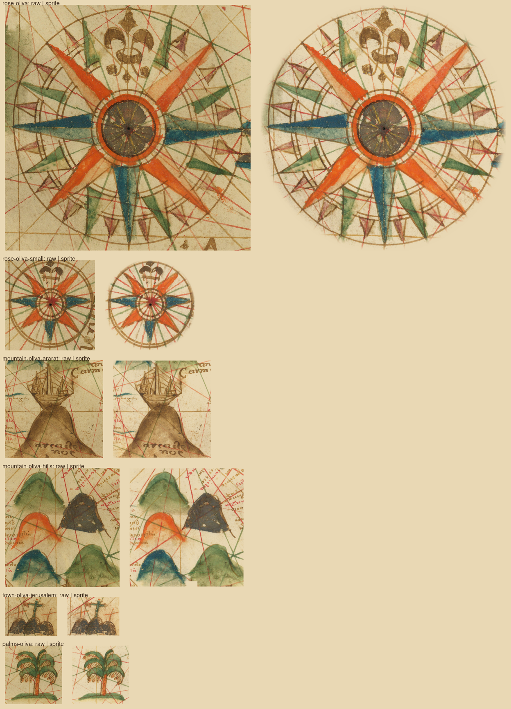

# The Oliva family chart's roses, mountains, Jerusalem and palm as patches

Six sprites of the `scanned` pack, style `oliva`, cut from
[17th-century_Portolan_chart_of_the_Mediterranean_Sea_by_a_member_of_the_Oliva_family.jpg](https://commons.wikimedia.org/wiki/File:17th-century_Portolan_chart_of_the_Mediterranean_Sea_by_a_member_of_the_Oliva_family.jpg)
(a member of the Oliva family, 1621–1665, hand-painted on vellum; scan by Barry Lawrence Ruderman Antique Maps, PD-Art;
17,316 × 11,126; source id `oliva-chart`). Every sprite is a patch: the whole crop, its edge feathered, the vellum
(`OLIVA_PAPER`, `#ddd7bf`, the mean of the 80th to 90th percentile of the big rose's pixels by brightness) divided out,
so the renderer's multiply sinks it into the parchment. No levels: the washes keep their tone.

`steps.png`: the raw crop on the left, the sprite on the right, both multiplied onto parchment at twice the width the map
draws them. `<id>.key.png` is the alpha key (white kept), shrunk to 800 px; `npm run packs -- --only scanned --keep <dir> <id>`
writes the full-size raw, key and cut.

The chart draws the Levant and Caucasus figures and the Barbary palm on their sides, base to the east; those four cuts are
turned a quarter clockwise (`turn: 90`) so they stand upright.

| Sprite | Kind | Crop (scan px) | Edge | Absent from the sprite, and why |
|---|---|---|---|---|
| `rose-oliva` | rose | (2750,7997)-(5150,10397) | circle r 1170, 20 px feather, just outside the outer ring | rhumb lines and the green hill outside the ring: surround. A sliver of the scale cartouche's blue wave sits inside the circle at the east tip, kept: trimming it would cut the tip. |
| `rose-oliva-small` | rose | (2484,3238)-(3284,4038) | circle r 392, 8 px feather | the rest of the coast name "Valentia" outside the ring: surround; the part inside stays as drawn. |
| `mountain-oliva-ararat` | mountain | (13620,2600)-(15160,4150), turned 90 | crop edge only | the "A" of "ASIA" and the hills west of the Ark: neighbours, outside the crop. "arca de noe", "Caum" and the rivers stay. |
| `mountain-oliva-hills` | mountain | (12360,2850)-(13760,4200), turned 90 | crop edge, one erase box | the Ark's prow (13690,3400)-(13760,3530): the next sprite's figure, erased; it leaves a small notch at the foot. Place-name lettering stays. |
| `town-oliva-jerusalem` | town | (15330,6430)-(16170,7560), turned 90 | crop edge only | the "Jerusalem" lettering: outside the crop. The orange crosses beside the city stay. |
| `palms-oliva` | tree | (4060,6930)-(5150,8000), turned 90 | crop edge only | nothing; the strip of ground and the rhumb lines stay. |

Not cut: the second big rose (top left) and the third (bottom right) repeat `rose-oliva`'s design, and the top-left one
is clipped by the scale bar; the scale-bar cartouche (bottom centre) has no blank panel for the map's title, and scale
bars are drawn in code; the tower-and-cross figures at Saida and Damascus are worn to blue blots.
