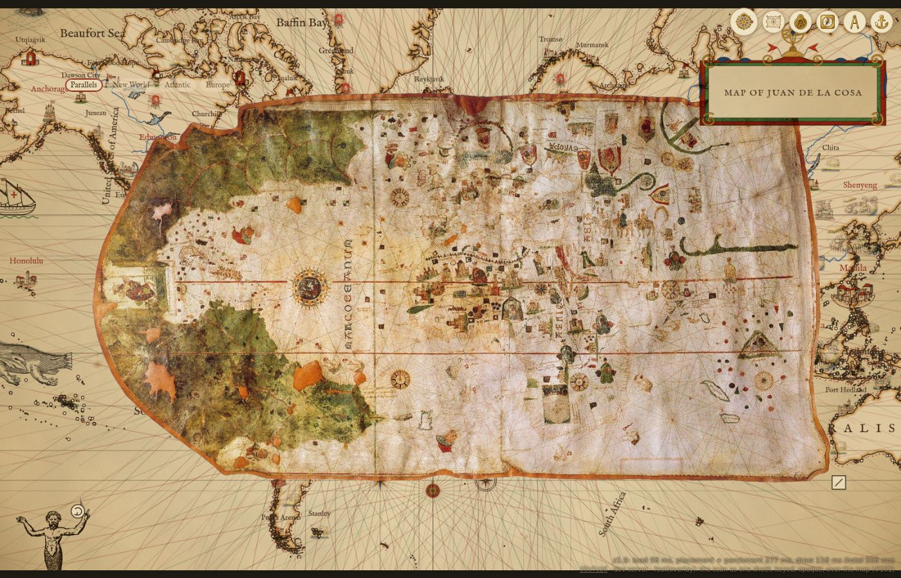
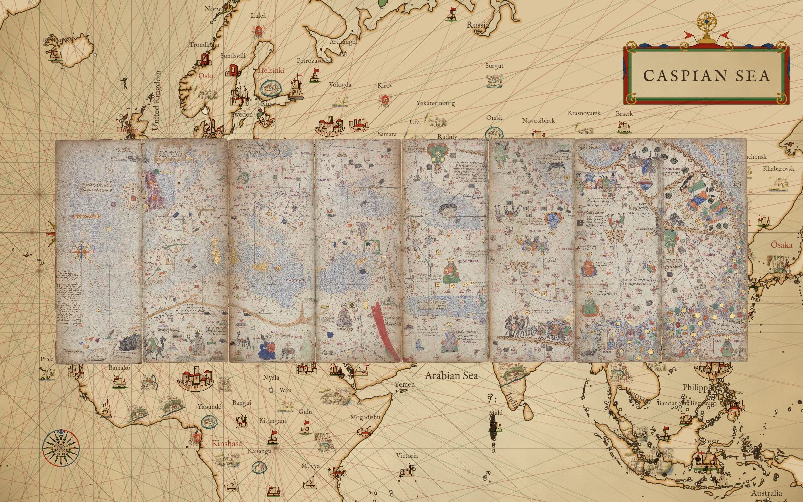
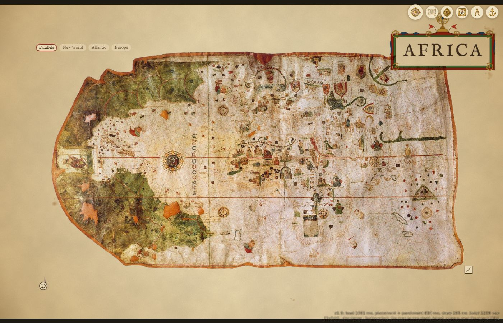
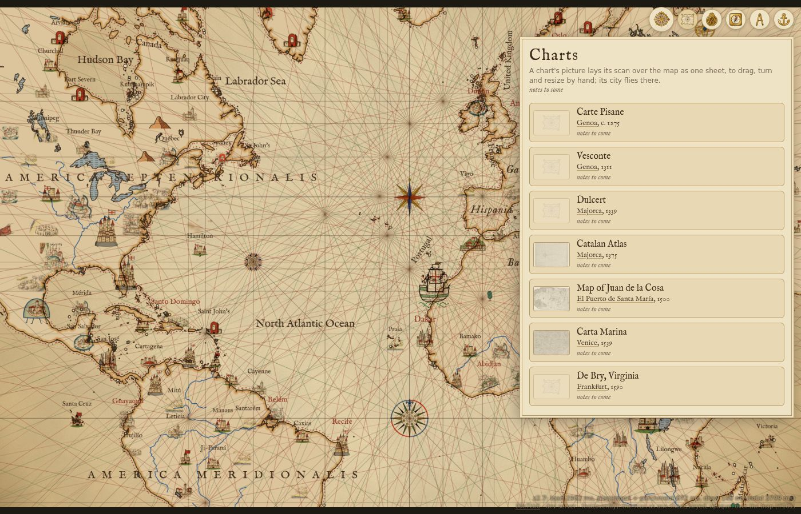
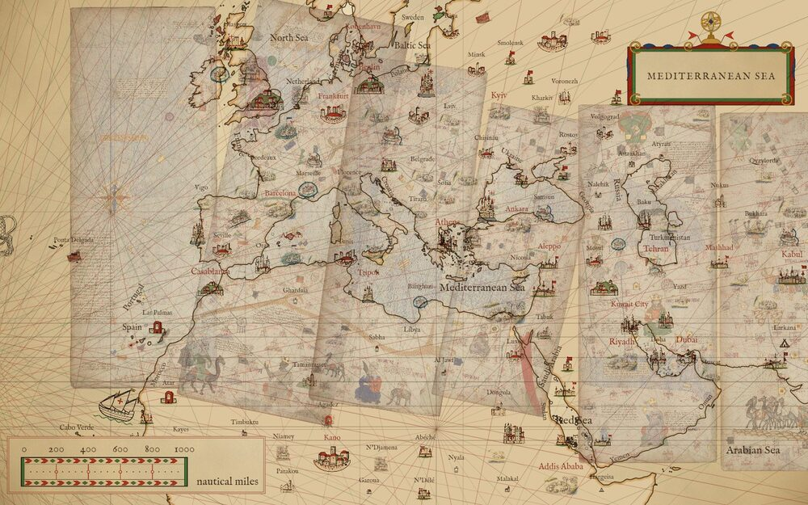
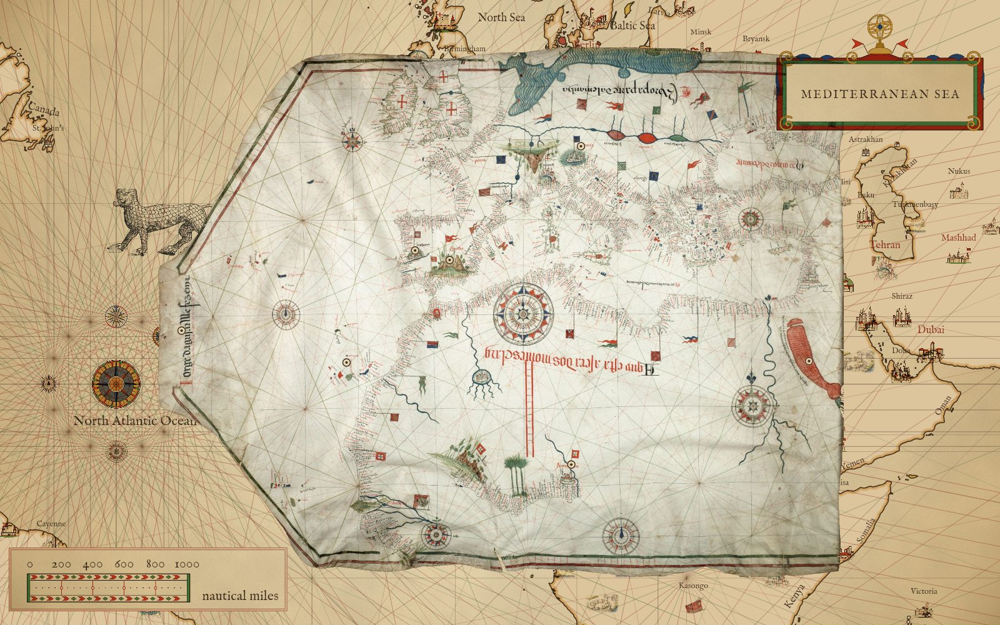
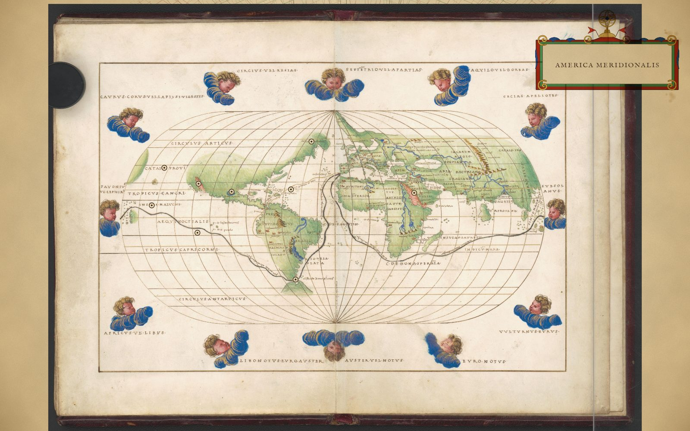
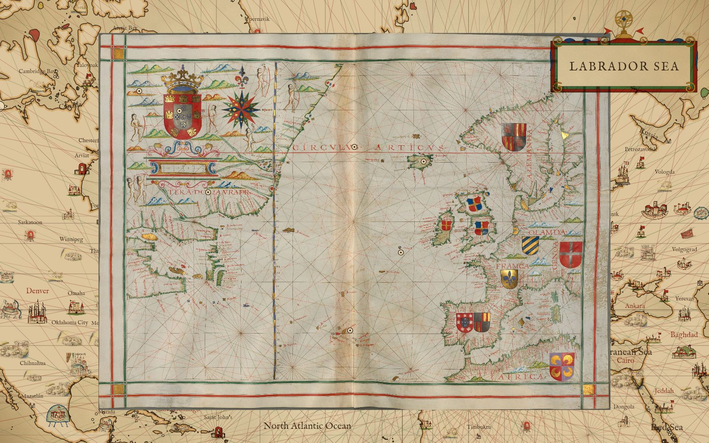
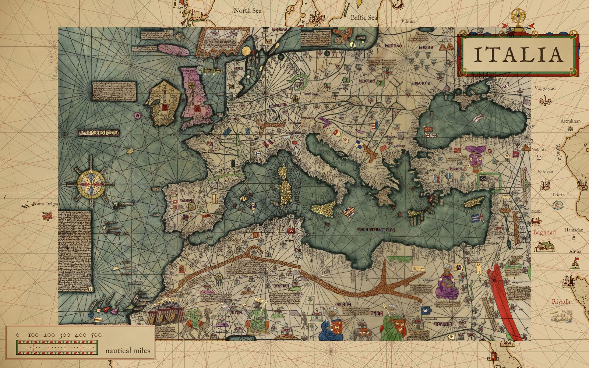

# The scan laid over the map

A chart's scan is laid over the live map as one sheet: the whole scan, undistorted, fully opaque, over
everything on the map (the land and sea, the rhumb lines, the names, the towns, the roses, the beasts,
the ships and the voyages), like one chart set down on another. The scanner's paper round the skin is
keyed off, so the map shows round the skin's ragged edge and nowhere else. The sheet is on when a chart's
name in the Charts drawer is clicked (the map flies to frame the whole sheet) and off when it is clicked
again; it is kept in the link as `overlay=de-la-cosa`.

Each chart is a Commons scan (see ASSETS.md for its rights): among them the Carta Marina, 1539 (Olaus
Magnus), at half size; the Catalan Atlas, 1375, its eight map pages side by side, at a quarter; and Juan de la
Cosa's chart of 1500 at full size, since its only scan is 2127 px wide. All are in `packs/overlays/` with
`overlays.json`. `npm run overlays` makes them from the full scans
(`scripts/build-overlays.mjs`): the shrunk JPEG, a mask PNG of the paper round the skin (a flood fill from
the image's border through light or grey unsaturated pixels, which the tinted skin stops; the outermost
px keyed whatever they hold; 19 to 38 KB each), and the placements below.

## Where the sheet lies

A placement is one similarity: the scan's centre at a longitude and latitude, a scale in Mercator degrees
per scan px, and a turn in degrees clockwise. The sheet's page size comes from the view's zoom alone, so it
keeps its size and its turn in every projection, its centre pinned; only the map under it changes.

A chart's own placement (`sheet` in overlays.json) comes from its drawn parallels where it has them: Juan de
la Cosa's chart carries the Tropic of Cancer and the equator as two long red lines across the whole skin (the
first on any nautical chart), and the build finds them (`redLines`: thin red runs in every column, a Hough
vote over slopes within 4° of level, a least-squares refit) and records them as `parallels`, each line's
endpoints in scan px with its latitude. The turn is what lays them level (the Commons scan, "rotated", still
tilts 2.2° down to the east), the scale what sets them their Mercator distance apart (0.1208 °/px, between
the east fit's 0.140 and the west's 0.078), the latitude what puts the scan's centre where it lies against
the equator, and the longitude midway between where the chart's two coasts' fits put the centre. That is the
"Parallels" chip. Without parallels a chart's own placement (the "Level" chip) is level, its scale the
geometric mean of its two coasts' fits and its centre midway between where those put the scan's centre; a
chart fitted in one piece takes that fit as it is. The `snaps` are the per-piece fits applied to the whole
scan, each a chip on the sheet: Juan de la Cosa's New World, Atlantic and Europe; the Carta Marina's West
and Baltic. The sheet is moved by hand: held anywhere on it, it is dragged; by the ring at its bottom left
corner it turns about its centre; by the square at its bottom right it is resized. Where it is let go goes
into the link as `sheet=<lon>,<lat>,<scale>,<turn>`.

| chart | own placement | snaps |
|---|---|---|
| Map of Juan de la Cosa | Parallels: 0.1208 °/px, turned 2.2° anticlockwise so its tropic and equator lie level at 23.44°N and 0°, centred 14.8°W | New World (0.0780 °/px, 7.9° anticlockwise), Atlantic (0.1307, 1.4° clockwise), Europe (0.1403, 4.9° clockwise) |
| Catalan Atlas | 0.00321 °/px, level, centred 53.2°E 39.3°N (the geometric mean of its Atlantic and Cathay pages' scales) | one per page: Atlantic, Mali, Italy, Black Sea, Persia, Central Asia, India, Cathay |
| Carta Marina | 0.0106 °/px, level | West (0.0113 °/px, 48° anticlockwise), Baltic (0.0100, 3° anticlockwise) |

`npm run render -- --view -25,22,2 --overlay de-la-cosa [--sheet lon,lat,scale,turn] --out <file>` draws it headless.

## A chart of several pages: panels

The Catalan Atlas is eight map pages, BnF sheets 5 to 12, each a tall half-leaf scanned on its own. It is one
chart, one row in the Charts drawer and one sheet over the map (`overlay=catalan-atlas`, as before): the pages
side by side as the open atlas, west to east, each cropped to its parchment (the scanner's white margin dropped)
and butted to the next. One image of them all would be 46800 x 15870 px at full size, 2.9 megapixels a page
even shrunk by four, too much for a phone to decode or hold as one canvas, so the sheet is not stitched.

Instead a chart may have `panels`: each page its own shrunk JPEG and mask, with `x`, its offset within the
sheet's full-resolution px (the sum of the widths of the pages west of it), its `width` and `height` there,
and `scanX`, where its crop starts in its own scan. The chart's `width` and `height` are the whole sheet's, so
its placement, frame, drag handles and notes work in the sheet's px exactly as for one scan. The sheet draws
every panel at its offset through the one transform; the warped pieces draw each panel's part inside a piece
(a piece is a page). The page loads the panels one by one and redraws as each lands, so the atlas appears page
by page rather than after the whole 11 MB; a headless render waits for them all. A chart without `panels` is
one scan file as before. The drawer's thumbnail is a strip of all eight pages, 480 px wide (`thumb`).

Each page is one piece, fitted to landmarks read off that page (docs/atlas/ornaments.md, "Landmarks, sheet 5"
to "sheet 12", page px; the build adds the page's offset), and one snap, the chip that lays the whole sheet at
that page's fit. Sheets 5 to 8, the portolan part, take a similarity each: 0.0026 to 0.0035 °/px, sheet 5 level
and sheets 6 to 8 turned 8° to 12° clockwise, the tilt of a portolan's grid; 72 to 130 km RMS. Sheets 9 to 12 are the
mappa mundi east of the Caspian, where a fit is rough: each is level at the scale of the atlas as a whole and
centred through its own few named places (Tabriz, Baghdad, Hormuz; Kollam and the Ganges; Khanbaliq and
Zayton), 340 to 600 km RMS; sheet 10, whose lettering is upside down and worn, is centred through sheets 9 and
11's. The atlas draws Corsica and Sardinia on both sides of the join between its second and third leaves
(sheets 6 and 7), so butted they show twice; the 1959 copy below draws them once.

`npm run render -- --view 53.22,39.30,2.69 --overlay catalan-atlas --out <file>`: the eight pages at their own
placement, the Atlantic to Cathay.

The same placement over an orthographic view (`&projection=orthographic`): the sheet's size and turn are the
same, the map under it is the globe.

The Charts drawer: each chart's scan as its thumbnail, the sheet's button; beside it the chart's name, and
under that the city it was made in (a link that flies there) with its year.

## Warped pieces

The older way is kept as a mode, "Warped pieces" under Settings → Under the hood, with its opacity slider
(`overlaymode=pieces&overlayopacity=0.6` in the link). In four steps:

1. **Cut.** The scan is cut into vertical strips, a few per chart (the Carta Marina two, Juan de la Cosa three,
   the Catalan Atlas one a page).
2. **Fit.** Each strip gets its own similarity: a scale, a turn and a shift, fitted by least squares to landmarks
   read off that strip of the scan (a cape, a town, an island, each with the longitude and latitude it has today).
3. **Draw.** Each strip is drawn onto the map by its own fit, at layer 2.1: over the land and sea, under the
   lattice and every ornament, with a plain alpha (the slider) and no other blending.
4. **Read.** So at opacity 1 the strips are opaque, yet the rhumb lines, names, towns, roses, beasts, ships and
   voyages still show over them; and where two neighbouring strips' scales disagree, they do not meet: the strips
   leave a gap, with no scan in it.

The gap is the picture to look for. Juan de la Cosa's New World is drawn larger than its Old, so its west and
Atlantic strips pull apart over the mid-Atlantic. At opacity 1 (the lattice and names still drawn over it):

The same chart at 0.6, the strips faint enough to see today's coast through them:

The rest of this page is about those strips, which the code and the sections below call pieces.

## At the Carta Marina view

`npm run render -- --view 19.7,61.7,4.6 --overlay carta-marina:<opacity> --out <file>` (an opacity after the id asks for the pieces), scaled to 1000 px.

Opacity 0.3: today's coast reads first, the chart under it.

Opacity 0.6, the default: Gotland, Öland and the Åland islands of the scan sit on today's.

Opacity 1: the scan alone under the lattice and the ornaments.

Orthographic, the same centre (`--view 19.7,61.7,4.6,orthographic`): each piece is still one affine,
so it lands as a parallelogram where the true warp would curve; Scandinavia sits near its place, the
far edges of the chart drift.

## At the Catalan Atlas, sheet 5

The Atlantic panel, Ireland at the top and the Canaries at the foot, is north up and takes one similarity:
0.00331 °/px, no turn, fitted to 19 landmarks read off the scan (the Shannon, the Portuguese and Moroccan
coasts, Madeira and the Canaries) with an RMS residual of 127 km; the table is in
[docs/atlas/ornaments.md](../atlas/ornaments.md) ("Landmarks, sheet 5"). The piece is the parchment,
x 288 to 6160 scan px, not the scan's white margin. East of it, sheet 6's piece takes up at Iberia.

`npm run render -- --view -14,40,4.4 --overlay catalan-atlas:<opacity> --out <file>`, scaled to 1000 px.

Opacity 0.3: the rose, Madeira and the Canaries faint over the open Atlantic.

Opacity 0.6, the default: the chart's Canaries, strung out further west than they lie, sit across today's.

Opacity 1: the scan alone, Portugal and Morocco meeting today's coast at the panel's east edge.

The Mediterranean, `--view 18,38,3.4 --overlay catalan-atlas:0.6`: sheets 5 to 9, each warped by its own fit,
overlapping where two fits disagree at a seam.

## At Juan de la Cosa, 1500

One similarity will not hold this chart: the New World is drawn at a larger scale than the Old, and the Red
Sea and the Cape are turned against the Atlantic coast. So it takes three pieces, each a similarity fitted to
the landmarks read off the scan in [docs/atlas/ornaments.md](../atlas/ornaments.md) ("Landmarks, 1500"), which
has each piece's scan range, scale, turn and residual.

The pieces run from the parchment's west edge to its east; above and below the parchment the scan's white
shows. Where the west and atlantic pieces meet, the two scales of the chart disagree by 1400 to 2000 km,
so a band of open Atlantic between about 37°W and 24°W has no scan over it.

`npm run render -- --view -30,15,2.6 --overlay de-la-cosa:<opacity> --out <file>`, scaled to 1000 px.

Opacity 0.3: the Caribbean and Brazil faint over today's.

Opacity 0.6, the default: Cuba and Hispaniola sit on today's; the chart's Africa runs east of the real one.

Opacity 1: the scan alone, the gap between its two worlds open in mid-ocean.

## Laid by a few landmarks: Aguiar, Agnese, Dourado

Three more charts are sheets with no warped coast fits: each is laid level by a handful of landmarks read off
the scan by eye (`levelFit` in scripts/build-overlays.mjs: the least-squares scale and centre through them, the
turn held at 0), so the Level chip is true and the hand does the rest. The landmarks sit beside each chart in
the build's `CHARTS`.

- **Aguiar, 1492** (Beinecke): Lisbon, Gibraltar, Venice, Jerusalem; its black scan keys `dark`.
- **Agnese, about 1544** (LoC, map 10): six capes and straits; the oval bends, so rough away from the centre.
- **Dourado, 1580** (BSB, chart 4): seven points, Lisbon to Iceland; its Iceland lies east of today's.
- **The Catalan Atlas's Mediterranean, a copy of 1959** (Library of Congress, Geography and Map Division; CC BY
  3.0, "Copia de 1959 del original de 1375"): not the original but a painted copy of sheets 5 to 8, its own
  chart in the drawer. Ten places, Gibraltar to Cyprus, 245 km RMS (London and Cyprus worst, 428 km each).

`npm run render -- --view <lon,lat,zoom> --overlay <id> --out <file>`, at each sheet's own frame.

Nothing marks a note on the scan. Over a noted figure the cursor turns to a pointer, and a click opens its
tile. The notes ride on the sheet where it lies, dragged, turned or resized. Juan de la Cosa has notes too.
