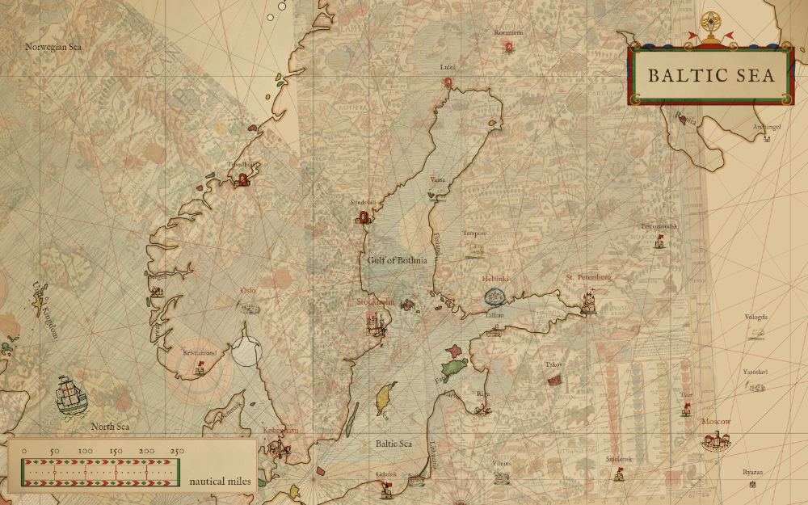
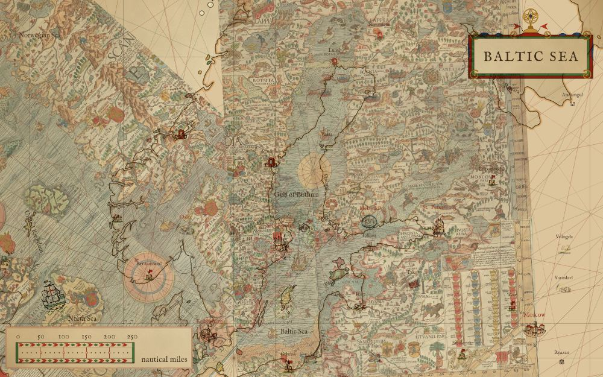
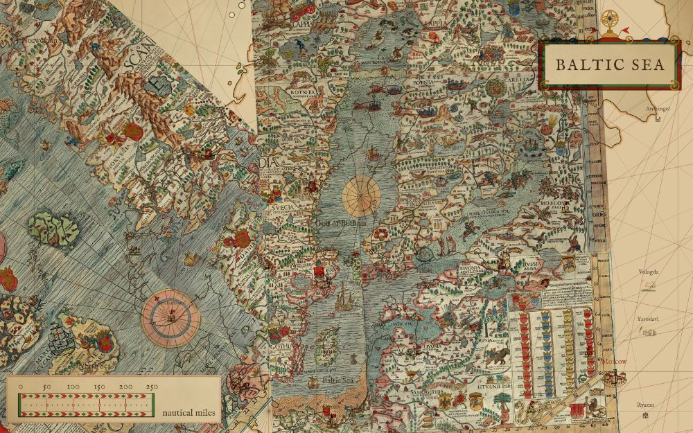
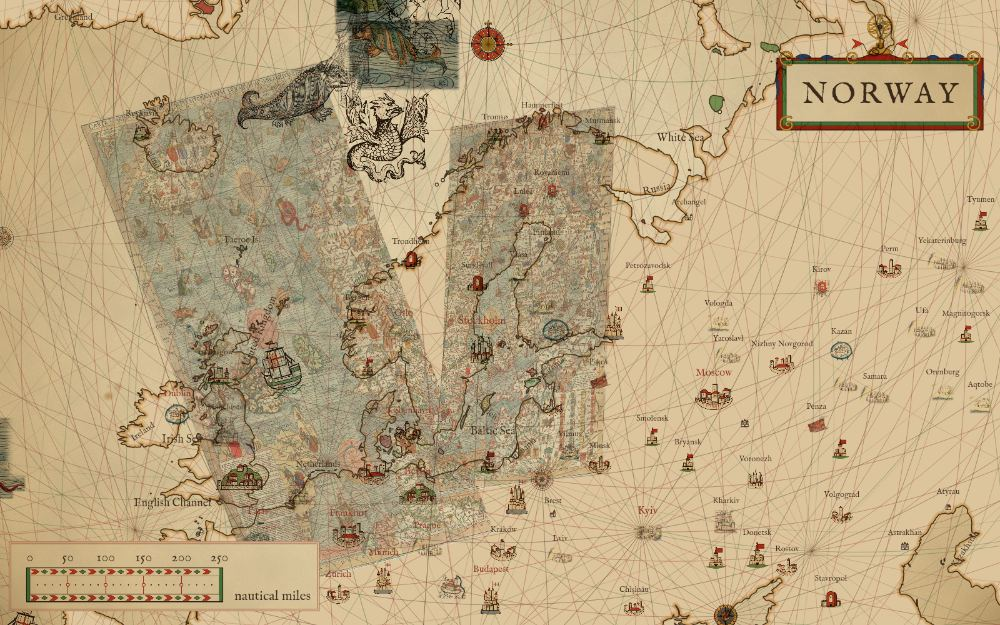
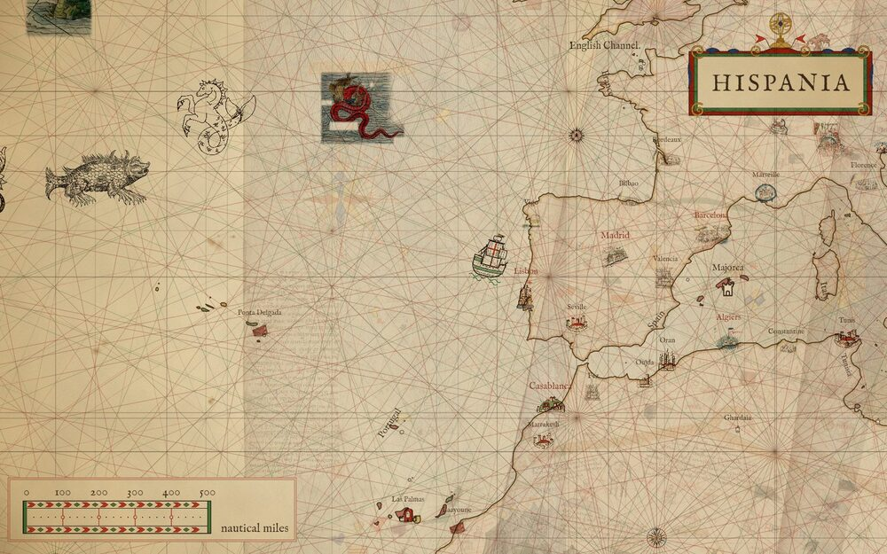
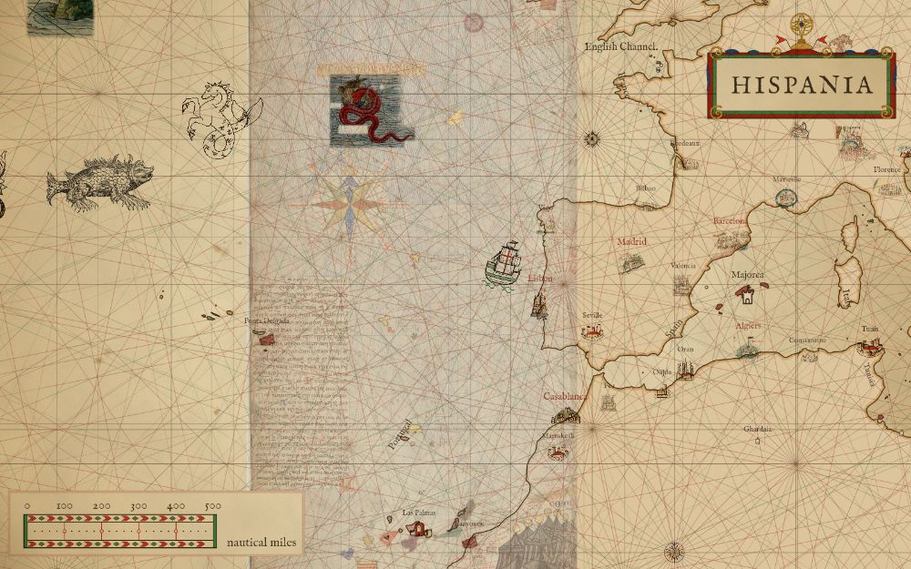
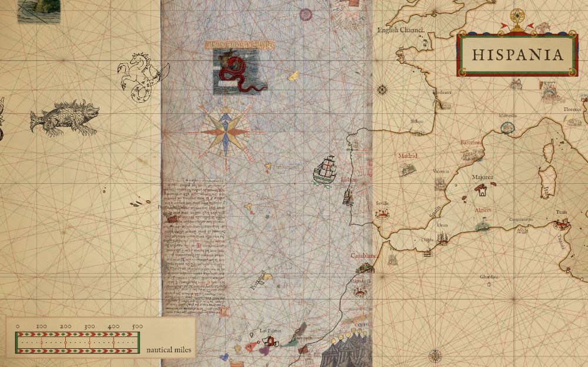
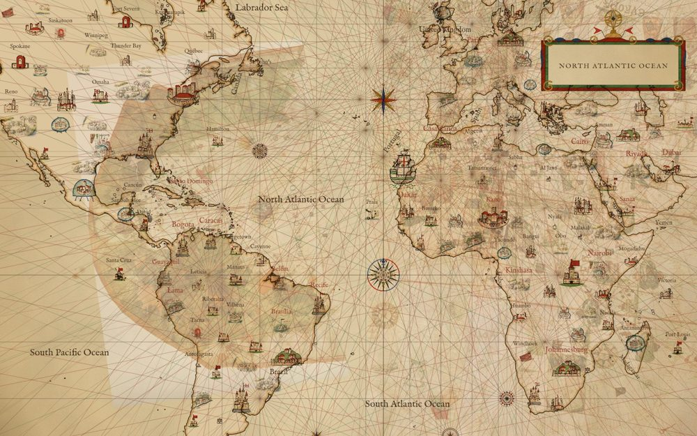
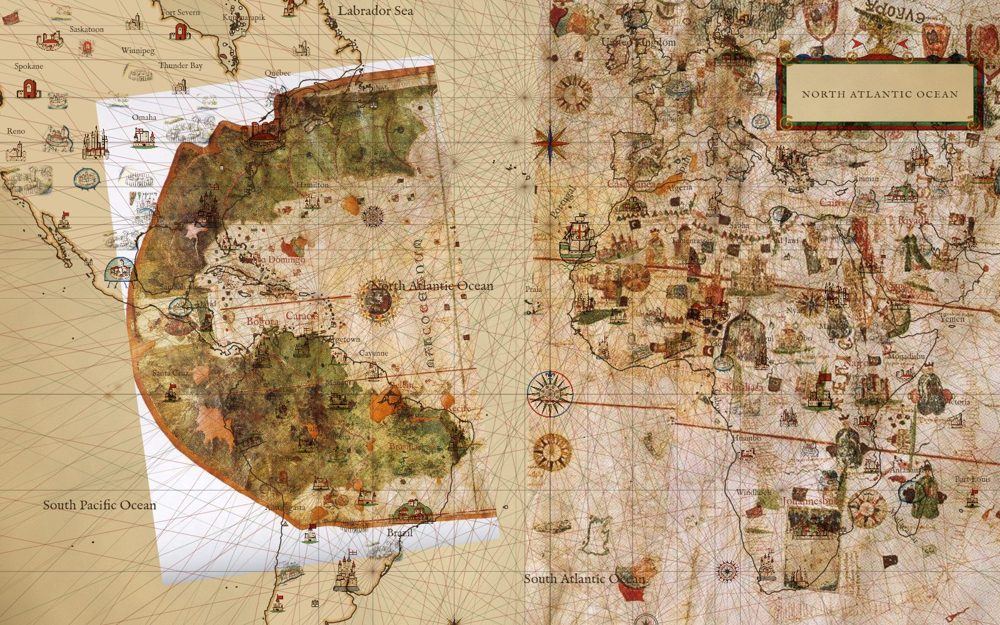

# The scan laid over the map

A chart's scan can be laid over the live map as an image, warped onto today's coast, so the reader slides
between the old chart and the vector one. It is an ornament over the vector coast: drawn over the land
and sea, under the rhumb lines, names, towns, roses, beasts, ships and voyages. Off by default, like a
voyage; turned on under the chart in the Charts drawer ("Lay the scan over the map", with an opacity
slider) and kept in the link as `overlay=carta-marina&overlayopacity=0.6`.

Three charts have it so far, each a Commons scan in the public domain (see ASSETS.md): the Carta Marina,
1539 (Olaus Magnus), at half size; sheet 5 of the Catalan Atlas, 1375, the Atlantic panel, at a quarter; and
Juan de la Cosa's chart of 1500 at full size, since its only scan is 2127 px wide. All are in
`packs/overlays/` with `overlays.json`. `npm run overlays` makes them from the full scans
(`scripts/build-overlays.mjs`).

## How it is placed

The chart is not one similarity: Scandinavia is turned. The two fits of
[docs/atlas/ornaments.md](../atlas/ornaments.md) ("Carta Marina, 1539") split it at x = 2700 scan px. Each is
a similarity (scale, turn, shift) from scan px to longitude and Mercator latitude, refitted by least
squares from that page's figures table, which gives every figure's scan px and the lon, lat its side's fit
put it at. The refit gives back all 27 rows to 0.07 degree (the table rounds to 0.1); the fits' own
residual against the landmarks is 47 to 101 km.

| piece | scan px | scale | turn |
|---|---|---|---|
| west | x 0 to 2700 | 0.0113 °/px | 48° |
| Baltic | x 2700 to 5016 | 0.0100 °/px | 3° |

Each piece is drawn with one affine through three of its corners (scan px, through its fit, through the
view's projection). A similarity onto Mercator coordinates is affine in Mercator, so there the warp is
exact. In any other projection it is an approximation: true at those three corners and drifting between
them, the more the further the chart reaches from the view's centre. Where the two pieces meet, at x = 2700,
a straight seam runs down through Sweden and the west piece's turned corner shows as a diagonal edge north
of it; that is the two fits disagreeing, not a fault in the drawing.

## At the Carta Marina view

`npm run render -- --view 19.7,61.7,4.6 --overlay carta-marina:<opacity> --out <file>`, scaled to 1000 px.

Opacity 0.3: today's coast reads first, the chart under it.

Opacity 0.6, the default: Gotland, Öland and the Åland islands of the scan sit on today's.

Opacity 1: the scan alone under the lattice and the ornaments.

Orthographic, the same centre (`--view 19.7,61.7,4.6,orthographic`): each piece is still one affine,
so it lands as a parallelogram where the true warp would curve; Scandinavia sits near its place, the
far edges of the chart drift.

## At the Catalan Atlas, sheet 5

The Atlantic panel, Ireland at the top and the Canaries at the foot, is north up and takes one similarity:
0.00331 °/px, no turn, fitted to 19 landmarks read off the scan (the Shannon, the Portuguese and Moroccan
coasts, Madeira and the Canaries) with an RMS residual of 127 km; the table is in
[docs/atlas/ornaments.md](../atlas/ornaments.md) ("Landmarks, sheet 5"). The piece is the parchment,
x 240 to 6080 scan px, not the scan's white margin. The panel's east edge is the join with sheet 6, so
the scan stops at the Iberian coast.

`npm run render -- --view -14,40,4.4 --overlay catalan-atlas:<opacity> --out <file>`, scaled to 1000 px.

Opacity 0.3: the rose, Madeira and the Canaries faint over the open Atlantic.

Opacity 0.6, the default: the chart's Canaries, strung out further west than they lie, sit across today's.

Opacity 1: the scan alone, Portugal and Morocco meeting today's coast at the panel's east edge.

## At Juan de la Cosa, 1500

One similarity will not hold this chart: the New World is drawn at a larger scale than the Old, and the Red
Sea and the Cape are turned against the Atlantic coast. So it takes three pieces, each a similarity fitted to
the landmarks read off the scan in [docs/atlas/ornaments.md](../atlas/ornaments.md) ("Landmarks, 1500", which
has each piece's scan range, scale, turn and residual):

The pieces run from the parchment's west edge to its east; above and below the parchment the scan's white
shows. Where the west and atlantic pieces meet, the two scales of the chart disagree by 1400 to 2000 km,
so a band of open Atlantic between about 37°W and 24°W has no scan over it.

`npm run render -- --view -30,15,2.6 --overlay de-la-cosa:<opacity> --out <file>`, scaled to 1000 px.

Opacity 0.3: the Caribbean and Brazil faint over today's.

Opacity 0.6, the default: Cuba and Hispaniola sit on today's; the chart's Africa runs east of the real one.

Opacity 1: the scan alone, the gap between its two worlds open in mid-ocean.

