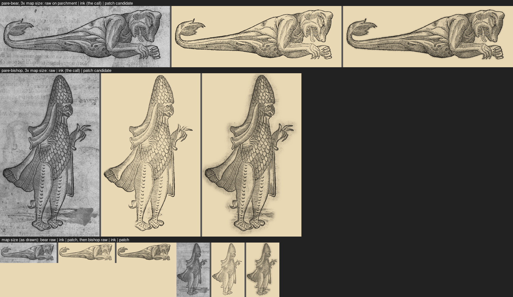

# Paré's bear-headed monster and sea bishop, `pare-bear` and `pare-bishop`: ink kept (#111)

Two sprites of the `scanned` pack from one scan, `pare-3059` (Ambroise Paré, *Des monstres*, woodcut, Wellcome
Collection L0033059, CC BY 4.0; 3555 px wide). Crops: bear (980,3140)-(2980,3860); bishop (1400,630)-(2520,2470).

`steps.png`: for each sprite, left to right, the raw crop, the ink sprite (the one shipped) and the patch candidate
(paper measured from the crop, `#c2c2c2` for the bear and `#b8b8b8` for the bishop; the figure's outline dilated 40 px
and feathered 14 px, so the whole crop round the figure stays), each multiplied onto parchment. The top two rows are 3x
the width the map draws them (bear 200 px, bishop 110 px); the bottom row is map size.
`pare-*.raw.png` and `.key.png` (both shrunk to 700 px wide) with `.cut.png` are the images behind the ink sprites;
`.patch.cut.png` is the candidate.

| Sprite | Call | Reason | In the raw, not in the sprite |
|---|---|---|---|
| `pare-bear` | keep `ink` | Ink alone on paper; the patch adds a grey halo at map size | the page's grey tone and mottling; the verso's ghost figure and its lettering under belly and arm |
| `pare-bishop` | keep `ink` | Ink alone on paper; the patch adds smears at map size | the page's tone and the verso's ghost figure; a grey stain and smeared strokes at his feet; the verso's lettering below |

The bear's crop reaches 80 px higher and 60 px further right than before, so the whole head is in.
Undo for each: `key: 'patch'` on the sprite (with a measured `paper`, as in the candidates) in `scripts/build-packs.mjs`.
