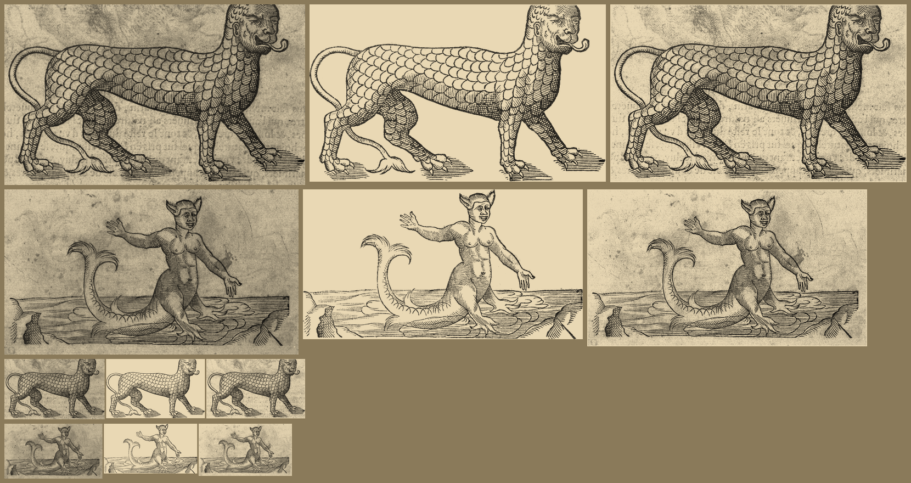

# Paré's scaled sea lion and horned sea-man, `pare-lion` and `pare-seaman`: ink kept (#111)

Two sprites of the `scanned` pack from one scan, `pare-3060` (Ambroise Paré, *Des monstres*, woodcut, Wellcome
Collection L0033060, CC BY 4.0; 3530 px wide). Crops: lion (670,1220)-(2350,2230); sea-man (480,2830)-(2440,3930).

`steps.png`: for each sprite, left to right, the raw crop, the ink sprite (the one shipped) and the patch candidate
(paper measured from the crop, `#d5d5d5` for the lion and `#cdcdcd` for the sea-man; no outline, the whole crop
feathered at its edge), each multiplied onto parchment. The top two rows are 3x the width the map draws them (lion 180 px,
sea-man 170 px); the bottom two rows are map size. `pare-*.raw.png` and `.key.png` (both shrunk to 700 px wide) with
`.cut.png` are the images behind the ink sprites; `.patch.cut.png` is the candidate.

| Sprite | Call | Reason | In the raw, not in the sprite |
|---|---|---|---|
| `pare-lion` | keep `ink` | Ink alone on paper; the hatching under each foot is kept by the silhouette, and the patch adds only the page's mottling | the page's grey tone and mottling; the verso's ghost lettering under the belly |
| `pare-seaman` | keep `ink` | Ink alone on paper; the water band, its ripples and both rocks are kept, and the patch adds only stains | the page's grey tone and mottling; a dark stain behind the right hand; a page mark at the lower left |

The sea-man's crop reaches 110 px higher than before (2830, not 2940), so both horns of his head-dress are in.
Undo for each: `key: 'patch'` on the sprite (with a measured `paper`, as in the candidates, and no `silhouette`) in `scripts/build-packs.mjs`.
