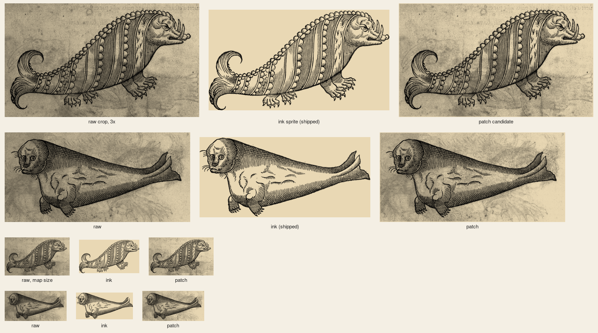

# Paré's sea boar and sea calf, `pare-boar` and `pare-calf`: ink kept (#111)

Two sprites of the `scanned` pack from one scan, `pare-3267` (Ambroise Paré, *Des monstres*, woodcut, Wellcome
Collection L0033267, CC BY 4.0; 3524 px wide). Crops: boar (520,2100)-(2500,3260); calf (580,590)-(2520,1530).

`steps.png`: for each sprite, left to right, the raw crop, the ink sprite (the one shipped) and the patch candidate
(paper measured from the crop, `#d6d6d6` for both; no outline, the whole crop feathered at its edge), each multiplied
onto parchment. The top two rows are 3x the width the map draws them (boar 180 px, calf 170 px); the bottom two rows
are map size. `pare-*.raw.png` and `.key.png` (both shrunk to 700 px wide) with `.cut.png` are the images behind the
ink sprites; `.patch.cut.png` is the candidate.

| Sprite | Call | Reason | In the raw, not in the sprite |
|---|---|---|---|
| `pare-boar` | keep `ink` | Ink alone on paper; every tooth, claw, the tail's curl and its lower tip are in, and the patch adds only the page | the page's grey tone and mottling; the verso's ghost (a fish's tail right of the legs, reversed lettering at the top edge) |
| `pare-calf` | keep `ink` | Ink alone on paper; whiskers, flippers and both tail lobes are in, and the patch adds only the page | the page's grey tone and mottling; a wavy grey haze behind and right of the body, which is the verso's print showing through, not drawn on this plate |

Both crops are wider than before (the boar by 40 px left, 80 right, 40 above and 60 below; the calf by 60 left, 80 right, 30 above and
20 below): the old boxes ran within 15 px of the calf's whisker and tail tip and within 20 px of the boar's tail tip and
snout, and a crop that close cuts the figure's own edge. The outline (`PAPER_FIGURE`) takes the ink and drops the book's
text below each figure.
Undo for each: `key: 'patch'` on the sprite (with `paper: '#d6d6d6'`, as in the candidates, and no `silhouette`) in `scripts/build-packs.mjs`.
