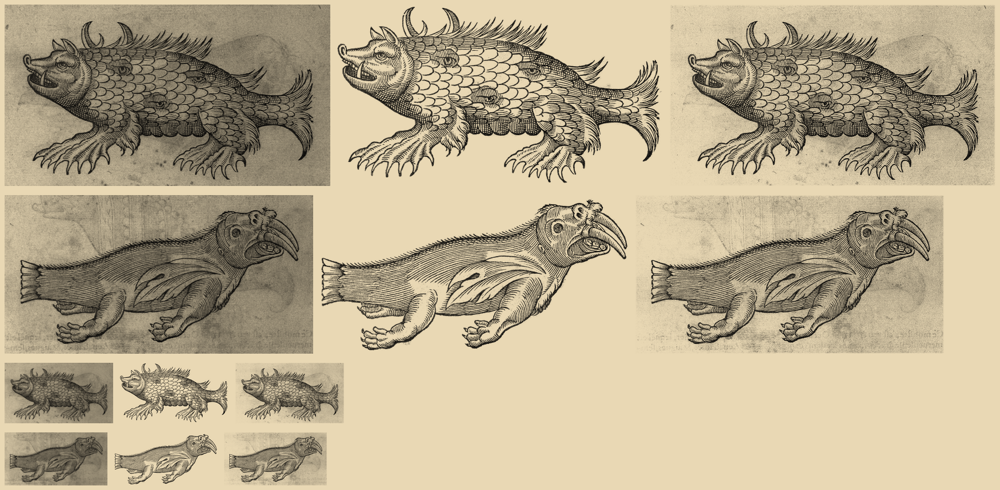

# Paré's sea sow and sea elephant, `pare-truie` and `pare-elephant`: ink kept (#111)

Two sprites of the `scanned` pack from one scan, `pare-3289` (Ambroise Paré, *Des monstres*, woodcut, Wellcome
Collection L0033289, CC BY 4.0; 3494 px wide). Crops: sow (880,440)-(3030,1640); elephant (790,2410)-(3020,3560).

`steps.png`: for each sprite, left to right, the raw crop, the ink sprite (the one shipped) and the patch candidate
(paper measured from the crop, `#b1b1b1` for both, the mean of its pixels above level 110; no outline, the whole crop
feathered at its edge), each multiplied onto parchment. The top two rows are 3x the width the map draws them (sow
190 px, elephant 180 px); the bottom two rows are map size. `pare-*.raw.png` and `.key.png` (both 700 px wide) with
`.cut.png` are the images behind the ink sprites; `.patch.cut.png` is the candidate.

| Sprite | Call | Reason | In the raw, not in the sprite |
|---|---|---|---|
| `pare-truie` | keep `ink` | Ink alone on paper; horns, spines, claws, tail tuft all in | page tone; verso ghost behind the neck |
| `pare-elephant` | keep `ink` | Ink alone on paper; tusk, head tuft, fish tail, toes all in | page tone; verso ghost of a figure and lettering |

The sow's old crop ended 1 px below a claw tip and 12 px from the tail tuft, the elephant's 3 px from the tusk tip and 9 px from the head tuft, so both are
widened (a crop within 20 px of the figure cuts its edge). Neither plate draws water or ground, so the raw holds none
for the ink key to lose. The verso show-through (a ghost figure above the elephant, lettering along its foot) is not the plate.
Undo for each: `key: 'patch'` on the sprite (with `paper: '#b1b1b1'`, as in the candidates, and no `silhouette`) in `scripts/build-packs.mjs`.
