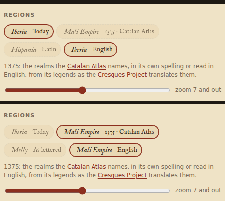
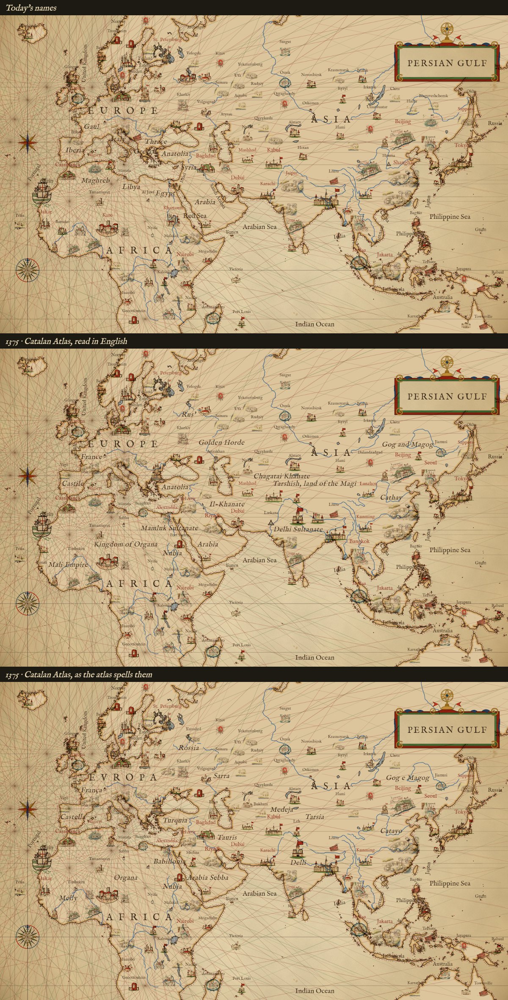
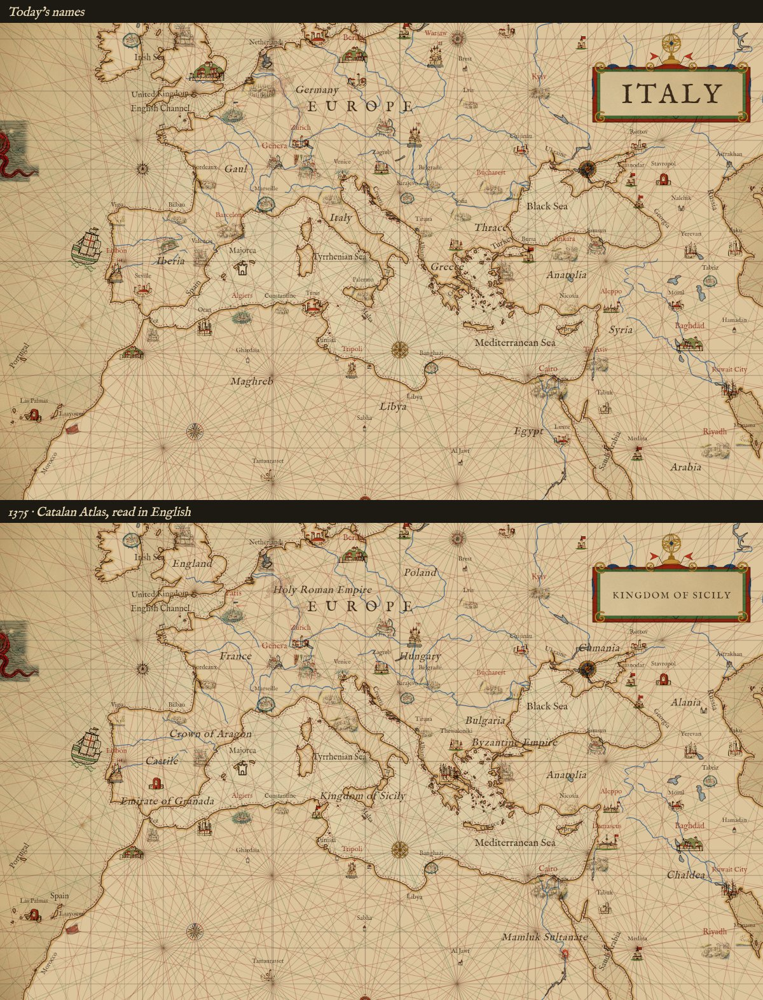
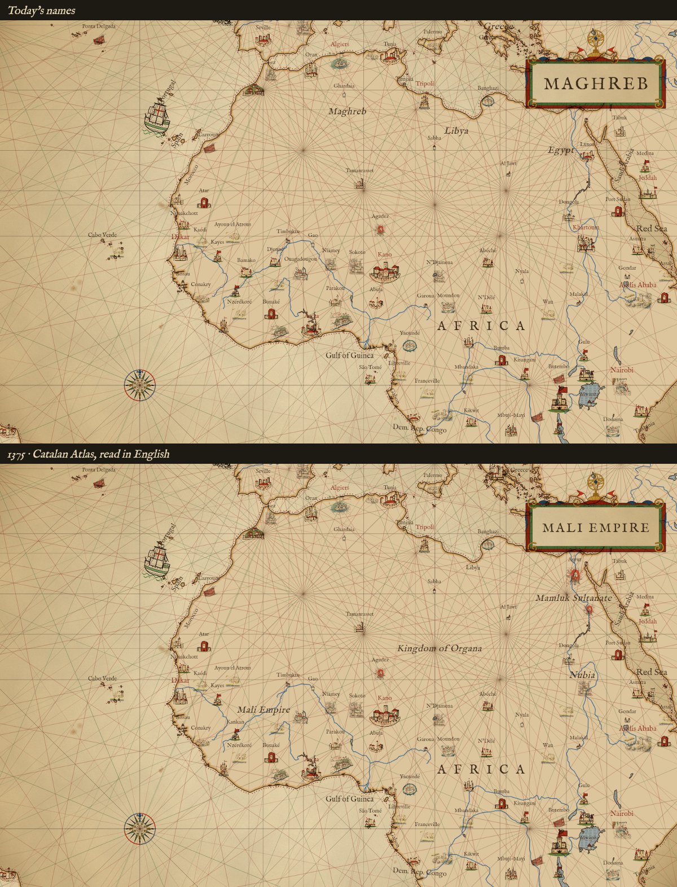
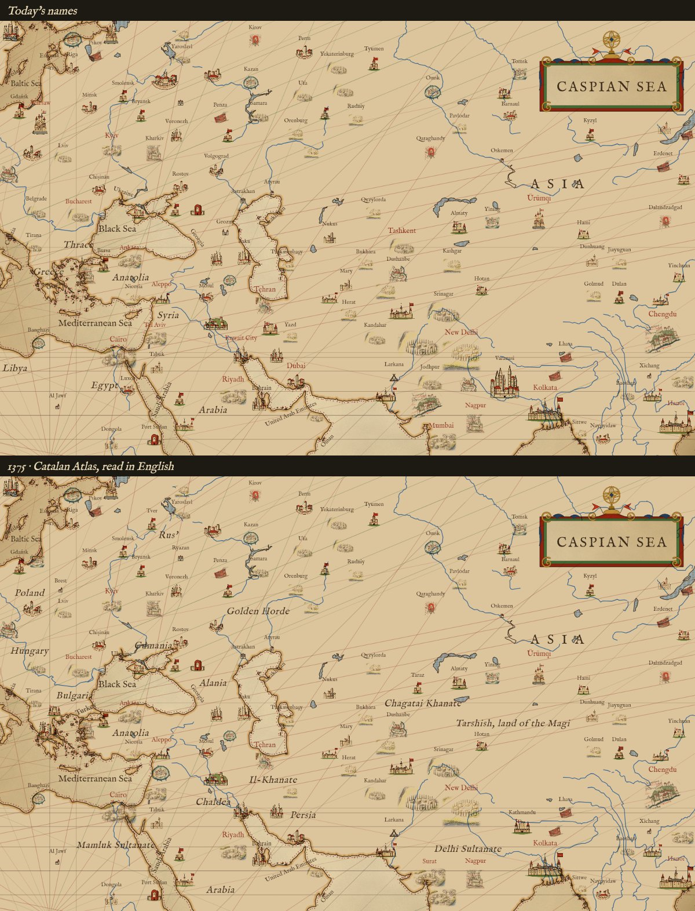
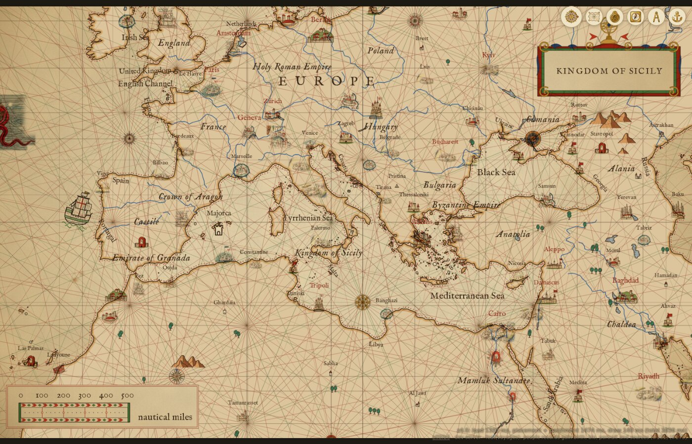

# Region names of 1375: the Catalan Atlas

The map can letter its regions in the Catalan Atlas's own terms for the realms of its day, in place of today's region names: Sarra for the Golden Horde, Melly for Mali, Catayo for Cathay. The chip sits beside the region names' language, in the settings drawer under Map, Regions:



Today stays the default. "1375 · Catalan Atlas" puts `regionset=catalan-1375` in the link. The language chips still apply: English letters a modern reading (Golden Horde), and Latin, which reads "As lettered" under 1375, letters the atlas's own spelling (Sarra).

Try it: `npm run dev -- --port 10375`, then open <http://localhost:10375/#map=2.60/33.000/62.000&regions=english&regionset=catalan-1375>.

## Renders

The live map's defaults, with continents and regions on: today's names above, the 1375 names below. The scene is the same in both, so only the lettering differs.

The Old World, zoom 2.6. The third panel is the atlas's own spelling.



The Mediterranean, zoom 4. The European kingdoms come in from zoom 2.5 to 4, Granada, Sicily and the Byzantine Empire at 4.



West Africa, zoom 3.8: Mali, Organa and Nubia across the Sahara.



Central Asia, zoom 3.6: the Golden Horde, the Chagatai Khanate, the Il-Khanate and the Delhi Sultanate.



The live page at `#map=4.00/40.000/16.000&regions=english&regionset=catalan-1375`:



## The data

A set of names is one file, `data/names/<id>.json`; `catalan-1375.json` is the first. Another period is one more file and one more entry in `REGION_SETS` (`scripts/scene.mjs`). One record:

```json
{ "name": "Sarra", "reading": "Golden Horde", "lon": 50, "lat": 50.5, "zoom": [0, 7], "sheet": 9,
  "legend": "Here resides the emperor of this northern region, whose empire starts in the province of Bulgaria and ends in the city of Organcio. The sovereign is named Jambech, Lord of Sarra.",
  "note": "Jambech is Jani Beg, khan of the Golden Horde to 1357; Sarra is Sarai on the Volga." }
```

The renderer reads `name` (under Latin), `reading` (under English), `lon`, `lat` and `zoom`, as today's names, which are the same shape in `scene.mjs` without a zoom band. The name is lettered while `zoom[0] <= zoom < zoom[1]`, and the Regions slider still sets where all of them stop. The names are placed in file order, so the great realms come first and win where two names meet; the kingdoms of Europe follow, from zoom 2.5 to 4.5. `legend` is the atlas's own legend in translation, `note` ours, and `sheet` the BnF sheet (5 to 12) where the name or its ruler is drawn. The renderer ignores those three; they are there for a tile or a Learn page to show later.

Today's region names are hand-set points too, not Natural Earth polygons, so the two sets draw the same way: the same IM Fell English italic at the same size, each name centred on its anchor.

## The names

36 names. Where the atlas names a ruler, not a realm (Rey del Tauris, Musse Melly, the sultan of Babylon), the realm is lettered and the ruler is kept in the legend.

| As lettered | Read in English | Sheet | From zoom |
|---|---|---|---|
| Sarra | Golden Horde | 9 | 0 |
| Catayo | Cathay | 12 | 0 |
| Medeja | Chagatai Khanate | 11 | 0 |
| Tauris | Il-Khanate | 9 | 0 |
| Melly | Mali Empire | 6 | 0 |
| Delli | Delhi Sultanate | 10 | 0 |
| Babillonia | Mamluk Sultanate | 8 | 0 |
| Arabia Sebba | Arabia | 9 | 0 |
| Organa | Kingdom of Organa | 7 | 0 |
| Nubia | Nubia | 8 | 0 |
| Tarsia | Tarshish, land of the Magi | 10 | 0 |
| Gog e Magog | Gog and Magog | 12 | 0 |
| Turquia | Anatolia | 8 | 2.5 |
| Rossia | Rus' | 8 | 2.5 |
| Germania | Holy Roman Empire | 7 | 2.5 |
| Castella | Castile | 6 | 2.5 |
| França | France | 6 | 2.5 |
| Polonia | Poland | 7 | 3 |
| Panonia | Hungary | 7 | 3 |
| Anglaterra | England | 6 | 3 |
| Caldea | Chaldea | 9 | 3 |
| Indies | India | 10 | 3 |
| Aragó | Crown of Aragon | 6 | 3 |
| Svessia | Sweden | 6 | 3 |
| Nuruega | Norway | 6 | 3 |
| Persia | Persia | 9 | 3.5 |
| Burgaria | Bulgaria | 8 | 3.5 |
| Boemia | Bohemia | 7 | 3.5 |
| Dacia | Denmark | 6 | 3.5 |
| Cumania | Cumania | 8 | 3.5 |
| Alania | Alania | 8 | 3.5 |
| Granada | Emirate of Granada | 6 | 4 |
| Sicilia | Kingdom of Sicily | 7 | 4 |
| Constantinoble | Byzantine Empire | 8 | 4 |
| Colombo | Kingdom of Quilon | 10 | 4 |
| Lombardia | Lombardy | 6 | 4.5 |

## Sources

- The sheets themselves: [Catalan Atlas BNF, sheets 5 to 12](https://commons.wikimedia.org/wiki/File:Catalan_Atlas_BNF,_sheet_5.jpg) on Wikimedia Commons (public domain), from [BnF Gallica btv1b55002481n](https://gallica.bnf.fr/ark:/12148/btv1b55002481n). The region names lettered in red and blue capitals were read off the sheets at reduced size: Svessia, Dacia, Nuruega (in its legend), Anglaterra, Castella, Lombardia (sheet 6); Polonia, Boemia, Germania, Panonia, Organa, Nubia (sheet 7); Rossia, Alania, Cumania, Burgaria, Turquia (sheet 8); Rey del Tauris, Caldea, Arabia Sebba (sheet 9); Rey de Delli, Tarsia (sheet 10).
- The legends in translation: [The Cresques Project](https://www.cresquesproject.net/catalan-atlas-legends), panels III to VI.
- [Catalan Atlas](https://en.wikipedia.org/wiki/Catalan_Atlas), Wikipedia (CC BY-SA 4.0): Musse Melly, Jambech of Sarra, Chabech of Medeja, Holubeim and Catayo, the king of Organa, the sultan of Delhi, the king of Tauris.
- [Atles català](https://ca.wikipedia.org/wiki/Atles_catal%C3%A0), Viquipèdia (CC BY-SA 4.0): the flags of Granada, Sicily and Hungary, the sultan of Babylon of Egypt, Tàrsia.

## What is rough

- The anchors are read by eye, and where a realm reached in 1375 is a judgment: each name sits where the realm's heart was, not where the atlas letters it.
- Aragon, France and the Byzantine Empire have no name on the atlas, only their flags over their towns; they are lettered in the atlas's language (Aragó, França, Constantinoble) and the record's `note` says so.
- The atlas's names are older than its date in places: Jambech died in 1357, Chabech in 1326, and the Il-Khanate had broken up by 1335 (Tabriz was the Jalayirids' in 1375). The readings follow the atlas, not the year.
- The Maghreb has no names yet: Fez, Tlemcen and Tunis are drawn as cities with their flags, and their spellings were not checked against the sheets.
- Spellings read off the sheets at reduced size may be a letter out (Anglaterra, Castella).
