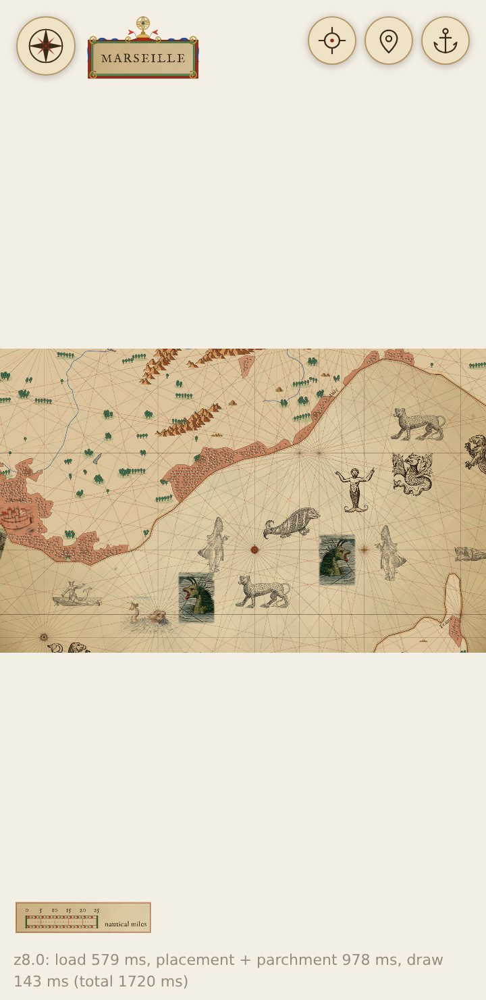
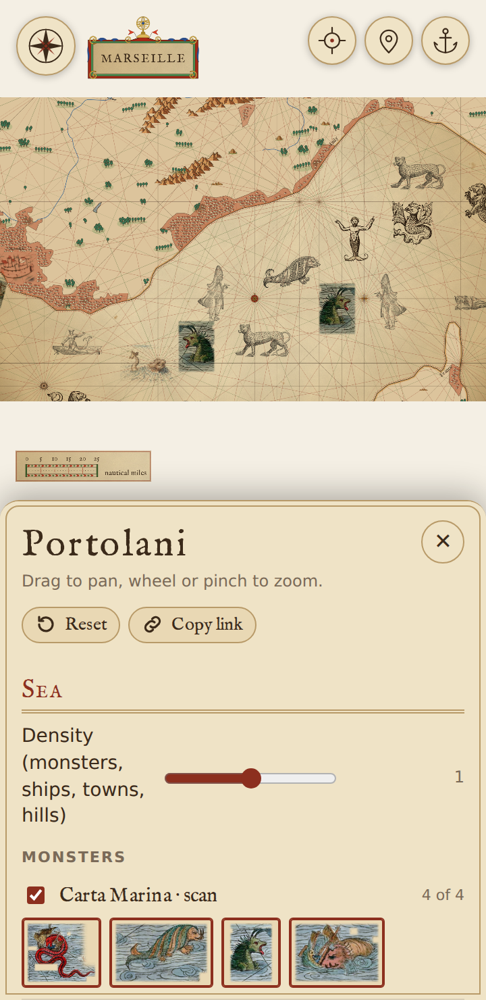
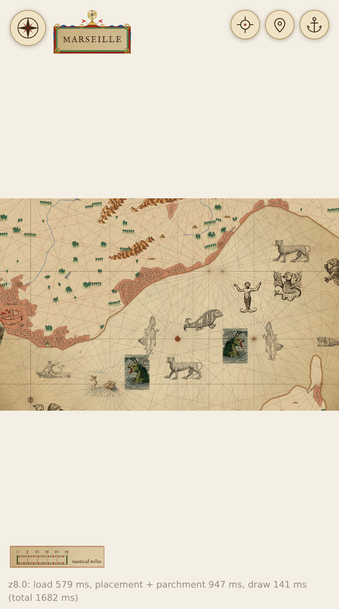
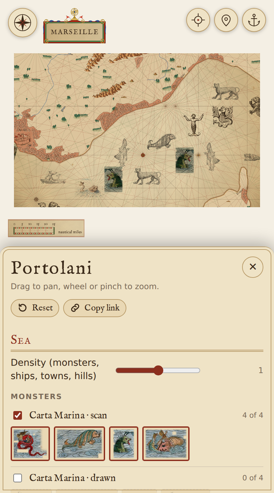

# The page on a phone

An account of what broke on a phone ([#109](https://github.com/mark-brannan/portolani/issues/109)), what shipped and what is still open. It is written from the PR bodies; the screenshots are the ones in this folder.

## What broke

| Bug | Cause | Shipped in |
|---|---|---|
| Pinch zoomed the page, not the map | The Go flyout's box stayed laid out when shut and sat over the map's top right, taking the touches there. Also, the map was a band a third of the window high, so a pinch in the margin above it went to the browser. | [#166](https://github.com/mark-brannan/portolani/pull/166), [#262](https://github.com/mark-brannan/portolani/pull/262) |
| The flyout never closed | It opened on `:hover`, and a tap leaves `:hover` stuck on the last thing touched. | [#166](https://github.com/mark-brannan/portolani/pull/166) |
| Locate behaved oddly | A tap flew to the fix, popped the flyout open as a side effect and left it over the map; then the keyboard came up over the sheet because the box was focused. | [#166](https://github.com/mark-brannan/portolani/pull/166), [#262](https://github.com/mark-brannan/portolani/pull/262) |
| The layout was wrong at phone width | The 1600 by 1000 canvas shrank to the window's width: a 225 px band on a 360 px phone, with lettering too small to read. | [#167](https://github.com/mark-brannan/portolani/pull/167), [#262](https://github.com/mark-brannan/portolani/pull/262) |

## What shipped

- **#166**: the flyout takes no touches itself, only its buttons do. A places button opens it by touch; hover opens it only where the device hovers. It shuts after a choice, on a tap on the map and on Esc.
- **#167**: under 520 px the settings drawer is a bottom sheet at half the window's height, the map shrunk (not cropped) into the half above it. The cartouche and scale bar sit on cards clear of the map.
- **#262**: the map fills the window, cropped at its sides, so a pinch lands on the map anywhere. Find my position fills the box, shuts Go and flies there, without focusing the box. The lighter drawers became only as tall as their lines.
- **#292**: a choice in a drawer, or a tap on the map, no longer shuts it, on a phone or a wide screen. This reverses #262's shut-on-a-tap, on the user's word of 2026-10-30. Grouped lists open one group at a time, and a click on the open group's heading shuts it.
- **#313**: the voyage fit uses the window's rectangle, not the whole canvas, so a chosen voyage's track is framed inside what a phone shows.

Where #167 and #262 differ, #262 holds for the map (it fills the window); the screenshots below are #167's, taken before that, so they show the map shrunk above the sheet.

| | closed | open |
|---|---|---|
| 360 |  |  |
| 412 |  |  |

## Not yet verified

- The pinch fix is tested with emulated touches only (headless Chromium, synthetic two-finger events). iOS Safari and Android Chrome may treat real fingers differently. It needs a try on a real phone.
- On a 3x phone the canvas shows at about 2 device pixels per canvas pixel, so lines may look soft. That is a guess, not measured.
- The refusal message for Find my position was not exercised.

## Still proposed

- **Position chips in the Charts drawer on a phone**: they sit in the chart's row as on a wide screen until the user has walked the phone's drawers (`docs/spec/design.md`, "a phone (waiting on a UI walk)").
- **Hover-to-open groups**: whether a group opens as the pointer nears it, and how a phone differs, waits until the user has seen it demoed both ways.
- **A canvas shaped like the phone** instead of cropping the 1600 by 1000 scene: a much bigger change to the scene's fixed size, not started.
