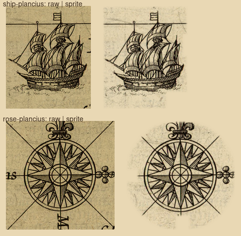

# The Plancius 1609 galleon and rose as patches

Two sprites of the `scanned` pack, style `plancius`, cut from Petrus Plancius, *Tabula geographica … Actis et Epistolis
Apostolorum* (Amsterdam, Cloppenburgh, 1609 state, engraved by Baptista van Doetecum; National Library of Israel, Eran Laor
Cartographic Collection, system no. 990023688790205171; public domain; 8,304 × 5,352; source id `plancius-acts`). Both are
patches: the whole crop, its edge feathered, the toned paper (`PLANCIUS_PAPER`, `#d5cdb2`, the mean of the 80th to 90th
percentile of the rose's pixels by brightness) divided out.

`steps.png`: the raw crop on the left, the sprite on the right, both multiplied onto parchment at twice the width the map
draws them. `<id>.key.png` is the alpha key (white kept).

| Sprite | Kind | Absent from the sprite, and why |
|---|---|---|
| `ship-plancius` | ship, bow left | two bits of lettering by the stern, erased; one leaves a bare corner of sea. |
| `rose-plancius` | rose | "Occidens", "Oriens", "Meridies": lettering; two stray ends inside, erased. |

Not cut: the scale cartouche (lower right) is a scale bar with Dutch lettering, and scale bars are drawn in code; the
Acts vignettes round the border are not map decorations.
