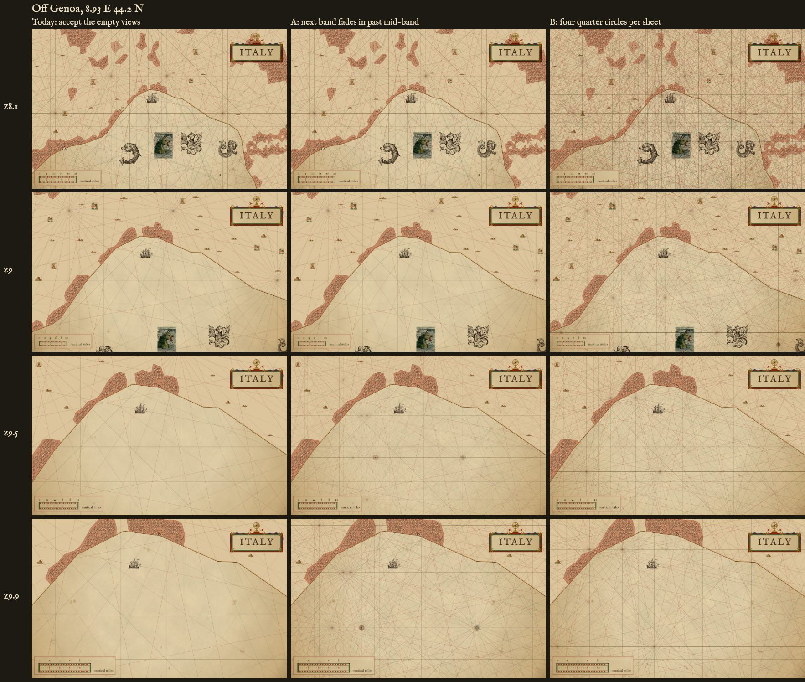
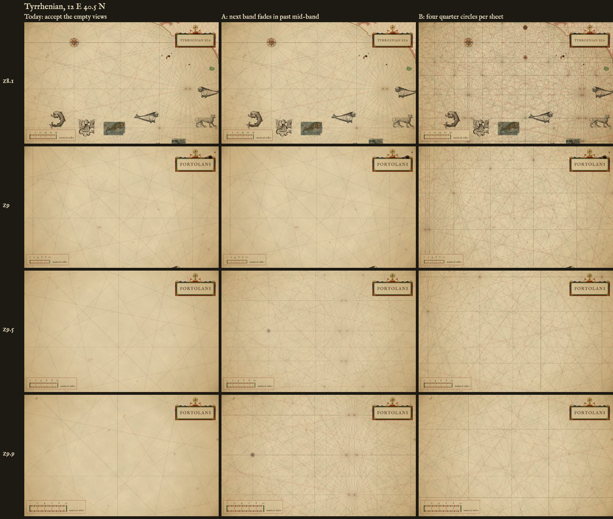
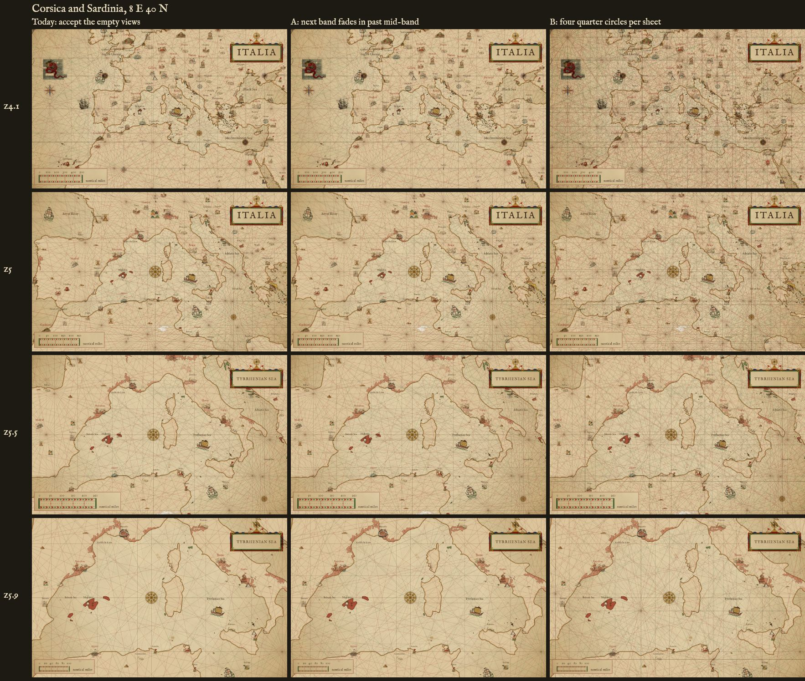

# Rhumb meeting points through a zoom band: three options (mockup, #107)

A mockup, not for merge. Late in a band most views have no rose, because a rose stands only where this band's lines meet, and none goes where it doesn't fit. Three options, rendered at the same views through the band, side by side:

- **Today**: accept the empty views. One hidden circle per grid sheet, only the current band's lines.
- **A, `tune=meet:fade`**: past the middle of a band, the next band's network fades in, its lines and roses at one alpha, 0 at the middle to 1 at the band's end. Below the middle it is the same as today.
- **B, `tune=meet:circles`**: each grid sheet adds four circles, one per quarter of the sheet, at full ink through the whole band.

The extra roses of A and B are small roses of the ring, one per extra circle at most, on its centre or a node, in clear sea only, clear of every rose and beast already placed. They take nothing from a sheet's own allotment.

## The views

Each row is one zoom, each column one option, the same 1600 x 1000 window, headless render (`scripts/render.mjs --batch`).

Off Genoa, 8.93 E 44.2 N, the general band (8 to 10):

Tyrrhenian, 12 E 40.5 N, open sea, the general band:

Corsica and Sardinia, 8 E 40 N, the ocean band (4 to 6):

## Counted

The same 35 views as the count on #107 (lon 3 to 18 step 2.5, lat 36 to 43 step 1.75), general band, measured at this branch's head. A meeting point is a circle's centre or node inside the window, at sea or on land; a rose is one drawn inside the window. A is today by construction below the band's middle, so its z8.1 and z9 rows are today's figures.

| zoom | option | windows with no rose | windows with no meeting point | average roses | average meeting points |
|---|---|---|---|---|---|
| 8.1 | today | 10 / 35 | 0 / 35 | 1.2 | 5.7 |
| 8.1 | A fade | 10 / 35 | 0 / 35 | 1.2 | 5.7 |
| 8.1 | B circles | 4 / 35 | 0 / 35 | 2.6 | 29.0 |
| 9 | today | 15 / 35 | 1 / 35 | 0.7 | 2.0 |
| 9 | A fade | 15 / 35 | 1 / 35 | 0.7 | 2.0 |
| 9 | B circles | 10 / 35 | 0 / 35 | 1.1 | 9.2 |
| 9.5 | today | 19 / 35 | 5 / 35 | 0.6 | 1.3 |
| 9.5 | A fade | 9 / 35 | 0 / 35 | 1.3 | 15.2 |
| 9.5 | B circles | 17 / 35 | 0 / 35 | 0.7 | 4.7 |
| 9.9 | today | 29 / 35 | 18 / 35 | 0.2 | 0.6 |
| 9.9 | A fade | 14 / 35 | 0 / 35 | 0.7 | 8.7 |
| 9.9 | B circles | 28 / 35 | 0 / 35 | 0.3 | 2.8 |

## What the renders show

- **A** changes nothing until mid-band, then fills the late band: at z9.9 the views with no rose drop from 29 to 14 of 35. Its lines start faint, so the network thickens gradually; at the band's end the next band's lines are at full ink, the network the next band draws, so the page turn at z10 should not jump (a guess; not rendered across the turn).
- **B** is busiest at the start of the band, where today already has meeting points (29 per window at z8.1, against 5.7), and helps least at the end: the quarter circles' points sit about 1 to 2.4 degrees apart, as wide as a z9.9 window, so a deep view holds a meeting point but often no rose that fits (28 of 35 with no rose at z9.9).
- **In the ocean band** (Corsica and Sardinia, z4 to 6), A is hard to tell from today: the overview band's extra roses mostly fall on land or beside roses already placed, and its lines are faint. B shows at once, as a denser grid.

## Not covered

- A different single radius (`tune=radius:`, already a knob, 0.25 to 0.8) is not a column: it moves a sheet's 16 nodes in or out but adds none.
- From the world-band card folded into this item: in the ocean-band rows the big rose stands in the sea west of Sardinia in every column (z5 to z5.9), not over Corsica and Sardinia. Beasts overlapping at a shared sheet edge were not looked for in these views.
- `meet` defaults to `today`; the goldens are not regenerated.
