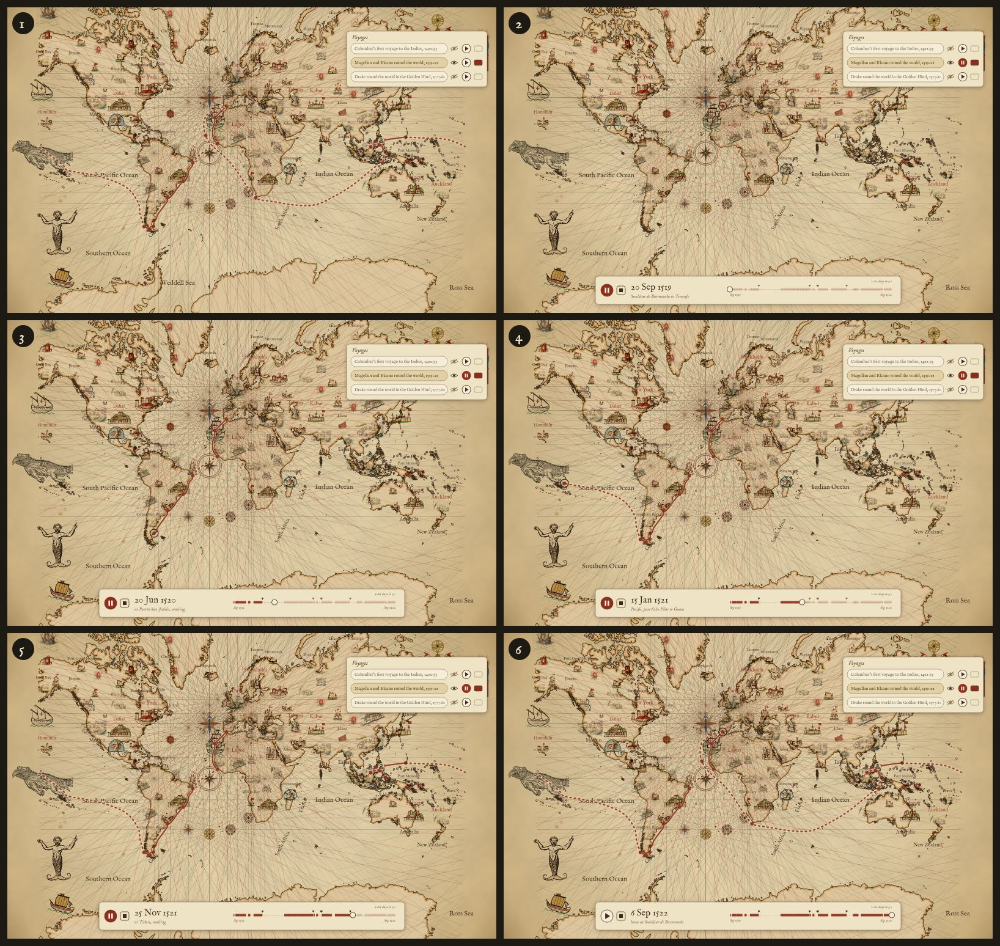
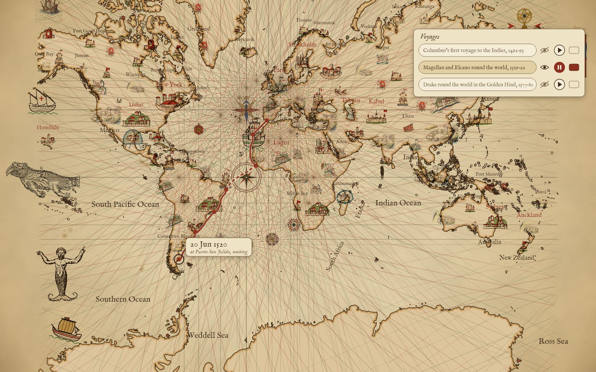
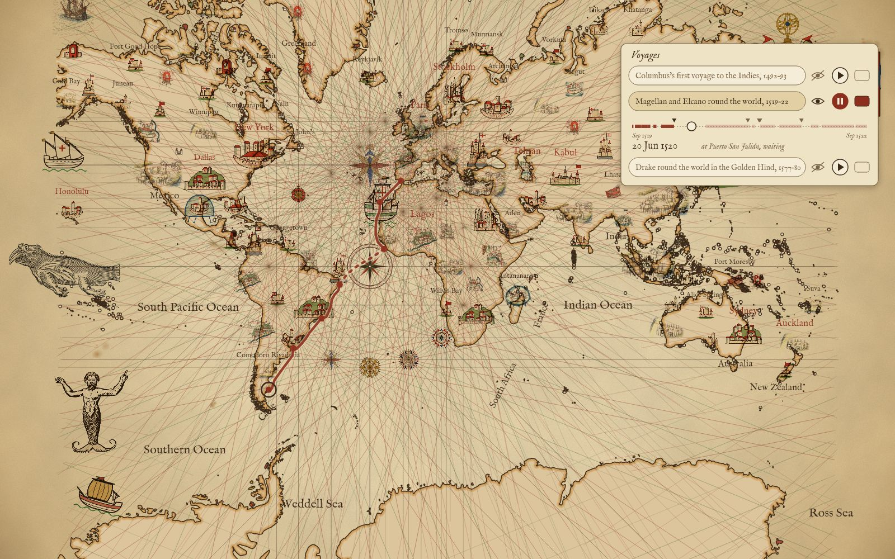
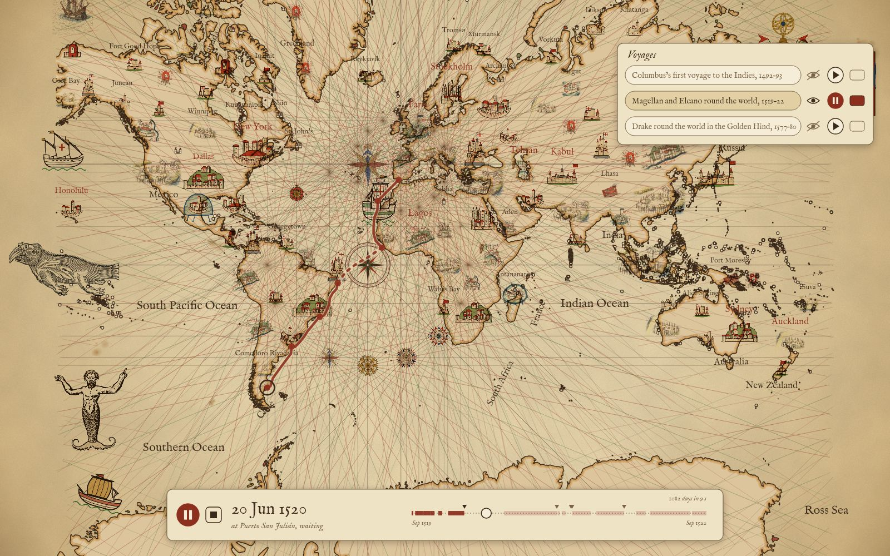

# A voyage sailed on its own calendar

Research for the scenario "the play button sails the voyage on its own calendar" in
[`docs/spec/design.md`](../spec/design.md) (the voyage row's Feature). It proposes; it settles nothing.
No app code and no voyage data change here.

Every image is the real renderer (`scripts/scene.mjs`) at map size, 1600 × 1000, with Magellan's
track cut at the pen's date and the controls painted over it as mockups. The line is drawn at 4.5 px,
the Heavy weight the voyage-line work proposes. The pen's calendar comes from today's free-text
`dates`, parsed (below), so it is what the button could do with the data as it is.

## The play transition, Magellan, 1,082 days in nine seconds



| # | the pen's date | what the user sees |
|---|---|---|
| 1 | before | the voyage drawn whole; the row's play button waits |
| 2 | 20 Sep 1519 | pressed: the line clears, the pen sits at Sanlúcar, the band opens at the foot of the map |
| 3 | 20 Jun 1520 | the winter at San Julián: the pen sits still while the date runs; the mutiny's mark has appeared |
| 4 | 15 Jan 1521 | mid-Pacific: the pen runs across open water at the leg's own pace |
| 5 | 25 Nov 1521 | the months at Tidore: still again; Guam, Magellan's death at Mactan, the Cebu banquet and the cloves at Tidore have appeared |
| 6 | 6 Sep 1522 | home: the line whole, the band's button back to play |

Each frame at full size: [1](play-1-before.jpg) · [2](play-2-press.jpg) · [3](play-3-winter.jpg) ·
[4](play-4-pacific.jpg) · [5](play-5-tidore.jpg) · [6](play-6-home.jpg).

At nine seconds for 1,082 days, one second is about 120 days: the strait (21 Oct – 28 Nov 1520) takes a
third of a second, the Pacific (98 days) under a second, the San Julián winter (1 Apr – 24 Aug 1520)
over a second of a still pen.

## Three ways to carry the controls, the same moment (20 Jun 1520)

| A: the button alone | B: the row grows a calendar | C: a log-book band on the map |
|---|---|---|
|  |  |  |
| The row's ▶ turns to ❚❚. The date and the leg ride beside the pen in a small label. Nothing else. | Under the playing row a strip opens: each leg a solid piece, each wait a gap, a tick for each event, a thumb at the pen. Date and leg under it. Nothing on the map but the pen. | A band at the foot of the map: pause and stop, the date large, the leg or the wait, the same strip as B, and the pace ("1082 days in 9 s"). The row's button mirrors the band's. |
| Least chrome; the eye is already on the pen. No pause target but the row, no scrubbing, and the label wanders and can cover a figure. | The strip is a scrubber where the controls already are. On a phone the drawer is a bottom sheet over the map, so the strip and the map compete for the same screen. | Works with the drawer shut and on a phone, and the date is read where the map is. Costs a band of map at the foot, like the cartouche or scale bar. |

**Pick: C.** The spec asks that the date and leg "show as it goes", and that pause or a scrubber may
join the button; C is the only one that keeps them in view when the drawer is shut or is a phone's
bottom sheet, and the strip doubles as the scrubber with no new control in the row. The row keeps
its order (name, eye, play, colour) unchanged.

## The shape of a leg's dates

Today each leg has one free-text `dates` string, and each event a `date` string. The census below
parsed every one of them as it stands (`sameAs` legs read through to the leg they name, so a shared leg counts once in each voyage that has it).

| | voyages | legs |
|---|---:|---:|
| every leg to the day | 1 (Columbus's first) | 82 at day precision, all voyages |
| every leg to the month or day | 8 more (Columbus 2–4, Dias, Drake, Magellan, Nearchus, Ponce de León) | 87 at month precision |
| parses, but some leg only to the year | 16 (Polo, two of the Zheng He voyages, four of Ibn Battuta's eight, da Gama for one `1499` leg, Erikson, Estevanico, Isabel de Olvera, the Mali fleet, and the ancient and Pacific voyages) | 298 at year precision |
| some leg does not parse | 11 | 28: seasons (`autumn 1327`), `early`, `late`, `after 1513`, `1502 or 1503`, `13th–14th century`, `1324, to July` |

So 9 of 36 voyages could play on their calendar today, as the strings stand, with a parser that knows
the forms above. A year-precision voyage plays, but its pen gets no calendar inside a year: Polo's six
legs dated `1271` share that year evenly.

What the parsed strings get wrong, measured on Magellan: a month at one end overlaps its neighbour.
`Cabo Vírgenes → Cabo Froward` ends `Nov 1520` and the next leg starts `Nov 1520`; read as whole months
the two legs overlap by a month, and the player must decide where the boundary falls (the mockups use
the precise side when there is one, else mid-month). Whatever the shape, it has to say how precise
each end is.

Three shapes, each shown on the same real leg (Magellan's third, today `"dates": "Nov – 29 Nov 1519"`):

### 1. Two dates, each as precise as the source

```json
{
  "from": "Sierra Leone coast", "to": "Cabo de Santo Agostinho",
  "dates": "Nov – 29 Nov 1519",
  "start": "1519-11", "end": "1519-11-29"
}
```

ISO 8601 dates cut to the precision known (`1519`, `1519-11`, `1519-11-29`), with the two qualifiers of
the Library of Congress's Extended Date/Time Format (EDTF) level 1: `~` approximate, `?` uncertain. A
year before Christ is a negative astronomical year: Nearchus's last leg `"start": "-0324-12", "end":
"-0323-02"`; Hanno `"start": "-0499~", "end": "-0499~"`. `dates` stays as the words the tile shows.

### 2. One interval string

```json
{
  "from": "Sierra Leone coast", "to": "Cabo de Santo Agostinho",
  "dates": "Nov – 29 Nov 1519",
  "when": "1519-11/1519-11-29"
}
```

EDTF's interval form in one field. It also covers forms shape 1 would need extra rules for: Ibn
Battuta's `autumn 1327` is `1327-23` (EDTF's seasons), Juan Garrido's `after 1513` is `1513/..`, his
`1502 or 1503` is `[1502,1503]`. `early 1327` has no EDTF form.

### 3. Days from the voyage's start

```json
{ "id": "magellan", "start": "1519-09-20", "legs": [
  { "from": "Sierra Leone coast", "to": "Cabo de Santo Agostinho",
    "dates": "Nov – 29 Nov 1519",
    "days": [42, 70] }
] }
```

The voyage carries one date; each leg two day counts from it, resolved by whoever writes the data.
The player reads it directly, but the precision is gone (`42` is a guess at "some time in November")
and an ancient voyage cannot say "c. 500 BC" at all.

**Pick: shape 1.** Each end reads on its own and checks with one regular expression; the precision
is the string's length, which is what the player needs to resolve an overlap like Magellan's November;
it is the plainest subset of EDTF, so shape 2 can be made from it by joining with `/` should the
seasons and open ends prove worth having; and `dates` keeps the period wording the tile already shows.
An event's `date` would take the same shape as one `start` (and an `end` when it spans, as Tidore's
`8 Nov – 21 Dec 1521` does).

The 28 legs that do not parse are the work either shape needs a person for; the rest could be written
by a script from the census's parser and reviewed.
