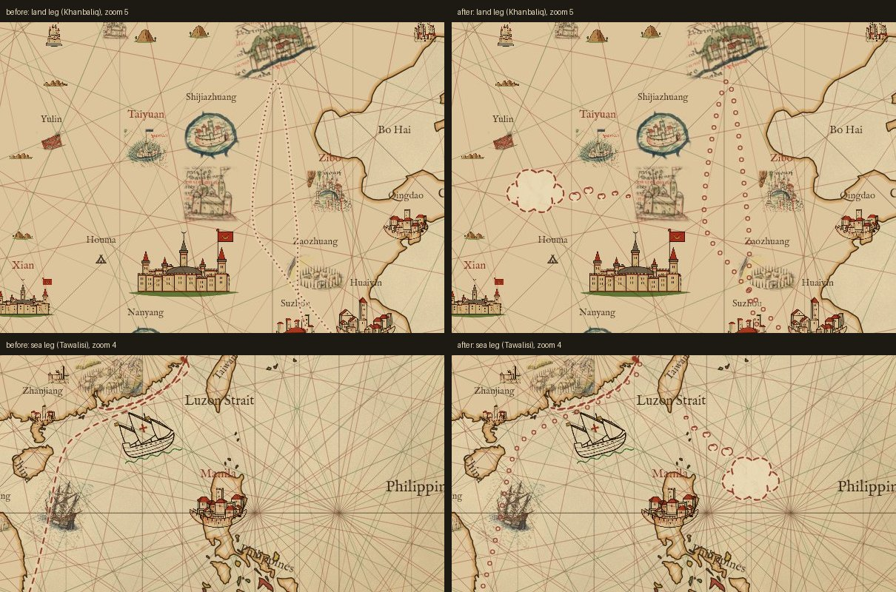
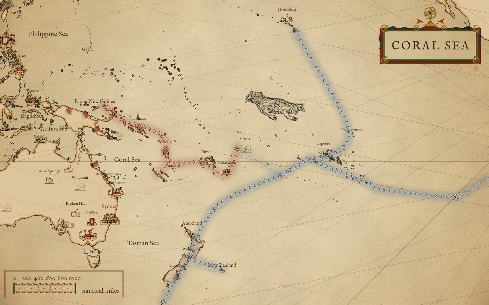
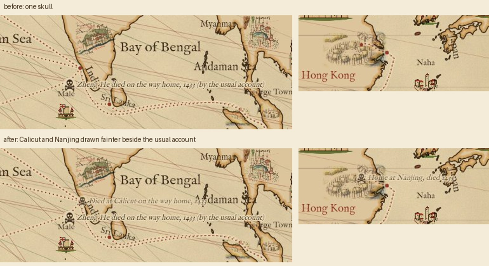

# Voyages

A voyage overlay is a historical track drawn over the modern-geometry map, in any projection: the
reader picks one at a time (none by default) and the map draws its legs, graded by how well the
course is known, with a skull and crossbones where one of its people died. Historical interest and
education come before precision: where the course is unknown the line is an editorial broad brush,
a smooth curve the way the winds and currents would have taken a ship, and it says so by its stroke.
The ancient voyages are told at second hand; every identification of a place on them is one scholarly
guess among several.

| Confidence | Stroke | Means |
|---|---|---|
| `attested` | solid | the course is recorded: a log, a journal, a pilot's roteiro, a named landfall every few days |
| `inferred` | dashed | ends known; the way between worked out from winds and currents, or a later account |
| `conventional` | dotted | the way scholars usually draw it; the sources do not say |

Each leg is joined one of three ways: `rhumb` (a constant bearing, straight on Mercator: how a pilot
actually steered between two known points), `great-circle` (the shortest way: an ocean crossing with
no intermediate fix), or `spline` (a smooth curve through every waypoint: the broad brush, for a
coasting run or a route drawn by the winds).

## The record

Each piece of text is written once, in four kinds of file under `data/voyages/`:

| file | holds |
|---|---|
| `<id>.json` | one voyage: its legs, its events, and `who` |
| `index.json` | the menu order: by start year, a voyage's own sub-voyages kept together |
| `people.json` | each person, keyed by a slug |
| `sources.json` | each source, keyed by an id that a `cite` or a `sources` list names |

`readVoyage` in `scripts/voyages.mjs` puts a voyage together; `problems` and `checkPerson` beside it are
the schema, and `node scripts/check-voyages.mjs` checks every record and that each sea leg stays at sea.

A voyage names its people in `who`, slugs into `people.json` in order of prominence. It is the one
has-relationship between a voyage and a person, and the only place it is written: a person's voyages
are the voyages whose `who` names them. There is no leader field; the title says whose voyage it is,
and a crew member or a nameless company is a record like any other.

```json
"who": ["ferdinand-magellan", "juan-sebastian-elcano"]
```

A person needs nothing: what is there is checked, and what is not is simply unknown. The one rule
that binds is the drawing's: a death with `lon` and `lat` is drawn, so it carries a `label` and a
`source`.

```json
"ferdinand-magellan": {
  "name": "Ferdinand Magellan",
  "bio": "A Portuguese officer of minor nobility who served the Crown in Asia, …",
  "images": [{ "file": "Retrato_de_Hernando_de_Magallanes.jpg", "kind": "posthumous", "author": "Unknown",
               "date": "1848", "licence": "Public domain", "note": "A copy after the Madrid portrait; …" }],
  "sources": ["ferdinand-magellan"],
  "born":  { "lon": -7.58, "lat": 41.27, "date": "c. 1480", "place": "Sabrosa, northern Portugal",
             "label": "Magellan born in northern Portugal, c. 1480", "text": "…", "confidence": "inferred",
             "source": "Wikipedia: Ferdinand Magellan", "cite": "ferdinand-magellan",
             "alternatives": [{ "lon": -8.42, "lat": 41.8, "place": "Ponte da Barca",
                                "label": "Born at Ponte da Barca", "source": "Wikidata" }] },
  "death": { "lon": 123.97, "lat": 10.29, "date": "27 Apr 1521", "label": "Magellan killed at Mactan",
             "text": "Magellan took sides in a local quarrel, …", "source": "Pigafetta",
             "cite": "battle-of-mactan" }
}
```

A marker is one shape for `events`, `born`, `death` and `alternatives`; the fields are in the `checkPerson`
header. Here is Narváez's death, where nobody recorded the place, so the gap is told in `text`:

```json
"death": { "lon": -89.31, "lat": 28.61, "date": "1528",
           "label": "Narváez lost at sea, 1528", "confidence": "inferred",
           "text": "He is believed to have been swept out to sea in a storm …; nobody recorded where. …",
           "source": "Wikipedia, Narváez expedition", "cite": "narvaez-expedition" }
```

`lon` and `lat` are where the mark stands, not a claim of exactness. A death is drawn by them alone:

| the death has | drawn | |
|---|---|---|
| `lon` and `lat` | a skull | its `confidence` says how the place is known |
| a date and a sentence, no `lon` and `lat` | nothing | nobody knows where; the record keeps the date |

The People drawer marks the birth and lays the `images` on the map; `npm run people` builds them for the site.

A flight to a person frames their birth, death, voyages and pictures, and ends no closer than zoom 6, as does a flight
to a voyage. A person may carry `"fly": { "lonMin": -17.6, "lonMax": 40, "latMin": 13, "latMax": 36, "zoom": 4 }`: a box the
flight frames as well, in the part of the window the open drawer leaves clear, and no closer than that `zoom`.

### Confidence

How sure a leg, an event, a birth or a death is: one word, `confidence`, and at most one sentence,
`doubt`. The word sets the ink on the map and reaches the reader as a fixed phrase in the tile. `doubt`
is used only where a source disputes the fact, and it is written as a hook into that dispute, never a
disclaimer: Esteban may have lived on among the Zuni; Korčula claims Marco Polo. A gap in precision (a
year only, a place nobody wrote down) is not a dispute; it stays in `text`.

| `confidence` | means | on the map | the tile will say |
|---|---|---|---|
| `attested` | recorded: a log, a journal, a pilot's roteiro, a witness | a leg solid | on record |
| `inferred` | worked out from the record: the ends known, the rest from winds, currents or a later account | a leg dashed | reckoned from the record |
| `conventional` | the way scholars usually draw it; the sources do not say | a leg dotted | the usual account |
| `speculative` | a guessed place, one among several | a mark only, never a leg | a guess |

The tile does not say the phrase yet; drawing it is a later change.

Two directions the record has not taken yet: a `places.json`, so a port's coordinates are written once
(Genoa's are written five times in `data/charts/portolans.json`), and one Commons-image shape, `images[]`
above, shared by the charts and the people.

### Conventions

Two conventions the checks cannot see. Where a source says a person died at sea or on the way but gives
no place, the skull stands at the middle of the leg it must have happened on, and the death's `text` says
so. An `alternative` is another place of death, never of burial.

A traveller whose road splits into journeys has the whole road in one file and each journey in its own
(`ibn-battuta` and `ibn-battuta-1` to `ibn-battuta-8`): the parts name the whole road's legs by `sameAs`,
so a course is drawn once. Where the traveller's own dates and a modern chronology differ, a leg's `dates`
are the modern one, and the journey's `summary` or the leg's `note` gives the traveller's.

## What is drawn

Any number of voyages are drawn at once, each in its own ink: the first voyage on is the chart's red,
the rest get their own colours, and a colour picked for a voyage overrides them. Each leg is stroked
in its voyage's ink over a parchment halo, dashed by its confidence, with a dot at each leg's ends; the
line weight is one for all of them (Fine, Standard, Bold or Heavy). A death is a skull and crossbones,
and each of its `alternatives` a smaller, fainter skull tied to it by a thin dashed line in the
voyage's ink; an event or landfall is a ring. Nothing is lettered beside a mark: a click or tap on one, on any voyage that is on, opens a small tile
beside it with its heading, date, text and source, and the next touch of the map, Esc or the tile's ×
shuts it.

A doubted leg is drawn as sparse open rings in the voyage's ink, not a line, with a thought cloud nearby; a tap on the cloud opens the leg's tile, which opens with "Scholars doubt this
part:" and the doubt. A doubted event's mark is drawn at half its ink (a death's skull keeps its full ink), and its tile opens the same way.



The overlay rides in the link as `voyages=<id>[:rrggbb],...`, in the order chosen, a picked colour
after its id (`voyages=magellan,columbus,da-gama:16727a`), and `voyagewidth=<px>` when the weight is
not Standard. An older `voyage=<id>` link still opens, as a list of one.

## Migrations

A record with `"kind": "migration"` is the spread of a people rather than a course sailed by named ones:
`lapita-expansion` (the Bismarcks to Samoa, c. 1500–800 BC) and `east-polynesia-settlement` (the long pause,
then the burst across the Polynesian Triangle, c. 1000–1300). `who` may be empty, and each settled place is a
`waypoint` event whose tile carries its date and story. How it is drawn is in the header of `scripts/voyages.mjs`.

A migration's legs add three fields to the usual ones:

| Field | Values | What it sets |
| --- | --- | --- |
| `reach` | `[0, 0.85]` | how far along the whole spread the leg runs: 0 at the start, 1 at the furthest front |
| `heads` | `end`, `both`, `none` | where the ink chevrons go; `both` for a leg whose direction is unknown |
| `pause` | `true` | a long wait, drawn fainter with a dotted trail |

A branch is a leg that starts on another leg's waypoint.




