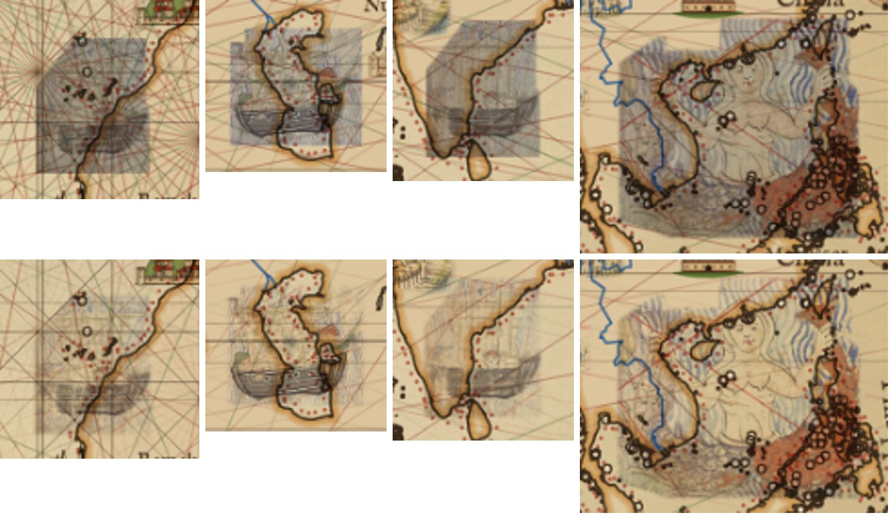
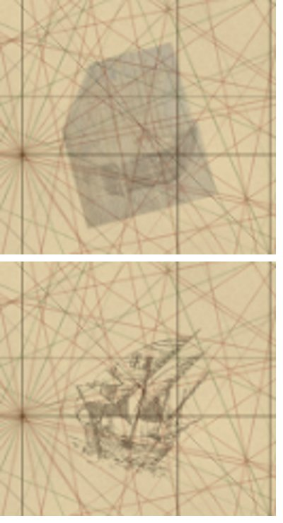
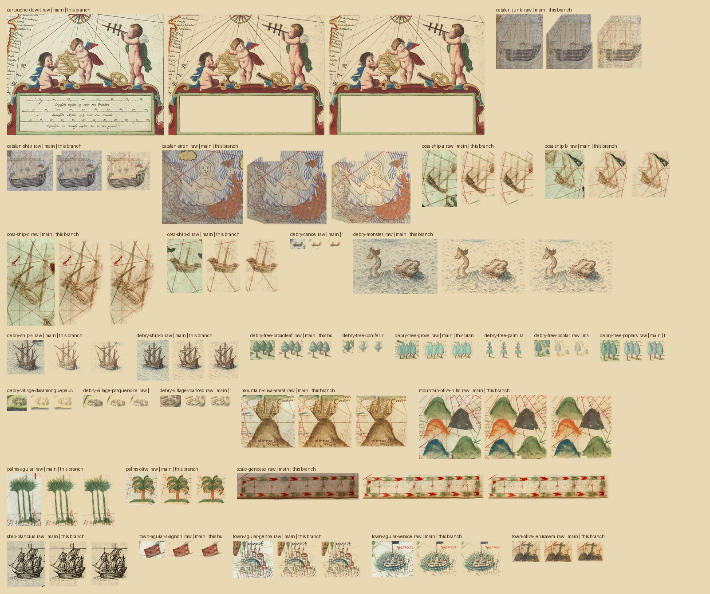
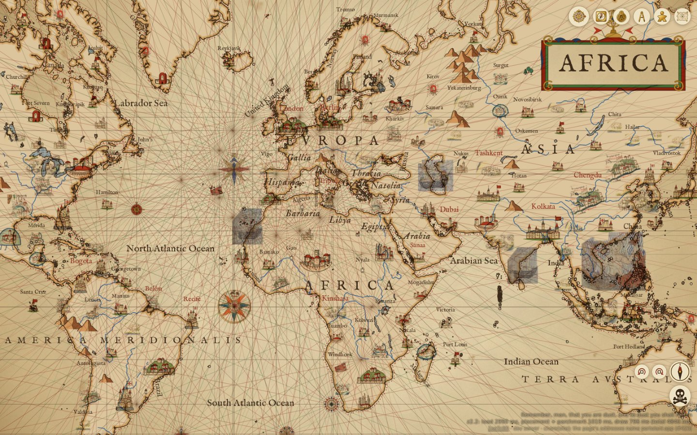
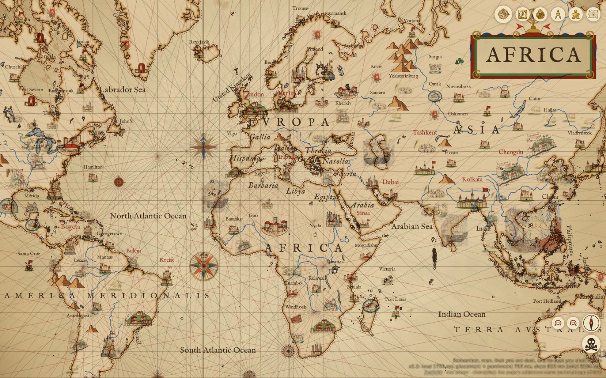
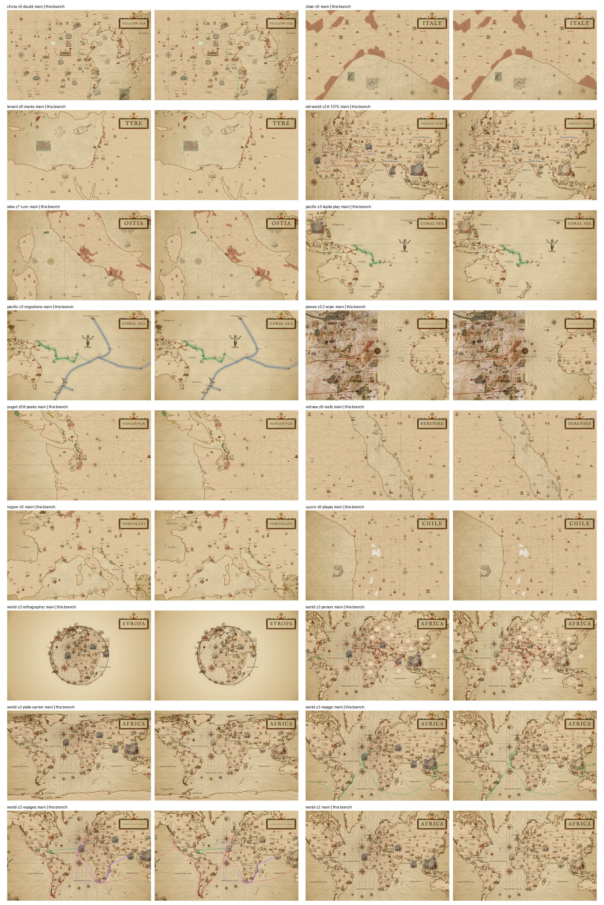

# The whole-world view: grey patches and the Atlantic fan

At world zoom the map drew four hard-edged grey-blue squares (off Cape Bojador, the Caspian, the Bay of Bengal, the
South China Sea) and a dense fan of rhumb lines over the Atlantic.

**The squares** are the Catalan Atlas's ship, junk and siren. Each patch was divided by the map's parchment, not by its
own sheet's vellum, which is greyer and bluer, so the whole crop stayed tinted. Each is now divided by its own sheet's
vellum, as the scanned-sprite rule asks, and the patch sinks into the parchment. The same junk was the grey square
south-east of Gotland at zoom 7:

**The edge fade** at a crop's border was 6 scan px for every sprite. On a big scan cut small (the BnF Catalan sheets,
the Oliva chart, de Bry, de la Cosa) that is under a pixel once drawn, a hard edge. It is now at least 3 px as drawn,
about what the Carta Marina sprites always had. A rose's circle and an ink-keyed sprite keep the old fade. What each
changed sprite loses is the outer 3 px or so of its crop, faded rather than cut:

**The fan** is the Catalan Atlas's ring. At world zoom its sheet is about half a window wide, so its seventeen hubs
sit close together over Iberia and the eastern Atlantic, each casting 32 lines across the page. A sheet narrower than
one window now fades out its half and quarter winds between one window wide and half of one. The eight winds stay.
A band's sheets are at least one window wide in their band, so outside the world band only a page turn sees it: the
incoming band's finer winds, already fading in, start at 0.8 of their ink.

The world goldens change on both counts. The others change only where a re-cut sprite stands.
